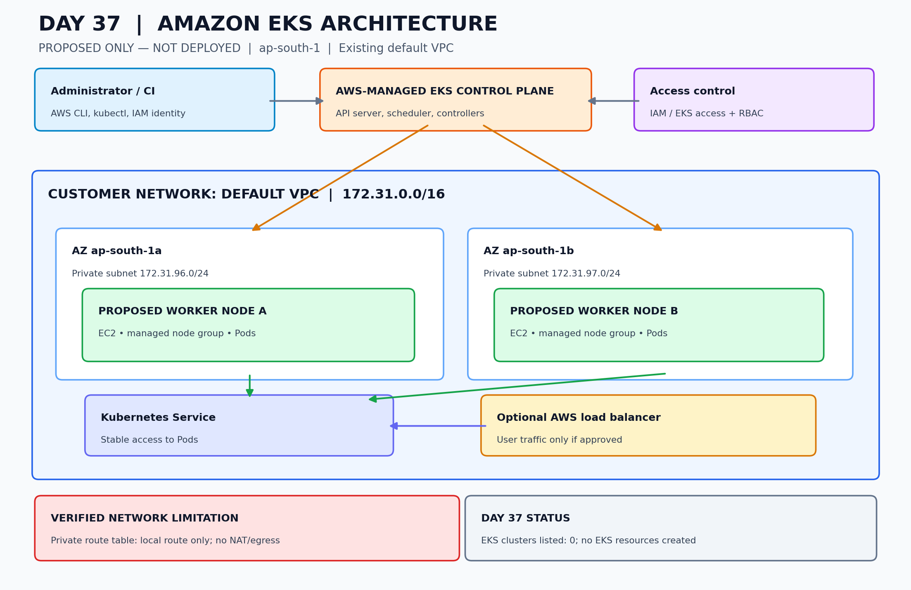

# DevOps Winter Arc — Day 37/90: AWS EKS Architecture & Cluster Setup

> **Date:** 23 November 2026  
> **Region:** `ap-south-1` (Mumbai)  
> **Status:** Architecture, AWS read-only preflight, cluster planning and theoretical troubleshooting **completed**. **No real EKS cluster created.**  
> **Cost policy:** No chargeable AWS resources intentionally provisioned for Day 37. Existing resources were inspected, not modified. **This is not a full AWS-account billing audit.**



## Contents

1. [Mission and learning outcomes](#1-mission-and-learning-outcomes)
2. [What was done vs. planned](#2-what-was-done-vs-planned)
3. [EKS fundamentals](#3-eks-fundamentals)
4. [Architecture and traffic flows](#4-architecture-and-traffic-flows)
5. [Existing AWS environment and network findings](#5-existing-aws-environment-and-network-findings)
6. [Actual preflight commands and observations](#6-actual-preflight-commands-and-observations)
7. [Proposed cluster setup plan](#7-proposed-cluster-setup-plan)
8. [IAM vs Kubernetes RBAC](#8-iam-vs-kubernetes-rbac)
9. [Theory-only cluster creation walkthrough](#9-theory-only-cluster-creation-walkthrough)
10. [Troubleshooting playbook](#10-troubleshooting-playbook)
11. [Costs, safeguards and cleanup](#11-costs-safeguards-and-cleanup)
12. [Interview questions and answers](#12-interview-questions-and-answers)
13. [Evidence and screenshots](#13-evidence-and-screenshots)
14. [Completion checklist and next steps](#14-completion-checklist-and-next-steps)

---

## 1. Mission and learning outcomes

The Day 37 assignment asks us to understand EKS architecture, plan a secure network and cluster, perform **read-only** checks, document IAM versus RBAC, and prepare a cost/cleanup plan. Cluster creation is **optional** and requires explicit cost approval.

By the end of the day, we can explain:

- The difference between the **AWS-managed EKS control plane** and **customer-managed worker capacity and workloads**.
- Why EKS needs a VPC, subnets, networking, IAM, compatible add-ons and a Kubernetes API access design.
- How administrators and applications communicate with a cluster.
- How to inspect existing AWS infrastructure before deploying anything.
- How to troubleshoot worker nodes that cannot join an EKS cluster.
- How to avoid accidental EKS, EC2, NAT, load balancer and storage costs.

**Scope reminder:** Day 28 already introduced EKS. Day 37 focuses on architecture and safe setup decisions, not repeating the earlier Nginx exercise.

## 2. What was done vs. planned

| Activity | Status | Evidence / qualification |
|---|---|---|
| AWS CLI and kubectl client checks | **Executed** | Versions recorded below |
| AWS IAM identity and profile inspection | **Executed** | Profile `devops-learner`; sensitive values redacted |
| EKS cluster listing in Mumbai | **Executed** | `{"clusters":[]}` |
| Existing default VPC and subnets inspection | **Inspected** | VPC CIDR, subnet layout and routes recorded below |
| EKS architecture diagram | **Prepared** | `architecture.png` — **proposed**, not deployed |
| Cluster name, access, capacity and IAM design | **Planned** | No AWS create operations |
| EKS control plane | **Not created** | No active EKS cluster observed in checked Region |
| EKS managed node group / worker EC2 | **Not created** | Proposed only |
| EKS add-ons, load balancer, OpsPulse deployment | **Not deployed** | Future steps only |
| Troubleshooting scenarios | **Theory practice** | No real EKS incident diagnosed |
| Full billing and all-Region resource audit | **Not performed / not established** | Do not infer total account charges from EKS list alone |

## 3. EKS fundamentals

| Component | Beginner-friendly meaning | Who manages it? |
|---|---|---|
| EKS control plane | The Kubernetes “brain”: API server, scheduling and controllers | AWS operates it |
| Kubernetes API endpoint | Secure entry point for Kubernetes management requests | AWS hosts; customer configures access |
| Worker nodes | EC2 computers that run containers inside Pods | Customer chooses capacity; EKS managed node group automates parts of lifecycle |
| Managed node group | EKS-integrated group of EC2 worker instances | Shared responsibility |
| Pods | Smallest deployable Kubernetes workload units | Customer deploys and operates applications |
| Kubernetes Service | Stable network abstraction to reach changing Pods | Customer configures |
| VPC/subnets/routes | AWS network where worker nodes and networking resources live | Customer plans and operates |
| IAM / EKS access | AWS identity, service roles and cluster authentication/authorization integration | Customer configures permissions |
| Kubernetes RBAC | API-level permissions inside Kubernetes | Customer configures |
| Add-ons | VPC CNI, CoreDNS, kube-proxy and related components | Customer selects compatible configuration/lifecycle |
| kubectl | Command-line tool for interacting with Kubernetes API | Administrator operates |

**Analogy:** AWS runs the EKS control-plane “control room.” We plan the building (VPC), staff access (IAM/RBAC), worker machines (EC2), and application services (Pods and Services).

## 4. Architecture and traffic flows

See **[architecture.png](architecture.png)**. It is a **design diagram**, not a screenshot of running AWS infrastructure.

### Management flow

```text
Administrator / CI
       |
       | AWS IAM identity + AWS CLI / kubectl
       v
EKS Kubernetes API endpoint  [AWS-operated control plane]
       |
       | Kubernetes scheduling and node communication
       v
Managed node group -> EC2 worker nodes -> application Pods
```

**Important nuance:** Kubernetes control-plane components schedule workloads; kubelet on the worker node communicates with the API and starts Pods through the container runtime. The diagram simplifies that distributed interaction.

### Application traffic (only if deployed)

```text
End user
   |
   v
Optional AWS load balancer (public-facing if approved)
   |
   v
Kubernetes Service
   |
   v
OpsPulse application Pods on worker nodes
```

A load balancer is **not automatically created merely because an EKS cluster exists**. Application traffic configuration is a separate design/deployment choice.

### Two Availability Zones

- **ap-south-1a**: proposed private worker subnet `172.31.96.0/24`.
- **ap-south-1b**: proposed private worker subnet `172.31.97.0/24`.
- Two AZs reduce reliance on a single AZ; merely setting desired capacity to 2 does **not** by itself prove one node will land in each AZ.

### AWS-managed vs. customer-managed

**AWS-managed:** Kubernetes control-plane infrastructure and its availability.  
**Customer-managed decisions:** VPC, routes, subnet selection, security groups, worker capacity, access permissions, add-ons configuration, workloads, observability, upgrades, budget and cleanup.

## 5. Existing AWS environment and network findings

**This VPC was already present from previous AWS labs. We did not create it on Day 37.**

| Property | Inspected value |
|---|---|
| Region | `ap-south-1` |
| Existing default VPC | `vpc-0db58479bcc738ebc` |
| VPC CIDR | `172.31.0.0/16` |
| Default public subnet in AZ 1a | `172.31.32.0/20` |
| Default public subnet in AZ 1b | `172.31.0.0/20` |
| Default public subnet in AZ 1c | `172.31.16.0/20` |
| Existing private subnets in AZ 1a | `172.31.96.0/24`, `172.31.98.0/24` |
| Existing private subnets in AZ 1b | `172.31.97.0/24`, `172.31.99.0/24` |
| Public subnet behavior | Auto-assign public IPv4 enabled; main route table has IGW default route |
| Private subnet behavior | Auto-assign public IPv4 disabled; associated private route table had **local route only** |

### Critical finding: private subnets lack general egress

A private subnet with only the VPC-local route cannot reach arbitrary public AWS service endpoints. If we later place EKS nodes there, we must design **appropriate NAT egress or sufficient VPC interface/gateway endpoints**, plus DNS, security-group rules and required EKS endpoint access. We did **not** add NAT or endpoints today.

**Don't confuse:** Private Kubernetes API endpoint connectivity with ECR/STS/EC2 service connectivity. Reaching the Kubernetes API does not guarantee access to every AWS service needed by nodes or workloads.

### Example read-only VPC inspection commands

The network was inspected during the Day 37 discussion; the exact original command lines are not all preserved in the visible record. The following are **reproducible reference commands, not a claim that these exact lines were executed**:

```bash
aws ec2 describe-vpcs \
  --region ap-south-1 --profile devops-learner \
  --filters Name=isDefault,Values=true \
  --query 'Vpcs[].{VpcId:VpcId,Cidr:CidrBlock,Default:IsDefault}'

aws ec2 describe-subnets \
  --region ap-south-1 --profile devops-learner \
  --filters Name=vpc-id,Values=vpc-0db58479bcc738ebc \
  --query 'Subnets[].{AZ:AvailabilityZone,CIDR:CidrBlock,PublicIP:MapPublicIpOnLaunch,SubnetId:SubnetId}'

aws ec2 describe-route-tables \
  --region ap-south-1 --profile devops-learner \
  --filters Name=vpc-id,Values=vpc-0db58479bcc738ebc \
  --query 'RouteTables[].{Id:RouteTableId,Routes:Routes,Associations:Associations}'
```

**Why:** These commands show existing network inventory and routes without creating anything. Avoid committing unredacted identifiers if your repository is public.

## 6. Actual preflight commands and observations

The following commands **were run** in WSL2 Debian. Sensitive account information is deliberately omitted.

### 6.1 Check AWS CLI version

```bash
aws --version
```

**Observed:** `aws-cli/2.39.6` (Linux/WSL2).  
**Why:** Ensure AWS CLI is installed and available before interacting with EKS APIs.

### 6.2 Confirm IAM identity

```bash
aws sts get-caller-identity \
  --profile devops-learner \
  --query '{Arn:Arn}' \
  --output json
```

**Observed, redacted:**

```json
{"Arn":"arn:aws:iam::<REDACTED_ACCOUNT_ID>:user/devops-learner"}
```

**Why:** Verify the active AWS identity before making any changes. Do not publish the real account ID or access keys.

### 6.3 Inspect active AWS CLI configuration

```bash
aws configure list --profile devops-learner
```

**Observed:** The profile was inspected; exact credential/config rows are intentionally not reproduced.  
**Why:** Confirm credentials and Region sources; avoid accidental operations in the wrong account.

### 6.4 Check kubectl client

```bash
kubectl version --client
```

**Observed:** `Client Version: v1.37.2`; Kustomize `v5.8.1`.  
**Why:** Confirm local Kubernetes CLI exists. This does **not** prove a cluster is connected.

### 6.5 List EKS clusters — read-only

```bash
aws eks list-clusters \
  --region ap-south-1 \
  --profile devops-learner
```

**Actual output:**

```json
{"clusters":[]}
```

**Meaning:** No EKS clusters were listed for this identity in `ap-south-1` at the time of the check. It is **not** a claim about all AWS Regions or other accounts.

### 6.6 Supported versions explored

The `aws eks describe-cluster-versions` API was inspected during planning; version `1.37` appeared under standard support at that time. **This is a version candidate, not a deployed cluster version.** Recheck support, compatibility and pricing before any future build.

## 7. Proposed cluster setup plan

**All values below are planning decisions, not deployed resources.**

| Setting | Proposal | Reason |
|---|---|---|
| Cluster name | `winter-arc-day37-eks` | Recognizable lab name |
| AWS Region | `ap-south-1` | Matches existing AWS lab Region |
| Kubernetes version | `1.37` candidate | Version observed as available; must revalidate |
| VPC | Existing default VPC | Reuse existing networking rather than create duplicate VPC |
| Worker subnet 1 | `172.31.96.0/24`, AZ 1a | Private workload network |
| Worker subnet 2 | `172.31.97.0/24`, AZ 1b | Multi-AZ design |
| API endpoint | Private enabled; public access only from an approved `/32` if necessary | Reduce management exposure |
| Node group | `opspulse-workers` | Managed EC2 worker capacity |
| Node scaling | Minimum 2 / desired 2 / maximum 3 | Example capacity; no EC2 instances provisioned |
| Cluster IAM | EKS cluster service role | Required AWS service integration |
| Node IAM | Appropriate EKS worker role/policies | Nodes access needed AWS services |
| Admin authorization | IAM/EKS access entries and Kubernetes RBAC | Least-privilege cluster access |
| Workload identity | Pod Identity or OIDC-based role association if needed | Avoid long-lived credentials in Pods |
| Application | OpsPulse Flask service, future only | No EKS application deployment today |

### Pre-deployment blockers / decisions

1. **Network egress:** Existing private routes are local-only. Design NAT or the required VPC endpoints before expecting private nodes to bootstrap.
2. **Subnet suitability:** Validate subnet tagging/discovery, IP capacity, security groups, DNS and AZ requirements.
3. **API reachability:** Determine administrator network path and approved public CIDR, if public endpoint is used.
4. **IAM and authorization:** Verify creator permissions, cluster role, node role and access entries.
5. **Compatibility:** Check EKS Kubernetes version, add-on versions and supported EC2 instance types.
6. **Costs:** Approve expected hourly charges and the time-bound cleanup plan **before** any creation.

## 8. IAM vs Kubernetes RBAC

**Assignment explanation (approximately 120 words):**

AWS IAM and Kubernetes RBAC solve different security problems in an EKS environment. IAM identifies AWS users, roles and services, and controls their permission to call AWS APIs such as creating or describing an EKS cluster. EKS also uses AWS IAM-based authentication and cluster access configuration to determine how an identity can access Kubernetes. Kubernetes RBAC then controls what an authenticated identity can do to Kubernetes resources. For example, an engineer might be allowed to view Pods in one namespace but not delete Deployments or modify Secrets. RBAC permissions are defined through Roles or ClusterRoles and granted through RoleBindings or ClusterRoleBindings. A secure EKS design uses both layers, follows least privilege and avoids granting every engineer cluster-administrator access. Workload AWS permissions should be granted separately through suitable Pod identities rather than embedded access keys.

**Simple analogy:** IAM = building entry badge; RBAC = which rooms and controls the badge holder may use.

## 9. Theory-only cluster creation walkthrough

> **NOT EXECUTED.** The following sequence describes what an approved future lab would involve. No creation commands were run today.

1. **Review cost and permissions.** Confirm account owner approval, current EKS pricing, quotas and deletion plan.
2. **Validate VPC/subnets.** Check two AZs, subnet CIDRs, route tables, DNS, security groups and service access.
3. **Prepare IAM.** Configure cluster role, node role and cluster access policy/entries with least privilege.
4. **Create EKS control plane.** Choose Region, cluster name, supported version, VPC/subnets and API endpoint access. Wait for `ACTIVE`.
5. **Configure kubectl.** Connect only after a real cluster exists; confirm the context.
6. **Create managed node group if approved.** Verify EC2 nodes launch and join. Do not confuse an `ACTIVE` control plane with healthy worker nodes.
7. **Validate add-ons.** Ensure VPC CNI, CoreDNS and kube-proxy versions/configuration are compatible and healthy.
8. **Deploy OpsPulse only in a later approved lab.** Validate Pods, Service, `/health`, logs and resource requests.
9. **Clean up deliberately.** Delete separately billed resources and verify results and billing.

### Future verification commands — **do not run without an existing approved cluster**

```bash
aws eks update-kubeconfig \
  --region ap-south-1 \
  --name winter-arc-day37-eks \
  --profile devops-learner

kubectl config current-context
kubectl get namespaces
kubectl get nodes
```

**Why:** `update-kubeconfig` writes local cluster access configuration; `kubectl` then queries a real Kubernetes API. They cannot validate a cluster that does not exist.

## 10. Troubleshooting playbook

These are **hypothetical production scenarios**, not failures encountered in a running Day 37 EKS cluster.

| Symptom | First checks | Possible causes |
|---|---|---|
| Wrong AWS identity | `aws sts get-caller-identity --profile devops-learner` | Wrong profile/account or permission boundary |
| Cluster creation fails | `aws eks describe-cluster` (if cluster exists), console events | IAM permissions, invalid subnets, version, quotas |
| kubectl cannot connect | kubeconfig context, EKS endpoint, identity and authorization | Wrong context/Region, inaccessible endpoint, auth failure |
| Worker nodes missing | EKS managed node group health and EC2 instance state | Insufficient capacity, role/policies, bootstrap or network failure |
| Nodes `NotReady` | `kubectl describe node NODE_NAME`, events, CNI | Kubelet/CNI problems, network/DNS, permissions, resources |

### Practice question and answer

**Question:** The EKS control plane is active, but worker nodes in private subnets are not joining. What might be wrong?

**My answer:** “The nodes cannot reach required AWS services or the Kubernetes API.”

**Evaluation:** Correct **as a plausible first hypothesis**, especially given our verified local-only private route tables. It is not a confirmed root cause. Private API access may provide Kubernetes API connectivity, while other required service access remains unavailable.

**Interview-ready investigation:**

1. Check node group health and EC2 instance launch status.
2. Verify node IAM role and required policies.
3. Check subnet routes, endpoints/NAT, DNS, security groups and API endpoint reachability.
4. Inspect node bootstrap/kubelet logs and VPC CNI behavior.
5. Verify node registration and `Ready` condition only after nodes actually exist.

### Read-only reference commands for a **future existing cluster**

```bash
aws eks describe-cluster \
  --name winter-arc-day37-eks \
  --region ap-south-1 --profile devops-learner

aws eks list-nodegroups \
  --cluster-name winter-arc-day37-eks \
  --region ap-south-1 --profile devops-learner

kubectl get nodes -o wide
kubectl describe node NODE_NAME
kubectl get events -A --sort-by=.lastTimestamp
```

These commands were **not run against EKS today**.

## 11. Costs, safeguards and cleanup

### Potential cost categories

| Resource | Cost consideration |
|---|---|
| EKS control plane | Hourly charge even without worker nodes |
| EC2 managed node group | EC2 instance-hours and associated resources |
| EBS volumes/snapshots | Storage and snapshot charges |
| NAT Gateway | Hourly and data-processing charges |
| Application Load Balancer | Hourly and capacity/usage charges |
| Public IPv4 / Elastic IP | Potential hourly charges |
| VPC endpoints | Some interface endpoints incur hourly and data charges |
| Data transfer and logs | May incur usage/storage charges |
| VPC, subnet, route table, IAM role | Usually no direct standalone hourly charge |

**Important:** AWS Budgets alerts are not hard spending limits. Verify current pricing for the selected Region before approving deployment.

### What we did today

- [x] Used read-only AWS commands and architecture planning.
- [x] Chose **not** to create an EKS control plane, worker group, NAT Gateway or load balancer.
- [x] Preserved the existing default VPC and its subnets.
- [x] Recorded the observed `{"clusters":[]}` result in `ap-south-1`.
- [ ] Full account-wide cost/resource audit: **not verified** in this Day 37 record.

### Future cleanup checklist (only after future approved deployment)

- [ ] Remove application Ingress/Services and load balancers, observing finalizers.
- [ ] Delete managed node groups and confirm associated EC2 instances are gone.
- [ ] Delete the EKS cluster and confirm absence in the target Region.
- [ ] Remove **only lab-created** NAT Gateways, VPC endpoints, EIPs, load balancers, security groups and logs as appropriate.
- [ ] Check EBS volumes, snapshots, public IPv4 and other residual billable resources.
- [ ] Check AWS Billing/Cost Explorer and resource inventory across applicable Regions.
- [ ] **Do not delete the shared/default VPC or earlier-lab resources by mistake.**

## 12. Interview questions and answers

**Q1. What is Amazon EKS?**  
A managed Kubernetes service in which AWS operates the Kubernetes control plane.

**Q2. What does AWS manage?**  
The EKS control plane. We still design access, worker compute, networking and applications.

**Q3. Where do application Pods run?**  
On Kubernetes worker compute, such as EC2 nodes or supported serverless options.

**Q4. What is a managed node group?**  
An EKS-integrated EC2 worker group that automates parts of provisioning and node lifecycle management.

**Q5. Why use at least two AZs?**  
To reduce dependence on a single Availability Zone and improve resilience.

**Q6. IAM versus RBAC?**  
IAM handles AWS identities, API permissions and EKS access integration; Kubernetes RBAC defines permissions to Kubernetes resources.

**Q7. Why might private nodes fail to join?**  
Missing network access to the Kubernetes API or required AWS services, wrong IAM role, DNS/security-group issues, capacity or bootstrap failures.

**Q8. Does an `ACTIVE` EKS cluster mean the application is healthy?**  
No. Worker nodes, add-ons, Pods, Services and application health must be checked separately.

**Q9. Does deleting the EKS cluster guarantee no more charges?**  
No. Check separately created load balancers, NAT Gateways, EBS, IPs, endpoints and other services.

**Q10. Why did we skip cluster creation today?**  
The assignment makes it optional; we chose to avoid hourly AWS charges until a time-bound lab is approved.

## 13. Evidence and screenshots

The assignment requests 3–5 proof-of-work screenshots. **Do not fabricate screenshots.** Add real redacted screenshots if available:

1. **Architecture:** `architecture.png` (included; explicitly labeled proposed).
2. **AWS CLI identity:** capture with account ID and credentials redacted.
3. **EKS cluster list:** capture `{"clusters":[]}` for `ap-south-1`.
4. **VPC/subnet/route inspection:** screenshot existing default VPC and local-only private route.
5. **README / cleanup checklist:** screenshot this file or its GitHub rendering.

EKS console cluster overview and Kubernetes node screenshots are **not applicable**, because no real cluster or nodes were created.

## 14. Completion checklist and next steps

- [x] Explain EKS control plane, workers, node groups, VPC and IAM.
- [x] Produce proposed two-AZ EKS architecture diagram.
- [x] Perform read-only preflight checks and record actual observations.
- [x] Explain IAM versus RBAC in 100–150 words.
- [x] Produce a cluster plan and highlight networking prerequisites.
- [x] Complete theory-only troubleshooting and interview answer.
- [x] Document cost risks and future cleanup steps.
- [x] Avoid unapproved EKS resource creation.
- [ ] Add actual redacted terminal screenshots to repository if desired.
- [ ] Commit and push README/PNG to GitHub (not performed here).

### Suggested Git commands — **not executed here**

```bash
# Run from your Git repository root after choosing the correct Day 37 directory.
mkdir -p AWS/Day37
cp /path/to/README.md AWS/Day37/README.md
cp /path/to/architecture.png AWS/Day37/architecture.png

git status
git add AWS/Day37/README.md AWS/Day37/architecture.png
git commit -m "docs: add Day 37 EKS architecture and preflight notes"
git push
```

Adjust the destination folder to match your repository's actual structure; **do not blindly overwrite an existing README**.

### One-line summary

**Day 37 taught how to plan a secure, multi-AZ EKS architecture and verify AWS prerequisites without deploying chargeable infrastructure.**

---

*Source: `DevOps_Winter_Arc_Day37_AWS_EKS_Architecture_Cluster_Setup(1).pdf` (four-page Day 37 assignment). Observed environment details come from the Day 37 chat; planned architecture is explicitly labeled as such.*
