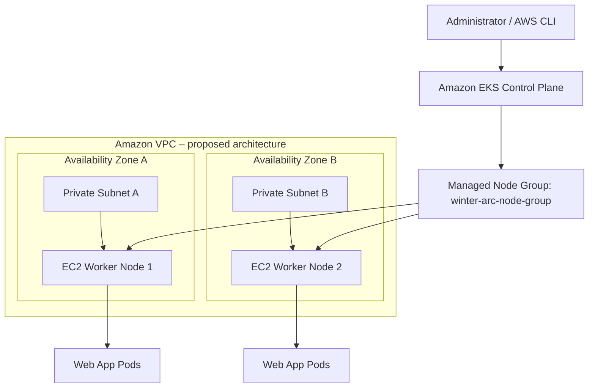

# Day 38/90 – AWS EKS Managed Node Groups

> **DevOps Winter Arc | Day 38**  
> **Environment:** Debian 13 (WSL2), Docker, Floci AWS emulator, AWS CLI, local K3s Kubernetes  
> **Simulated AWS Region:** `us-east-1`  
> **Simulated Cluster:** `winter-arc-eks`

## 1. Overview and Objectives

Amazon Elastic Kubernetes Service (Amazon EKS) runs a managed Kubernetes control plane. **EKS managed node groups** provide and manage groups of Amazon EC2 instances that join a real EKS cluster as worker nodes. Kubernetes then schedules application Pods on suitable nodes according to resource requests and scheduling constraints.

For Day 38, I designed a managed node group for a stateless web application, inspected an EKS API simulation using Floci, and ran Kubernetes scheduling experiments against the **local K3s runtime provided by Floci**.

**Scope and honesty note:** This is a local learning lab. The simulated EKS cluster showed `ACTIVE`, but **no real AWS EKS cluster, EC2 instances, or managed node group was created**. The one Ready K3s node observed in Kubernetes is a local container-based node, not a real managed EC2 worker node. The two-worker-node architecture below is a **proposal**, not a deployed result.

### Learning goals

- Understand the roles of EKS control planes, worker nodes, and managed node groups.
- Design minimum, desired, and maximum node capacity across two Availability Zones.
- Explain private subnets, instance selection, IAM roles, labels, updates, and spare capacity.
- Inspect node capacity, allocatable resources, labels, taints, health, Pods, and events.
- Deploy two Nginx replicas with CPU and memory requests.
- Reproduce and diagnose an `Insufficient memory` scheduling failure.
- Compare application Pod scaling with worker-node scaling.

## 2. Core Concepts

### 2.1 EKS control plane vs worker nodes

The **EKS control plane** manages Kubernetes API and control-plane functionality in real AWS EKS. **Worker nodes** supply CPU, memory, storage, and a container runtime for application Pods. In AWS EKS, those nodes can be EC2 instances launched through a managed node group.

### 2.2 Managed node groups

An EKS managed node group integrates an EC2 Auto Scaling-backed group of worker instances with EKS. AWS assists with node provisioning and supported lifecycle updates. A managed node group does **not** automatically increase capacity every time a Deployment is scaled; dynamic capacity changes require an appropriate scaling workflow, such as correctly configured Cluster Autoscaler or another supported node-provisioning solution.

### 2.3 Minimum, desired, and maximum nodes

| Setting | Planned value | Meaning |
|---|---:|---|
| Minimum | 2 | Lowest permitted worker-node count in the proposed design |
| Desired | 2 | Target worker-node count initially |
| Maximum | 3 | Upper scaling bound, permitting a third node when appropriate |

These values specify **node count**, not Kubernetes Deployment replica count.

### 2.4 Capacity, allocatable, requests, and actual usage

- **Capacity:** Total resources reported by the node.
- **Allocatable:** Resources available for Pod scheduling after node/system reservations.
- **Requests:** Per-container resource amounts considered by the Kubernetes scheduler.
- **Actual usage:** CPU and memory currently consumed, as reported by metrics tools.

For CPU, `1000m = 1 vCPU`, so `100m = 0.1 vCPU`. Memory `Mi` and `Gi` are binary units.

### 2.5 Labels, taints, and tolerations

**Node labels** are key-value metadata used in selection and affinity rules. For example, the design proposes `workload=web`. **Taints** can discourage or prevent Pods from scheduling onto certain nodes; matching **tolerations** allow a Pod to be considered on a tainted node. A toleration does not force placement.

### 2.6 Node IAM role and Pod identity

The **node IAM role** grants AWS permissions needed by EC2 worker nodes and supported integrations. Application AWS access should use a workload-specific identity mechanism, such as EKS Pod Identity or IRSA when supported, rather than relying on broad node permissions. Administrative permissions are a separate concern.

### 2.7 Rolling updates and spare capacity

During node replacement or rolling updates, workloads may need somewhere else to run. Keeping headroom and allowing a maximum greater than the normal desired size can help, subject to actual update strategy, instance availability, PodDisruptionBudgets, and resource limits. A maximum of three **allows** a third node; it does not guarantee the update will always launch one.

## 3. Proposed EKS Architecture (Design Only)

The architecture is documented in [`node-group-architecture.md`](node-group-architecture.md). The design uses private worker subnets in two Availability Zones.



**Why private subnets?** Private EC2 workers generally do not require unrestricted inbound internet access. Workloads can receive approved traffic through load balancers and Services, with controlled outbound connectivity through approved NAT or VPC endpoints as necessary. NAT Gateways and other AWS networking services may incur charges. Merely creating a node group does not create an application load balancer automatically.

### Task A – Node group design table

| Item | Proposed configuration |
|---|---|
| EKS cluster | `winter-arc-eks` |
| Managed node group | `winter-arc-node-group` |
| Instance candidate | `t3.small` (subject to compatibility, pricing, and performance review) |
| Minimum / desired / maximum | `2 / 2 / 3` |
| Worker disk | `20 GiB` |
| Placement | Two **private** subnets across two Availability Zones |
| Node label | `workload=web` |
| Example workload | Small stateless Nginx/web application |
| IAM | Least-privilege node IAM role; separate workload AWS access |
| Update planning | Spare capacity, PodDisruptionBudgets, draining and replacement |

See [`node-group-design.md`](node-group-design.md) for the design explanation. [`nodegroup-config.json`](nodegroup-config.json) is **an example with placeholder subnet and IAM-role values**, not a deployable production manifest. The generated `nodegroup-skeleton.json`, if retained locally, is a CLI template rather than evidence of a created node group.

## 4. Practice Environment and Safety

| Component | Used in this lab |
|---|---|
| Host OS | Debian 13 on WSL2 |
| Docker | Runs the local Floci services and Kubernetes runtime |
| Floci CLI | `0.4.0` |
| Floci server | `2.5.0` (`floci-always-free`) |
| AWS CLI | `2.39.6` |
| Kubernetes | K3s `v1.29.14+k3s1` inside the Floci EKS runtime container |
| Region | `us-east-1` for local AWS API simulation |

**Safety:** Every AWS CLI command below explicitly targets `http://localhost:4566`. This is important: omitting the emulator endpoint in an otherwise authenticated AWS shell could point commands at real AWS.

The unrelated Kind cluster `opspulse` was not used or modified. To avoid stale host `kubectl` contexts, Kubernetes lab commands explicitly execute inside `floci-aws-eks-winter-arc-eks`.

## 5. Task B – Floci EKS API Inspection

### 5.1 Check the emulator

```bash
floci status
docker ps
```

If needed, start Floci with the installed CLI using the locally approved setup. For the recorded exercise, the local AWS API was available at `http://localhost:4566`.

### 5.2 Inspect the simulated EKS cluster

```bash
aws eks list-clusters \
  --region us-east-1 \
  --endpoint-url http://localhost:4566

aws eks describe-cluster \
  --name winter-arc-eks \
  --region us-east-1 \
  --endpoint-url http://localhost:4566 \
  --query 'cluster.{Name:name,Status:status,Endpoint:endpoint,Version:version}'

aws eks list-nodegroups \
  --cluster-name winter-arc-eks \
  --region us-east-1 \
  --endpoint-url http://localhost:4566
```

**Recorded results:**

```text
Clusters:         ["winter-arc-eks"]
Cluster status:   ACTIVE
Cluster version:  1.29
Cluster endpoint: https://localhost:6500
Managed node groups: []
```

**Interpretation:** The Floci simulator had an active simulated cluster record, but **zero managed node groups**. This does not establish real AWS worker capacity. The cluster API endpoint in the simulated metadata should not be confused with a working host `kubectl` context.

For further setup context, see [`floci-inspection.md`](floci-inspection.md).

### 5.3 Read-only commands for a real EKS account (not executed here)

When a real, authorized EKS cluster exists, an operator can inspect it with:

```bash
aws eks list-nodegroups --cluster-name YOUR_CLUSTER --region YOUR_REGION
aws eks describe-nodegroup --cluster-name YOUR_CLUSTER \
  --nodegroup-name YOUR_NODEGROUP --region YOUR_REGION
```

**Do not use creation or scaling commands in a real account without budget and change approval.**

## 6. Task C – Kubernetes Node Inspection

The local runtime was accessible by executing `kubectl` inside the Floci Kubernetes container:

```bash
docker exec floci-aws-eks-winter-arc-eks kubectl get nodes -o wide
docker exec floci-aws-eks-winter-arc-eks kubectl get nodes --show-labels
docker exec floci-aws-eks-winter-arc-eks kubectl describe nodes
docker exec floci-aws-eks-winter-arc-eks kubectl get pods -A -o wide
docker exec floci-aws-eks-winter-arc-eks kubectl get events -A --sort-by=.lastTimestamp
docker exec floci-aws-eks-winter-arc-eks kubectl top nodes
```

### 6.1 Actual node observations

| Inspection item | Observed value |
|---|---|
| Registered Kubernetes nodes | 1 local K3s node |
| Node status | `Ready` |
| Node roles | `control-plane,master` |
| Kubernetes version | `v1.29.14+k3s1` |
| Reported CPU capacity | `4` cores |
| CPU allocatable | `1930m` |
| Reported memory capacity | `3899036Ki` (about `3.72Gi`) |
| Memory allocatable | `2117276Ki` (about `2.02Gi`) |
| Taints | `<none>` |
| Unschedulable | `false` |
| MemoryPressure / DiskPressure / PIDPressure | All `False` |
| Ready condition | `True` |
| System workloads | CoreDNS and Metrics Server Running |

Example topology labels were `topology.kubernetes.io/region=us-east-1` and `topology.kubernetes.io/zone=us-east-1a`; these belong to the **local simulation**. There were not two independent cloud Availability Zones in the running lab.

Before application deployment, the two system Pods requested `200m` CPU and `140Mi` memory together. The metrics snapshot showed about `76m` CPU and `441Mi` memory actually used. These are different measurements.

### 6.2 Event observations

The node became `Ready`, with no memory, disk or PID pressure. Startup events included `InvalidDiskCapacity` and temporary readiness-probe errors for system Pods; subsequent inspection showed CoreDNS and Metrics Server Running. Old warning events alone do not prove a continuing fault.

## 7. Task D – Nginx Deployment and Scheduling

### 7.1 Deployment manifest

The file [`node-capacity-demo.yaml`](node-capacity-demo.yaml) defines two Nginx replicas:

```yaml
apiVersion: apps/v1
kind: Deployment
metadata:
  name: node-capacity-demo
spec:
  replicas: 2
  selector:
    matchLabels:
      app: node-capacity-demo
  template:
    metadata:
      labels:
        app: node-capacity-demo
    spec:
      containers:
        - name: nginx
          image: nginx:stable
          resources:
            requests:
              cpu: 100m
              memory: 128Mi
```

**Why these fields?** The Deployment controller maintains the requested replicas; selectors identify the Pods it manages; `resources.requests` tells the scheduler how much CPU and memory each Pod needs to fit.

### 7.2 Apply to the local K3s runtime

From the directory containing the YAML file:

```bash
docker exec -i floci-aws-eks-winter-arc-eks \
  kubectl apply -f - < node-capacity-demo.yaml

docker exec floci-aws-eks-winter-arc-eks kubectl get deployments
docker exec floci-aws-eks-winter-arc-eks kubectl get pods -o wide
docker exec floci-aws-eks-winter-arc-eks \
  kubectl describe deployment node-capacity-demo
```

### 7.3 Observed results

- Deployment reached `2/2` Ready and `2` available replicas.
- Both Nginx Pods were `Running` with zero restarts.
- Both were placed on the **same one local K3s node** because that was the only registered node.
- Each Pod requested `100m` CPU and `128Mi` memory, so Nginx collectively requested `200m` CPU and `256Mi` memory.
- Including CoreDNS and Metrics Server, the node's `Allocated resources` section showed **`400m` CPU and `396Mi` memory requests**.

**Important:** Two available Pods on one node improve replica availability but do **not** provide resilience against the loss of that node. The two-node, two-AZ goal belongs to the proposed AWS design, not the current local execution.

## 8. Insufficient Capacity: Pending Pod Lab

### 8.1 Reproduce the scheduling failure

[`insufficient-capacity.yaml`](insufficient-capacity.yaml) defines a Pod that requests more memory than the node can offer:

```yaml
apiVersion: v1
kind: Pod
metadata:
  name: capacity-test
spec:
  containers:
    - name: nginx
      image: nginx:stable
      resources:
        requests:
          cpu: 100m
          memory: 3Gi
```

Apply and inspect:

```bash
docker exec -i floci-aws-eks-winter-arc-eks \
  kubectl apply -f - < insufficient-capacity.yaml

docker exec floci-aws-eks-winter-arc-eks \
  kubectl get pod capacity-test -o wide

docker exec floci-aws-eks-winter-arc-eks \
  kubectl describe pod capacity-test
```

### 8.2 Actual scheduling evidence

```text
NAME            READY   STATUS    NODE
capacity-test   0/1     Pending   <none>

PodScheduled: False

Warning  FailedScheduling
0/1 nodes are available: 1 Insufficient memory.
preemption: 0/1 nodes are available: 1 No preemption victims found for incoming pod.
```

**Root cause:** The Pod requested `3Gi` memory, while the only node offered approximately `2.02Gi` **total allocatable memory**, even before accounting for other requested workload memory. The scheduler therefore could not assign the Pod to a node. This was **not** an `ImagePullBackOff` or an Nginx application crash; the container never started.

**Potential remedies in a real deployment:** Set an evidence-based, smaller memory request if the workload can safely use it; add node capacity; select appropriately sized instances; or set up a compatible, correctly configured autoscaling system. Do not arbitrarily lower requests for applications that genuinely need more memory.

The test Pod was later absent from the namespace, and no further deletion was needed. See [`troubleshooting.md`](troubleshooting.md).

## 9. Deployment Scaling vs Node Group Scaling

The application was scaled from two replicas to three, then back to two:

```bash
docker exec floci-aws-eks-winter-arc-eks \
  kubectl scale deployment node-capacity-demo --replicas=3

docker exec floci-aws-eks-winter-arc-eks kubectl get deployments
docker exec floci-aws-eks-winter-arc-eks kubectl get pods -o wide

docker exec floci-aws-eks-winter-arc-eks \
  kubectl scale deployment node-capacity-demo --replicas=2
```

| Measurement | Initially | Scaled up | Restored |
|---|---:|---:|---:|
| Ready Nginx Pods | 2 | 3 | 2 |
| Registered Kubernetes nodes | 1 | 1 | 1 |
| Nginx CPU requests | `200m` | `300m` | `200m` |
| Nginx memory requests | `256Mi` | `384Mi` | `256Mi` |

The three-Pod Deployment reached **`3/3` Ready**, with all three Pods on the existing node. After scaling down, two healthy Nginx Pods remained.

**Conclusion:** `kubectl scale deployment` changes application Pod count. **Managed node group scaling** changes EC2 worker-node count in a real EKS cluster. An additional node is not automatically created merely because the Deployment has another replica.

See [`scaling-observations.md`](scaling-observations.md).

## 10. Scheduling Controls: Labels, Node Selectors, Taints and Tolerations

These concepts are important to the design but **were not applied as a separate mutating lab** in this exercise. The actual K3s node had no taints.

**Illustrative selector** (requires a node labeled `workload=web`):

```yaml
spec:
  nodeSelector:
    workload: web
```

**Illustrative toleration** (permits consideration for a node tainted `dedicated=web:NoSchedule`):

```yaml
spec:
  tolerations:
    - key: dedicated
      operator: Equal
      value: web
      effect: NoSchedule
```

A node selector restricts acceptable nodes; a toleration permits matching a taint but does not force scheduling. Do not taint a shared or single-node control-plane environment just to reproduce this example.

## 11. Troubleshooting Guide

| Symptom | Likely investigation | Useful command |
|---|---|---|
| Pod `Pending` | Resource requests, taints, selectors, volumes | `kubectl describe pod POD_NAME` |
| `Insufficient memory` | Requests exceed allocatable memory | `kubectl describe nodes` |
| Node `NotReady` | Kubelet, network, runtime, resource pressure | `kubectl describe node NODE_NAME` |
| `ImagePullBackOff` | Image name, registry, permissions, connectivity | `kubectl describe pod POD_NAME` |
| No EKS node groups listed | Node group not created or incorrect cluster/region | `aws eks list-nodegroups` (correct endpoint) |
| Host `kubectl` connection fails | Stale context or inaccessible endpoint | `kubectl config get-contexts` |
| Managed node group update stalls | Capacity, draining, PDB, launch problems | `aws eks describe-nodegroup` on an approved real cluster |

For this lab, the verified failure was **`FailedScheduling: Insufficient memory`**. Earlier K3s startup warning events did not prevent the later observed healthy node and running workloads.

## 12. Cost Awareness and Cleanup

Potential real AWS charges include EKS cluster management, EC2, EBS volumes, NAT Gateways, load balancers, data transfer, and public IPv4 addresses. A Free Tier account does not imply all EKS resources are free, and a budget alert is not a hard spend cap.

**No real AWS resources were created in this exercise.** Review pricing and obtain budget approval before attempting a real deployment.

To inspect or clean up the **local** workload only:

```bash
docker exec floci-aws-eks-winter-arc-eks kubectl get pods

docker exec floci-aws-eks-winter-arc-eks \
  kubectl delete pod capacity-test --ignore-not-found

# Optional, only after collecting evidence:
docker exec floci-aws-eks-winter-arc-eks \
  kubectl delete deployment node-capacity-demo
```

Do **not** stop/delete the unrelated `opspulse` Kind cluster. No EKS EC2 node-group cleanup is needed because none was provisioned.

## 13. Interview Questions and Answers

1. **What is an EKS managed node group?** A service-integrated group of EC2 worker instances managed through EKS.
2. **What is a worker node?** A machine that supplies compute resources and runs Kubernetes Pods.
3. **What do minimum, desired, and maximum mean?** Lower bound, target count, and upper bound for node capacity.
4. **Why use private subnets for workers?** To avoid unnecessary direct inbound internet exposure and use controlled network paths.
5. **What is a node IAM role?** AWS permissions assigned to EC2 workers for node-level tasks.
6. **How should application Pods obtain AWS permissions?** Through appropriately scoped workload identity rather than broad node permissions.
7. **What is a launch template?** An EC2 configuration template optionally used to customize worker-instance settings.
8. **What are node labels?** Metadata used to classify nodes and support scheduling selections.
9. **What is a taint?** A node property that repels Pods without suitable tolerations.
10. **What is a toleration?** A Pod rule allowing it to be considered on a matching tainted node.
11. **What is a node selector?** A Pod constraint requiring matching node labels.
12. **What is a resource request?** CPU or memory amount considered by the scheduler when placing a Pod.
13. **Capacity vs allocatable?** Total node resources versus resources made available for Pod scheduling.
14. **Why does a Pod stay Pending?** It may not meet a node's available resource or scheduling constraints.
15. **What did `FailedScheduling` mean in this lab?** The `3Gi` memory request exceeded the local node's allocatable memory.
16. **What does `PodScheduled: False` indicate?** The Pod has not been assigned to a node.
17. **Does `kubectl scale` create new EC2 nodes?** No; it modifies the Deployment's desired Pod replicas.
18. **What can increase node capacity in real EKS?** Managed node group scaling or an appropriately configured node autoscaling solution.
19. **Why allow spare capacity during upgrades?** Replacement Pods need room while nodes are drained or updated.
20. **Does a Floci `ACTIVE` cluster mean actual EC2 workers exist?** No; it is a simulated API state, and local K3s nodes are not managed EC2 instances.

## 14. Evidence, File Index, and Conclusion

### Files

| File | Description |
|---|---|
| [`node-group-design.md`](node-group-design.md) | Proposed node group configuration and rationale |
| [`node-group-architecture.md`](node-group-architecture.md) | Architecture/diagram source |
| [`floci-inspection.md`](floci-inspection.md) | Floci inspection notes |
| [`nodegroup-config.json`](nodegroup-config.json) | Design-only JSON with placeholders |
| [`node-capacity-demo.yaml`](node-capacity-demo.yaml) | Working Nginx Deployment manifest |
| [`insufficient-capacity.yaml`](insufficient-capacity.yaml) | Oversized-memory Pod manifest |
| [`troubleshooting.md`](troubleshooting.md) | FailedScheduling explanation |
| [`scaling-observations.md`](scaling-observations.md) | 2 → 3 → 2 scaling observations |

### Suggested screenshots (capture separately)

1. Proposed architecture diagram.
2. Floci `describe-cluster` and `list-nodegroups` outputs.
3. `kubectl describe nodes`: capacity, allocatable, conditions, taints.
4. `kubectl get pods -o wide`: successful two-/three-Pod placement.
5. `kubectl describe pod capacity-test`: Pending and `Insufficient memory` event (from the earlier run, if captured).

**Evidence status:** Screenshot image files were not present in the verified Day 38 directory listing. Do not claim screenshots were saved until they are actually captured and added.

### Conclusion

Day 38 covered the design of a two-node EKS managed node group and practical observation of Kubernetes scheduling on a local one-node K3s environment. A two-replica Nginx Deployment ran successfully, an oversized `3Gi` request remained Pending with `Insufficient memory`, and scaling to three replicas did not change the node count. The experiment demonstrates Kubernetes workload behavior while keeping **real AWS managed node group provisioning explicitly out of scope**.

**Day 38 complete: design, local API inspection, node inspection, scheduling, resource-pressure diagnosis, and Deployment scaling.**
