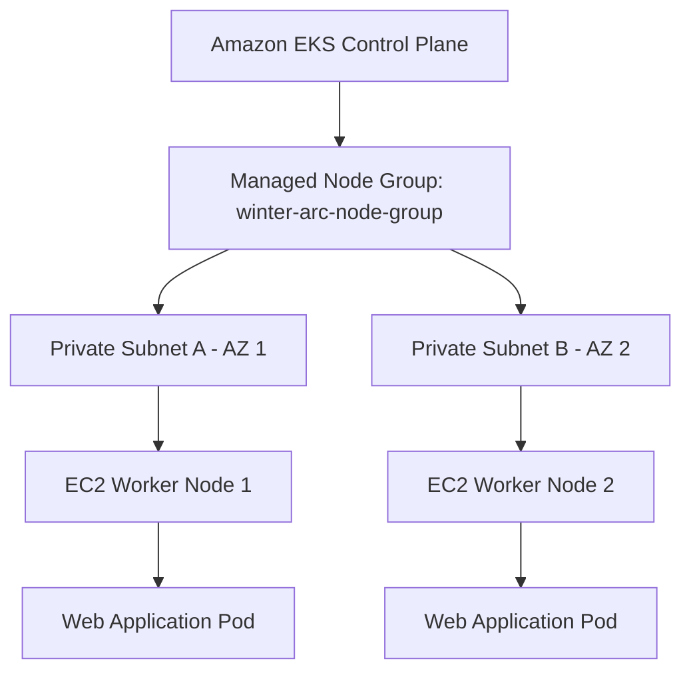

# AWS EKS Managed Node Group Architecture

This is a proposed architecture for Day 38.
No real AWS infrastructure has been provisioned.

## Planned Node Group Configuration

- Minimum nodes: 2
- Desired nodes: 2
- Maximum nodes: 3
- Subnets: Two private subnets in separate Availability Zones
- Node label: workload=web
- Instance type: t3.small (candidate for evaluation)

The control plane manages the Kubernetes cluster.
The managed node group provides EC2 worker capacity.
Application Pods run on the worker nodes.

Pod placement across nodes may require topology spread
constraints or Pod anti-affinity.
