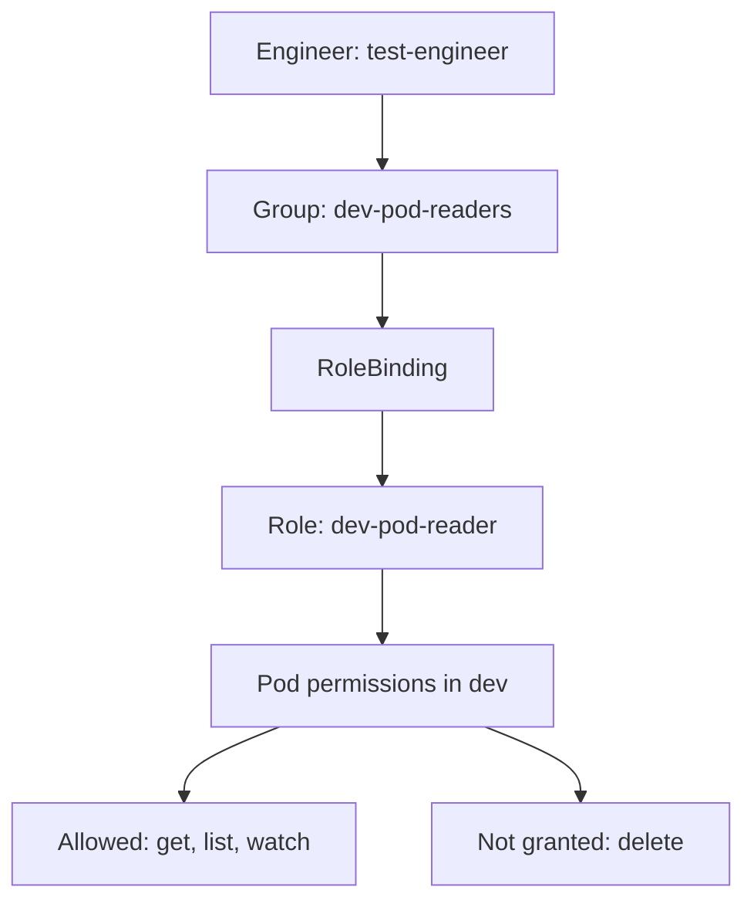
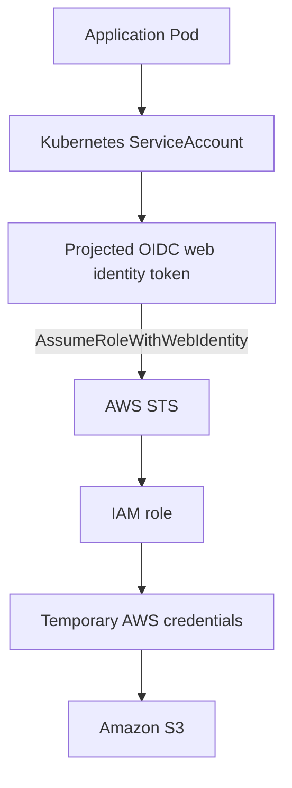

# Day 39 – AWS EKS IAM, Cluster Access & IRSA

**DevOps Winter Arc | Day 39 | Kubernetes Security**

## 1. Overview

Today I explored how access and permissions work in Amazon EKS.

The lab focused on three security concepts:

| Concept | Purpose |
|---|---|
| Kubernetes RBAC | Controls who can access Kubernetes resources |
| AWS IAM | Controls access to AWS services |
| IRSA | Allows EKS Pods to obtain temporary AWS credentials |

I used a local Floci AWS emulator and a K3s Kubernetes cluster
running inside Docker.

### What I achieved

- Created a read-only Kubernetes Role.
- Connected a Kubernetes group to the Role using a RoleBinding.
- Verified allowed and denied permissions.
- Inspected simulated AWS IAM and EKS resources.
- Created an IRSA-annotated Kubernetes ServiceAccount.
- Prepared IAM trust and S3 permissions policy templates.
- Investigated ServiceAccount tokens and IRSA configuration.
- Documented limitations of the local environment.

> **Result:** Kubernetes RBAC worked successfully.
> The IRSA configuration was demonstrated, but actual AWS
> role assumption and S3 access were not verified.

---

## 2. Lab Environment

| Component | Details |
|---|---|
| Operating environment | Debian on WSL2 |
| AWS emulator | Floci |
| AWS endpoint | http://localhost:4566 |
| AWS region | us-east-1 |
| Kubernetes distribution | K3s |
| Kubernetes container | floci-aws-eks-winter-arc-eks |
| Namespace | dev |

### Running Kubernetes commands

The host kubectl context was not used for this lab.

Instead, I ran kubectl inside the K3s Docker container:

```bash
docker exec floci-aws-eks-winter-arc-eks kubectl get pods -n dev
```

### Running AWS commands

All AWS CLI commands targeted Floci:

```bash
aws --endpoint-url http://localhost:4566 \
  sts get-caller-identity \
  --region us-east-1
```

---

## 3. Task A – Kubernetes RBAC

### What is RBAC?

RBAC stands for Role-Based Access Control.

It determines which Kubernetes operations a user or group
is allowed to perform.

For example, a developer may need to view Pods but should
not be able to delete them.

### My goal

Allow the group `dev-pod-readers` to:

- Get Pods
- List Pods
- Watch Pods

But do not grant permission to delete Pods.

### Resources created

**Role:** `dev-pod-reader`

File: `dev-pod-reader-role.yaml`

**RoleBinding:** `dev-pod-reader-binding`

File: `dev-pod-reader-binding.yaml`

**Namespace:** `dev`

**Group:** `dev-pod-readers`

### How RBAC works



### Permission testing

I used Kubernetes impersonation to simulate a user
belonging to the group.

**Test 1 – Can the user get Pods?**

```bash
docker exec floci-aws-eks-winter-arc-eks \
  kubectl auth can-i get pods -n dev \
  --as=test-engineer \
  --as-group=dev-pod-readers
```

Result:

```text
yes
```

**Test 2 – Can the user list Pods?**

```bash
docker exec floci-aws-eks-winter-arc-eks \
  kubectl auth can-i list pods -n dev \
  --as=test-engineer \
  --as-group=dev-pod-readers
```

Result:

```text
yes
```

**Test 3 – Can the user delete Pods?**

```bash
docker exec floci-aws-eks-winter-arc-eks \
  kubectl auth can-i delete pods -n dev \
  --as=test-engineer \
  --as-group=dev-pod-readers
```

Result:

```text
no
```

### RBAC verification

| Operation | Expected | Actual |
|---|---|---|
| Get Pods | Allow | yes |
| List Pods | Allow | yes |
| Delete Pods | Deny | no |
| Watch Pods | Allow | Configured, not tested separately |

**Outcome: RBAC least-privilege access was verified.**

---

## 4. Task B – AWS IAM and EKS Inspection

### What is AWS IAM?

AWS Identity and Access Management (IAM) controls
access to AWS resources.

Kubernetes RBAC controls Kubernetes permissions,
while AWS IAM controls AWS permissions.

They are different security systems.

### Check AWS identity

```bash
aws --endpoint-url http://localhost:4566 \
  sts get-caller-identity \
  --region us-east-1
```

The emulator returned a simulated AWS account:

```text
Account: 000000000000
```

### Check IAM roles

```bash
aws --endpoint-url http://localhost:4566 \
  iam list-roles \
  --region us-east-1
```

No IAM roles were listed.

### Check OIDC providers

```bash
aws --endpoint-url http://localhost:4566 \
  iam list-open-id-connect-providers \
  --region us-east-1
```

Result:

```json
{
  "OpenIDConnectProviderList": []
}
```

### Check EKS clusters

```bash
aws --endpoint-url http://localhost:4566 \
  eks list-clusters \
  --region us-east-1
```

Result:

```json
{
  "clusters": []
}
```

### Important observation

The Floci EKS API did not list the cluster.

However, the existing K3s Docker container was running,
and Kubernetes resources were accessible.

This was an environment mismatch, not evidence that
the running Kubernetes cluster had disappeared.

---

## 5. Task C – Understanding IRSA

### What is IRSA?

IRSA stands for IAM Roles for Service Accounts.

On a properly configured Amazon EKS cluster, IRSA allows
a Pod to obtain temporary AWS credentials without storing
long-lived AWS access keys inside the container.

### How IRSA works



**Note:** This is the intended IRSA architecture,
not a flow successfully verified in this local lab.

### My example

I created:

**ServiceAccount:** `dev/s3-reader-sa`

File: `s3-reader-serviceaccount.yaml`

**Demo Pod:** `dev/s3-reader-demo`

File: `s3-reader-pod.yaml`

The ServiceAccount was annotated with:

```yaml
eks.amazonaws.com/role-arn: arn:aws:iam::000000000000:role/winter-arc-s3-reader-role
```

The Pod used:

```yaml
serviceAccountName: s3-reader-sa
```

### IAM policy templates

I also prepared two JSON files.

**1. Trust policy template**

`s3-reader-trust-policy.template.json`

Defines which OIDC identity should be allowed to assume
the IAM role.

It restricts access to:

```text
Namespace: dev
ServiceAccount: s3-reader-sa
Audience: sts.amazonaws.com
```

The template contains an OIDC provider placeholder.

**2. S3 permissions policy**

`s3-reader-permissions-policy.json`

Allows:

```text
s3:ListBucket
s3:GetObject
```

For the example bucket:

```text
winter-arc-day39-test-bucket
```

It does not grant S3 write or delete permissions.

Both JSON files passed syntax validation.

The IAM role and OIDC provider were not created in Floci.

---

## 6. Task D – IRSA Verification

### What I verified

The demo Pod reached the `Running` state.

The Pod was configured to use `s3-reader-sa`.

The ServiceAccount contained the expected IAM role annotation.

The container also had the standard Kubernetes
ServiceAccount token mount.

### What I checked next

I inspected the Pod for these IRSA environment variables:

```text
AWS_ROLE_ARN
AWS_WEB_IDENTITY_TOKEN_FILE
```

Result:

```text
No IRSA environment variables found
```

I also inspected projected volumes.

Observed:

```text
kube-api-access-54x8q
```

This was the standard Kubernetes API access volume.

No separate AWS IRSA web identity token volume was found.

### Final IRSA results

| Verification | Result |
|---|---|
| ServiceAccount created | Passed |
| IAM role annotation present | Passed |
| Pod uses correct ServiceAccount | Passed |
| Standard Kubernetes token mounted | Passed |
| IRSA environment variables injected | No |
| Separate IRSA token volume found | No |
| IAM role assumption via STS | Not verified |
| S3 access through IRSA | Not verified |

### Why did IRSA not work end-to-end?

The local environment did not have the complete
EKS IRSA infrastructure:

- No IAM OIDC provider was registered.
- The referenced IAM role did not exist.
- IRSA-specific environment variables were not injected.
- No successful STS web identity exchange was demonstrated.

**Key lesson:** Adding an IAM role annotation to a
ServiceAccount does not automatically make IRSA work.

---

## 7. Troubleshooting

### Problem 1 – ImagePullBackOff

The original demo Pod used:

```text
amazon/aws-cli:2
```

The image could not be pulled.

I changed it to:

```text
amazon/aws-cli:latest
```

The Pod then started successfully.

**Lesson:** Check image names and tags when troubleshooting
`ErrImagePull` or `ImagePullBackOff`.

### Problem 2 – Pod completed before inspection

The Pod originally ran:

```text
sleep 3600
```

After the command finished, the Pod entered
the `Completed` state.

I changed the sleep duration to `86400` seconds
and recreated only the demo Pod.

**Lesson:** A completed Pod is different from a failed Pod.

### Problem 3 – EKS cluster missing from emulator API

Floci returned an empty EKS cluster list,
while the K3s container remained operational.

**Lesson:** Inspect the actual cluster and resources
before attempting destructive troubleshooting.

---

## 8. Files in This Lab

| File | Description |
|---|---|
| `dev-pod-reader-role.yaml` | Read-only Kubernetes Role |
| `dev-pod-reader-binding.yaml` | Binds the reader group to the Role |
| `s3-reader-serviceaccount.yaml` | IRSA-annotated ServiceAccount |
| `s3-reader-pod.yaml` | AWS CLI demo Pod |
| `s3-reader-trust-policy.template.json` | IAM OIDC trust policy template |
| `s3-reader-permissions-policy.json` | S3 read-only permissions |
| `verification-results.md` | Recorded verification evidence |
| `README.md` | Lab explanation and documentation |

---

## 9. Key Takeaways

1. **Kubernetes RBAC** controls permissions inside Kubernetes.
2. **AWS IAM** controls permissions to AWS resources.
3. **IRSA** connects EKS workload identity to IAM through OIDC and STS.
4. **Least privilege** means granting only necessary permissions.
5. **Verification matters:** A configuration file alone does not prove
   that authentication or authorization works.
6. **Troubleshooting is part of DevOps:** Errors provide valuable
   evidence about how systems behave.

## Final Result

**Successfully completed:** Kubernetes RBAC,
IAM/EKS inspection, ServiceAccount configuration,
IAM policy templates, and local verification.

**Not completed:** End-to-end AWS IRSA role assumption
and S3 access.

This lab helped me understand the separation between
Kubernetes authorization and AWS workload identity.

---

**DevOps Winter Arc – Day 39**
