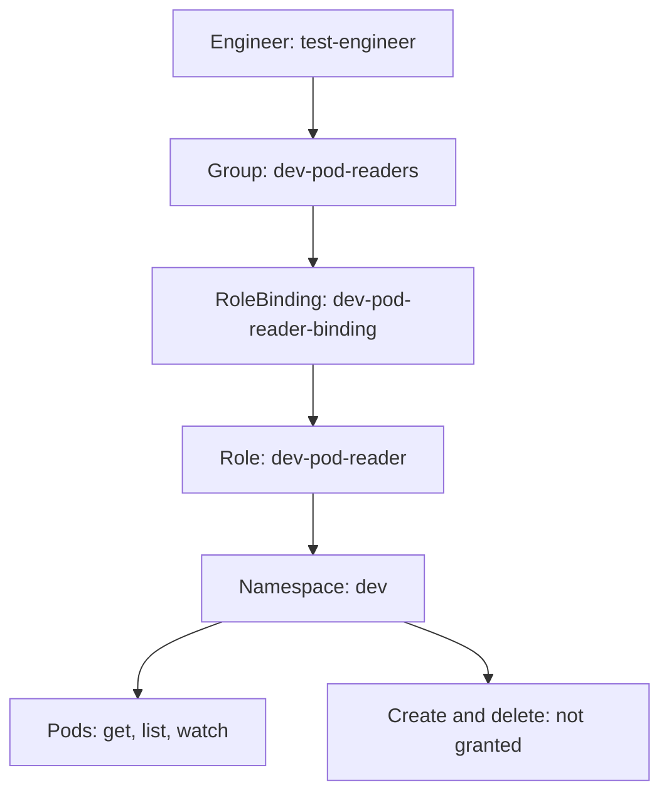
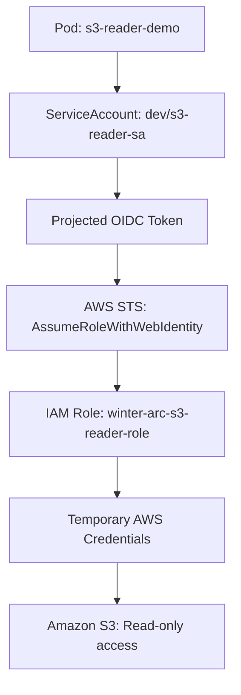

# Day 39 – AWS EKS IAM, Cluster Access & IRSA

## DevOps Winter Arc | AWS EKS Security

### Objective

Understand and demonstrate three important security concepts:

1. Kubernetes Role-Based Access Control (RBAC)
2. AWS IAM and EKS cluster access
3. IAM Roles for Service Accounts (IRSA)

This lab uses a local Floci AWS emulator and a Docker-based K3s
Kubernetes cluster.

> **Important:** Kubernetes RBAC was successfully tested.
> IRSA architecture and policy templates were prepared, but
> end-to-end AWS IRSA authentication was not established.

---

## 1. Lab Environment

| Component | Configuration |
|---|---|
| AWS emulator | Floci |
| AWS endpoint | http://localhost:4566 |
| AWS region | us-east-1 |
| Simulated account | 000000000000 |
| Kubernetes | K3s inside Docker |
| Docker container | floci-aws-eks-winter-arc-eks |
| Namespace | dev |
| Test Pod | nginx-test |
| IRSA demo Pod | s3-reader-demo |

Kubernetes commands were executed through:

```bash
docker exec floci-aws-eks-winter-arc-eks kubectl ...
```

AWS commands explicitly targeted the local Floci endpoint.

---

## 2. Task A – Kubernetes RBAC

### Goal

Allow members of the `dev-pod-readers` group to read Pods
in the `dev` namespace without granting modification permissions.

### RBAC Architecture



### Role

File: `dev-pod-reader-role.yaml`

The Role grants:

- `get` – Read individual Pods
- `list` – List Pods
- `watch` – Observe Pod changes

It does not grant `create`, `update`, `patch`, or `delete`.

### RoleBinding

File: `dev-pod-reader-binding.yaml`

The RoleBinding connects the Kubernetes group
`dev-pod-readers` to the `dev-pod-reader` Role.

### Permission Verification

Tests were performed using Kubernetes impersonation:

```bash
kubectl auth can-i get pods -n dev \
  --as=test-engineer --as-group=dev-pod-readers

kubectl auth can-i list pods -n dev \
  --as=test-engineer --as-group=dev-pod-readers

kubectl auth can-i delete pods -n dev \
  --as=test-engineer --as-group=dev-pod-readers
```

Actual results:

| Operation | Result |
|---|---|
| Get Pods | YES |
| List Pods | YES |
| Delete Pods | NO |
| Watch Pods | Configured, not separately tested |

**Outcome:** Least-privilege Kubernetes Pod access verified.

---

## 3. Task B – AWS IAM and EKS Inspection

### AWS STS Identity

Command:

```bash
aws --endpoint-url http://localhost:4566 \
  sts get-caller-identity --region us-east-1
```

Floci returned:

```json
{
  "UserId": "000000000000",
  "Account": "000000000000",
  "Arn": "arn:aws:iam::000000000000:root"
}
```

This is a simulated AWS account identity.

### IAM Role Inspection

The `iam list-roles` command displayed no roles.

### OIDC Provider Inspection

The `iam list-open-id-connect-providers` command returned:

```json
{
  "OpenIDConnectProviderList": []
}
```

### EKS Cluster Inspection

The Floci EKS API returned an empty cluster list
in `us-east-1`.

However, the existing K3s Docker container remained operational.

The `nginx-test` Pod, Role, and RoleBinding were still present.

**Lesson:** The local Kubernetes cluster state and the Floci
EKS API registry must not be treated as identical.

---

## 4. Task C – IRSA Architecture

### What Is IRSA?

IAM Roles for Service Accounts (IRSA) allows authorized
Kubernetes workloads on Amazon EKS to obtain temporary AWS
credentials using an OIDC web identity token.

This avoids storing long-lived AWS access keys inside Pods.

### Intended IRSA Flow



This diagram represents the intended AWS EKS IRSA architecture,
not a verified credential exchange in the local environment.

### ServiceAccount

File: `s3-reader-serviceaccount.yaml`

The ServiceAccount includes:

```yaml
eks.amazonaws.com/role-arn: arn:aws:iam::000000000000:role/winter-arc-s3-reader-role
```

The annotation was successfully verified in Kubernetes.

The referenced IAM role was not created in Floci.

### IAM Trust Policy

File: `s3-reader-trust-policy.template.json`

The trust policy template restricts role assumption to:

- OIDC audience: `sts.amazonaws.com`
- Kubernetes namespace: `dev`
- ServiceAccount: `s3-reader-sa`

The template contains an OIDC provider placeholder and
must not be deployed without a real provider configuration.

### S3 Permissions Policy

File: `s3-reader-permissions-policy.json`

The policy grants:

- `s3:ListBucket`
- `s3:GetObject`

For the example bucket:

`winter-arc-day39-test-bucket`

Write and delete permissions were not granted.

Both IAM policy JSON files passed syntax validation.

---

## 5. Task D – Local IRSA Investigation

### Demo Pod

File: `s3-reader-pod.yaml`

The Pod was configured with:

```yaml
serviceAccountName: s3-reader-sa
```

The Pod successfully ran using the configured ServiceAccount.

### Kubernetes Token Mount

The following files were observed:

```text
/var/run/secrets/kubernetes.io/serviceaccount/
├── ca.crt
├── namespace
└── token
```

This verified the standard Kubernetes ServiceAccount
token mount.

### AWS IRSA Environment Variables

The following variables were checked:

```text
AWS_ROLE_ARN
AWS_WEB_IDENTITY_TOKEN_FILE
```

Actual result:

```text
No IRSA environment variables found
```

### Projected Volumes

Observed volume:

```text
kube-api-access-54x8q
```

No separate AWS IRSA token volume was found.

### IRSA Verification Summary

| Check | Result |
|---|---|
| ServiceAccount exists | PASS |
| Pod uses ServiceAccount | PASS |
| IAM role annotation present | PASS |
| Kubernetes token mounted | PASS |
| AWS IRSA variables injected | NO |
| Separate AWS web identity token | NOT FOUND |
| STS role assumption | NOT VERIFIED |
| S3 access through IRSA | NOT VERIFIED |

**Conclusion:** Kubernetes identity configuration worked,
but end-to-end AWS IRSA was not established.

---

## 6. Troubleshooting Lessons

### Issue 1 – Floci EKS Cluster Not Found

The Floci EKS API returned:

```text
ResourceNotFoundException
No cluster found for name: winter-arc-eks
```

The cluster list was empty, while the K3s Docker container
and Kubernetes resources remained available.

**Lesson:** Verify actual Kubernetes state before recreating
or deleting infrastructure.

### Issue 2 – Container ImagePullBackOff

Initial image:

```text
amazon/aws-cli:2
```

Kubernetes reported that the image reference was not found.

The image was updated to:

```text
amazon/aws-cli:latest
```

The Pod subsequently reached `Running`.

For production, use a tested, pinned image version or digest.

### Issue 3 – Cannot Exec into Completed Pod

The demo Pod used `sleep 3600` with `restartPolicy: Never`.

After its command finished, Kubernetes marked it `Completed`.

The sleep duration was changed to `86400`, and the demo Pod
was recreated for inspection.

**Lesson:** A successfully completed Pod is not necessarily
a failed workload.

---

## 7. Security Takeaways

1. Kubernetes RBAC and AWS IAM solve different authorization problems.
2. Apply least-privilege permissions to users and workloads.
3. Use RoleBindings to assign Kubernetes Roles.
4. Restrict IRSA trust policies to specific ServiceAccounts.
5. Prefer temporary credentials over static AWS access keys.
6. Never expose ServiceAccount token contents.
7. An IAM role annotation alone does not prove IRSA is operational.
8. Validate configurations using real commands and record limitations.

---

## 8. Project Files

| File | Purpose |
|---|---|
| dev-pod-reader-role.yaml | Kubernetes Pod read permissions |
| dev-pod-reader-binding.yaml | RBAC group binding |
| s3-reader-serviceaccount.yaml | IRSA-annotated ServiceAccount |
| s3-reader-pod.yaml | Demo Pod |
| s3-reader-trust-policy.template.json | IAM OIDC trust template |
| s3-reader-permissions-policy.json | S3 read-only IAM permissions |
| verification-results.md | Recorded lab evidence |
| README.md | Lab documentation |

---

## 9. Final Outcome

**Completed:**
- Kubernetes RBAC implementation
- Read-only access testing
- AWS IAM and EKS inspection
- IRSA ServiceAccount and Pod configuration
- IAM trust and permissions policy templates
- Kubernetes token inspection
- Troubleshooting and documentation

**Not demonstrated:**
- Real AWS EKS IAM authentication
- Successful STS AssumeRoleWithWebIdentity
- S3 access using IRSA credentials

### Key Learning

**Kubernetes RBAC controls access to Kubernetes resources.**

**AWS IAM controls permissions for AWS resources.**

**IRSA connects Kubernetes workload identity to AWS IAM
through OIDC and temporary STS credentials.**

---

DevOps Winter Arc – Day 39
