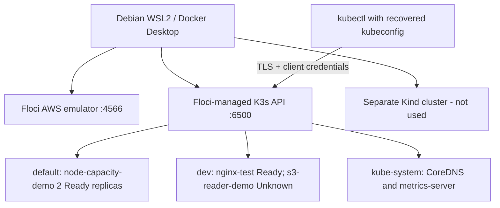
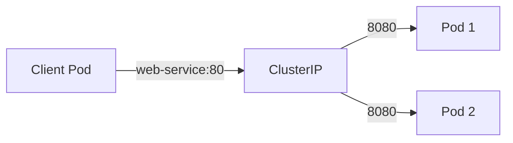
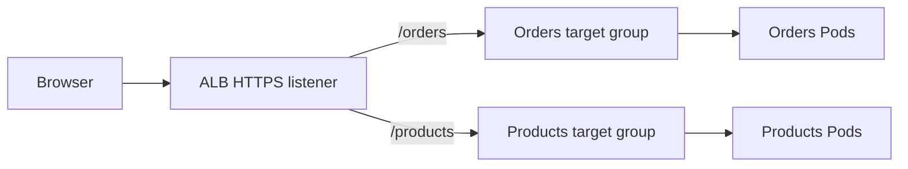
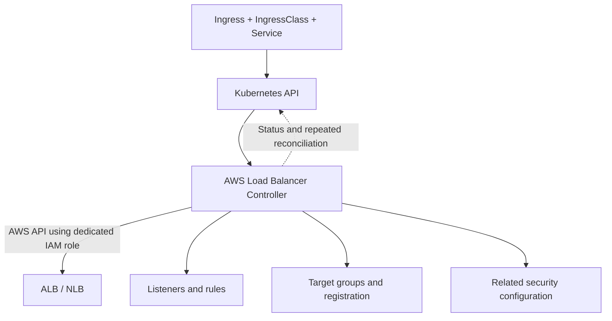
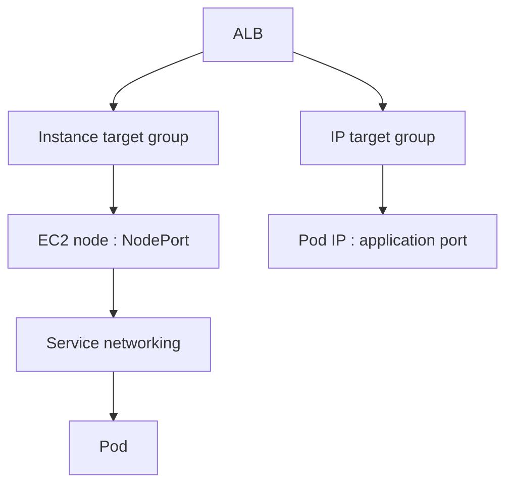
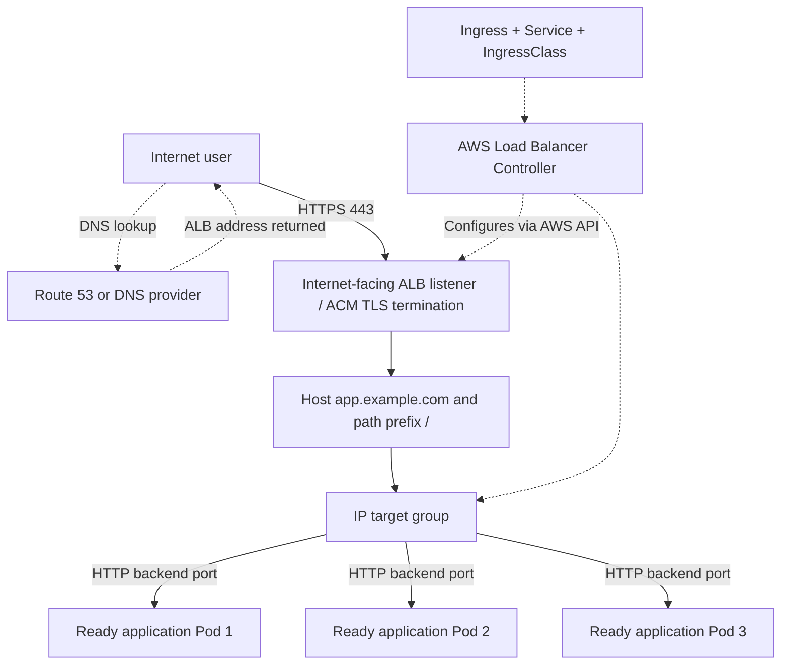
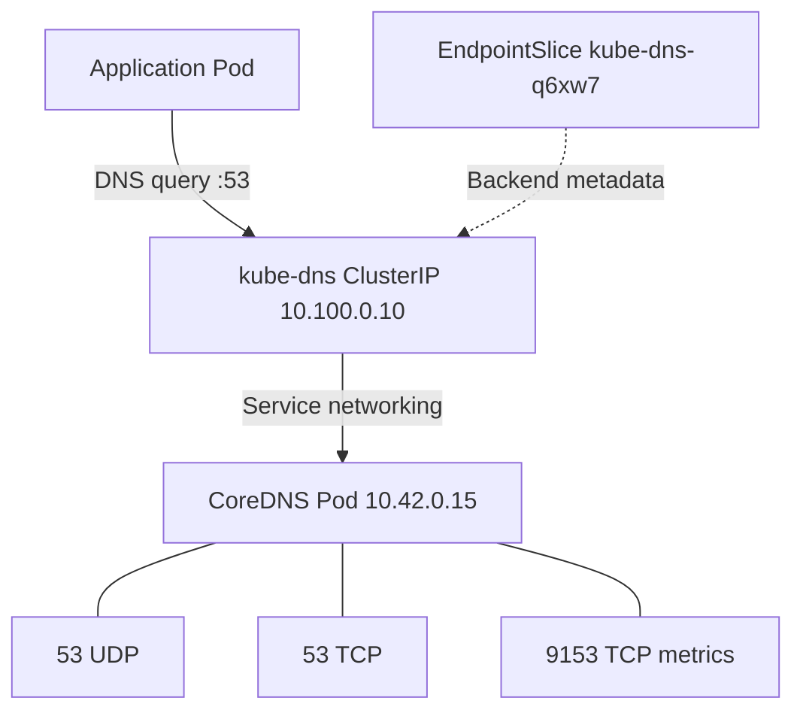
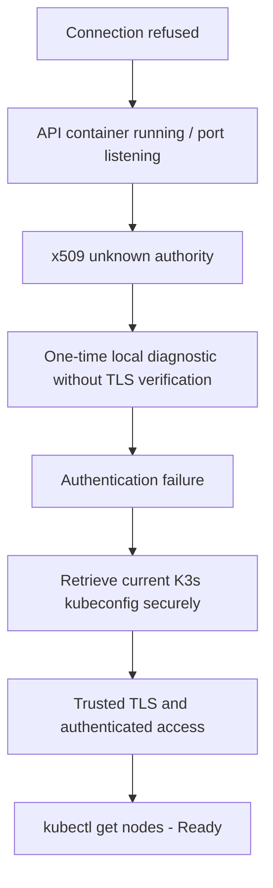

# Day 40 – AWS EKS: AWS Load Balancer Controller

**DevOps Winter Arc – 90 Days Challenge**  
**Week 6 – AWS EKS | Day 40 / 90 | 27 November 2026**

> **Lab type:** Theory + architecture design + hands-on local Kubernetes inspection and troubleshooting.  
> **Execution status:** Local inspection completed; Ingress manifest authored but not applied. Real AWS controller installation and ALB/NLB provisioning intentionally not performed.  
> **Cost objective:** No additional AWS infrastructure created as part of this exercise.

---

## Table of Contents

1. [Overview and objectives](#1-overview-and-objectives)
2. [Environment and actual architecture](#2-environment-and-actual-architecture)
3. [Kubernetes networking fundamentals](#3-kubernetes-networking-fundamentals)
4. [ALB and NLB](#4-alb-and-nlb)
5. [Ingress and AWS Load Balancer Controller](#5-ingress-and-aws-load-balancer-controller)
6. [Target groups, health checks, DNS and TLS](#6-target-groups-health-checks-dns-and-tls)
7. [Task A – Request flow](#7-task-a--request-flow)
8. [Task B – Exposure comparison](#8-task-b--exposure-comparison)
9. [Task C – Actual cluster inspection](#9-task-c--actual-cluster-inspection)
10. [Practical troubleshooting case study](#10-practical-troubleshooting-case-study)
11. [Task D – Ingress design](#11-task-d--ingress-design)
12. [Task E – Optional AWS implementation plan](#12-task-e--optional-aws-implementation-plan)
13. [Production troubleshooting](#13-production-troubleshooting)
14. [Interview questions and answers](#14-interview-questions-and-answers)
15. [Revision notes and completion](#15-revision-notes-and-completion)
16. [References](#16-references)

## 1. Overview and objectives

Day 40 builds on Kubernetes Pods, Deployments, Services, labels, selectors, CoreDNS and EndpointSlices. The focus is exposing workloads safely using AWS load balancing and understanding how declarative Kubernetes configuration becomes AWS infrastructure.

The learning objectives are to:

- Explain ClusterIP, NodePort and LoadBalancer Services and select the appropriate exposure method.
- Distinguish Layer 7 ALB from Layer 4 NLB.
- Understand Ingress, IngressClass and the AWS Load Balancer Controller.
- Trace DNS lookup, listeners, TLS termination, host/path routing, target groups and backend responses.
- Inspect real local Kubernetes resources and diagnose API connectivity, certificate trust and authentication failures.
- Design an ALB Ingress without provisioning paid cloud infrastructure.

## 2. Environment and actual architecture

| Component | Actual environment |
|---|---|
| Operating system | Debian GNU/Linux 13 (trixie), WSL2 |
| Docker | Docker Desktop; CLI 29.9.2 |
| AWS CLI | 2.39.6; learner profile login succeeded |
| AWS emulator | Floci, port 4566 |
| Local Kubernetes | Floci-managed K3s v1.29.14+k3s1 |
| Runtime | containerd://1.7.23-k3s2 |
| Kubernetes API | https://localhost:6500 |
| kubectl client | v1.37.2 |
| Active recovered context | default |
| Node count | One Ready control-plane node |
| Separate local cluster | Kind; not used for the final inspection |

**Important:** The AWS CLI login, Floci AWS API endpoint, and Kubernetes API authentication are separate. Floci is not evidence of a real AWS EKS deployment. The local kubeconfig was recovered from the K3s container. Its administrative credentials must not be published.

The kubectl client is substantially newer than the API server (1.37 vs 1.29), beyond the usual supported one-minor version skew. Commands used today succeeded, but a compatible client should be used for future labs.



## 3. Kubernetes networking fundamentals

### 3.1 Why a Service is necessary

Pods are replaceable. A Deployment maintains desired application configuration through ReplicaSets, but replacement Pods may have new IP addresses. A Service provides a stable virtual IP and DNS name instead of requiring clients to track changing backend addresses.

| Concept | Meaning | Memory aid |
|---|---|---|
| Service | Stable network access to backends | Reception desk |
| Selector | Matches Pod labels | Team filter |
| EndpointSlice | Records backend addresses, ports and conditions | Address book |
| CoreDNS | Resolves Service names | Phone directory |
| port | Service-facing port | Entrance |
| targetPort | Backend application port | Internal extension |

A Service object can exist without usable endpoints. Always verify selector matching, Pod readiness and endpoint information. CoreDNS resolves normal ClusterIP Service names to the Service IP; it does not proxy application traffic. Service networking selects backend connections, and repeated requests are not guaranteed to follow a fixed round-robin order.


### 3.2 ClusterIP

Default Service type. Provides internal access, normally used for microservices, internal APIs and databases.

```yaml
apiVersion: v1
kind: Service
metadata:
  name: web-service
spec:
  type: ClusterIP
  selector:
    app: web
  ports:
    - port: 80
      targetPort: 8080
```



The application must actually listen on targetPort. Declaring a containerPort does not start a listener. DNS short names normally work within the same namespace; cross-namespace clients can use `web-service.demo.svc.cluster.local` assuming the standard cluster domain.

### 3.3 NodePort

Exposes a Service through a port on eligible Kubernetes nodes. The default allocation range is 30000–32767 (configurable). A reachable node IP, routing and firewall rules are still required.

```yaml
apiVersion: v1
kind: Service
metadata:
  name: web-nodeport
spec:
  type: NodePort
  selector:
    app: web
  ports:
    - port: 80
      targetPort: 8080
      nodePort: 30080
```

```text
Client -> NodeIP:30080 -> Service networking -> PodIP:8080
```

NodePort normally retains a ClusterIP for internal clients. A node can forward traffic to backends on other nodes depending on the traffic policy and networking configuration.

### 3.4 LoadBalancer

Requests a load balancer from a compatible cloud integration or controller. It does not guarantee a public IP, and it may remain pending without a supported implementation.

```yaml
apiVersion: v1
kind: Service
metadata:
  name: web-loadbalancer
spec:
  type: LoadBalancer
  selector:
    app: web
  ports:
    - port: 80
      targetPort: 8080
```

The AWS Load Balancer Controller can provision an NLB for a suitably configured Service. Some implementations use NodePorts; others register backend IPs directly. The examples in this section are learning examples only and were not applied today.

## 4. ALB and NLB


### Application Load Balancer (ALB)

An ALB operates at Layer 7 and understands HTTP/HTTPS application requests. It can select a target group using a hostname, path, or other supported HTTP conditions.



Useful for websites, REST APIs and multiple applications sharing an HTTP entry point. A path rule selects the backend; it does not automatically strip a URL prefix.

### Network Load Balancer (NLB)

An NLB primarily operates at Layer 4 and distributes network flows. It supports TCP, UDP and TLS listener configurations. It does not route requests based on HTTP hostnames or URL paths.

| Feature | ALB | NLB |
|---|---|---|
| OSI layer | Layer 7 | Layer 4 |
| Typical protocols | HTTP, HTTPS | TCP, UDP, TLS |
| Host/path routing | Yes | No |
| Typical Kubernetes integration | Ingress | LoadBalancer Service |
| Example | Website and REST API | TCP or UDP application |

**Remember:** ALB understands application requests; NLB distributes network connections.

## 5. Ingress and AWS Load Balancer Controller


Ingress is a Kubernetes API resource describing HTTP/HTTPS routing rules. It is not a running proxy. IngressClass identifies which implementation should handle the resource. A compatible controller must be installed and configured for the rules to become functional.

| Resource | Responsibility |
|---|---|
| Ingress | Declares host/path rules |
| IngressClass | Selects the intended implementation |
| Service | Identifies the application backend and Service port |
| AWS Load Balancer Controller | Reconciles AWS resources from supported Kubernetes configuration |
| ALB | Handles actual client traffic |

### Reconciliation

Reconciliation is the process of bringing the actual infrastructure state into agreement with the desired configuration. The controller observes relevant Kubernetes resources, builds a desired AWS configuration and calls AWS APIs to create or update supported load balancers, listeners, rules, target groups and related security settings. It also updates status where appropriate and retries reconciliation when necessary.



The controller is part of the management path, not the application traffic path. IAM permissions authorize AWS API actions; Kubernetes RBAC authorizes Kubernetes API actions. Both must be appropriately configured, with least privilege rather than broad administrator access.

## 6. Target groups, health checks, DNS and TLS

### Target groups and target modes


A target group is a collection of registered destinations with protocol, port and health-check configuration.

| Mode | Actual traffic destination | Requirements |
|---|---|---|
| instance | EC2 node IP / instance on NodePort, then Service networking to Pod | Appropriate NodePort-backed Service and node reachability |
| ip | Registered backend Pod IP and target port directly | Routable supported Pod networking, appropriate security rules |



In IP mode the Service is used to identify backend configuration; the ALB does not need to send traffic through the Service ClusterIP. Local Floci Pod addresses are not evidence of AWS VPC-routable targets.

### Health checks

A load balancer periodically checks targets using a configured protocol, port and (for HTTP/HTTPS) path. A successful response matching the health-check criteria marks a target healthy after the required threshold.

For example, `GET /health` can return HTTP 200 when the application is ready to serve. The sample Ingress uses `/`, which must actually respond with an acceptable code.

Kubernetes readiness and ALB target health are distinct. A Ready Pod can still be unhealthy in AWS due to blocked security groups, wrong target ports, invalid health paths or routing problems. ALB normally routes to healthy targets; if all registered targets are unhealthy, ALB can fail open and route to unhealthy targets, so health checks are not a security boundary.

### DNS

Public DNS (for example a Route 53 alias) maps an application hostname to the ALB. CoreDNS resolves internal Kubernetes Service names. These are separate DNS roles. DNS lookup returns an address; the browser then establishes its connection to the ALB.

### TLS termination

For HTTPS, the ALB listener on port 443 presents an appropriate ACM certificate for the domain and terminates the client TLS connection. The backend may use HTTP or a separate HTTPS connection. The actual manifest authored today is an HTTP design and does not configure HTTPS or a certificate.

## 7. Task A – Request flow


### Proposed production architecture (not deployed)



Solid arrows represent application traffic; dashed arrows represent DNS lookup or configuration. Three Pods are illustrative, not observed application replicas in this lab.

1. A client resolves the application domain.
2. The client connects to the ALB listener on port 443.
3. The ALB terminates TLS using a matching certificate.
4. Listener rules evaluate host and path conditions.
5. The selected target group forwards the request to a backend according to target health and routing behavior.
6. The application processes the request and returns the response through the ALB.

## 8. Task B – Exposure comparison

| Method | Access | Routing | Typical use |
|---|---|---|---|
| ClusterIP | Internal virtual IP/DNS | Service networking | Internal API |
| NodePort | Reachable node IP + port | Service networking | Test environment or node-based access |
| LoadBalancer | Cloud LB IP/hostname | Depends on implementation | Dedicated TCP/UDP Service using NLB |
| Ingress + ALB | ALB hostname or application domain | HTTP host/path rules | Web applications and APIs |

Use ClusterIP for internal communication, NodePort when node-level exposure is appropriate, an NLB-backed Service for transport-level exposure, and Ingress with ALB for HTTP routing. An Ingress is not a fourth Service type: it is a separate Kubernetes resource.

## 9. Task C – Actual cluster inspection

All commands below were used for local inspection; outputs are selected, sanitized excerpts of the terminal results, not fabricated examples.

### 9.1 Context and nodes

```bash
kubectl config current-context
kubectl get nodes -o wide
```

Observed context: `default` (from the recovered kubeconfig).

```text
NAME                STATUS  ROLES                 VERSION           INTERNAL-IP
<local-node>        Ready   control-plane,master  v1.29.14+k3s1     172.17.0.3
```

The node name is redacted for publication. One local control-plane node was Ready; this is not a production multi-AZ EKS cluster.

### 9.2 Deployments and Pods

```bash
kubectl get deployments -A
kubectl get pods -A
kubectl get all -n dev
```

```text
NAMESPACE     NAME                 READY  UP-TO-DATE  AVAILABLE
default       node-capacity-demo   2/2    2           2
kube-system   coredns              1/1    1           1
kube-system   metrics-server       1/1    1           1
```

```text
NAMESPACE  NAME                READY  STATUS
dev        pod/nginx-test      1/1    Running
dev        pod/s3-reader-demo  0/1    Unknown
```

The existing capacity demo had two available replicas. CoreDNS and metrics-server each had one available replica. The unrelated S3 reader Pod was Unknown and was not modified or diagnosed in this lab.

### 9.3 Service and Ingress inventory

```bash
kubectl get svc -A
kubectl get ingress -A
kubectl get ingressclass
kubectl get endpointslices -A
```

```text
NAMESPACE    NAME            TYPE       CLUSTER-IP    EXTERNAL-IP  PORT(S)
default      kubernetes      ClusterIP  10.100.0.1    <none>       443/TCP
kube-system  kube-dns        ClusterIP  10.100.0.10   <none>       53/UDP,53/TCP,9153/TCP
kube-system  metrics-server  ClusterIP  10.100.238.0  <none>       443/TCP
```

Both Ingress and IngressClass commands returned `No resources found`. No application Service existed in the displayed inventory. No ALB address or target health was available to inspect; this is a valid result for the assignment.

```text
NAMESPACE    NAME                  ADDRESSTYPE  PORTS       ENDPOINTS
default      kubernetes            IPv4         6443        172.17.0.3
kube-system  kube-dns-q6xw7        IPv4         9153,53,53  10.42.0.15
kube-system  metrics-server-gg667  IPv4         10250       10.42.0.14
```

### 9.4 Inspect the existing CoreDNS Service

```bash
kubectl describe svc kube-dns -n kube-system
kubectl get endpoints kube-dns -n kube-system
kubectl get endpointslices -n kube-system \
  -l kubernetes.io/service-name=kube-dns -o wide
```

Actual observations:

| Property | Value |
|---|---|
| Service | kube-dns |
| Namespace | kube-system |
| Type | ClusterIP |
| Selector | k8s-app=kube-dns |
| ClusterIP | 10.100.0.10 |
| IP family | IPv4 |
| Backend IP | 10.42.0.15 |
| Session affinity | None |
| Internal traffic policy | Cluster |
| Service events | None |

| Service port | TargetPort | Endpoint | Purpose |
|---|---|---|---|
| 53/UDP | 53/UDP | 10.42.0.15:53 | DNS queries |
| 53/TCP | 53/TCP | 10.42.0.15:53 | DNS over TCP |
| 9153/TCP | 9153/TCP | 10.42.0.15:9153 | Prometheus metrics |

```text
NAME      ENDPOINTS
kube-dns  10.42.0.15:53,10.42.0.15:53,10.42.0.15:9153
```



There is one distinct backend IP, not three Pods. The repeated IP:53 represents UDP and TCP entries. The EndpointSlice stores the backend information, while Service networking forwards packets. The observed CoreDNS Pod was Ready, but no independent DNS query test was recorded in today's lab.

### 9.5 Existing application and events

```bash
kubectl get pod nginx-test -n dev -o wide --show-labels
kubectl get events -n dev --sort-by=.lastTimestamp
```

```text
NAME        READY  STATUS   IP          LABELS
nginx-test  1/1    Running  10.42.0.16  run=nginx-test
```

| Observed event | Meaning |
|---|---|
| SandboxChanged | Pod runtime sandbox needed recreation |
| Pulled | nginx:stable already present locally |
| Created | Container created |
| Started | Container started |

The events were consistent with recent environment restart, although the exact sandbox-change cause was not established. No new application Service was created today.

## 10. Practical troubleshooting case study

The most significant hands-on learning today was recovering access to the existing local Kubernetes API after three distinct errors.



### 10.1 Connection refused

```text
The connection to the server localhost:6500 was refused
```

The old `day28-floci` context pointed to `https://localhost:6500`, but the server was not accepting connections. Docker Desktop and the AWS emulator being available did not prove that the Kubernetes API was reachable.

Diagnostic commands:

```bash
docker ps -a
kubectl config get-contexts
kubectl config view --minify -o jsonpath='{.clusters[0].cluster.server}'
ss -lntp | grep 6500
curl -k --connect-timeout 3 https://localhost:6500/livez
```

A subsequent Docker listing showed `floci-aws-eks-winter-arc-eks` running with host port 6500 mapped to container port 6443. The port was listening, and unauthenticated curl returned HTTP 401. This established API reachability, not successful Kubernetes authentication. The exact action that started the container was not recorded.

### 10.2 TLS trust error

```text
tls: failed to verify certificate: x509: certificate signed by unknown authority
```

The API was reachable but the old kubeconfig did not establish trust in the presented certificate. A stale or mismatched CA was suspected; the precise cause was not independently verified.

A one-time local diagnostic using `--insecure-skip-tls-verify=true` then exposed the authentication error. This is not a recommended permanent solution and must not be used with real cloud credentials or untrusted servers.

### 10.3 Authentication failure and recovery

```text
error: You must be logged in to the server
(the server has asked for the client to provide credentials)
```

A successful AWS learner login did not resolve local Kubernetes credentials. The recovery approach used the running K3s instance's current kubeconfig rather than modifying the original configuration.

Recovery procedure for this owned local lab only:

```bash
mkdir -p ~/.kube
umask 077
docker exec floci-aws-eks-winter-arc-eks \
  cat /etc/rancher/k3s/k3s.yaml > ~/.kube/floci-day40.yaml
sed -i 's/127.0.0.1:6443/localhost:6500/g' ~/.kube/floci-day40.yaml
chmod 600 ~/.kube/floci-day40.yaml
export KUBECONFIG="$HOME/.kube/floci-day40.yaml"
kubectl get nodes --request-timeout=10s
```

The subsequent node, Pod and Service queries succeeded. No permanent TLS bypass was needed. Never commit the recovered kubeconfig because it contains privileged client credentials.

The new configuration used the `default` context. When the Kind context was requested, kubectl reported that it was not present in the active kubeconfig. This did not prove Kind was broken or deleted. The original file can be explicitly selected when necessary:

```bash
kubectl --kubeconfig ~/.kube/config --context kind-winter-arc get nodes
```

This alternative was not needed for the final Day 40 inspection.

**Memory aid:** Connection refused = reachability; x509 = trust; 401 = authentication; 403 = authorization. Diagnose the failing layer rather than reinstalling everything.

## 11. Task D – Ingress design

The following manifest was authored and verified using `cat ingress.yaml` in the existing learning repository under `AWS-EKS/Day40`. It was not applied.

```yaml
apiVersion: networking.k8s.io/v1
kind: Ingress
metadata:
  name: web-ingress
  namespace: demo
  annotations:
    alb.ingress.kubernetes.io/scheme: internet-facing
    alb.ingress.kubernetes.io/target-type: ip
    alb.ingress.kubernetes.io/healthcheck-path: /
spec:
  ingressClassName: alb
  rules:
    - host: app.example.com
      http:
        paths:
          - path: /
            pathType: Prefix
            backend:
              service:
                name: web-service
                port:
                  number: 80
```

| Field | Explanation |
|---|---|
| apiVersion / kind | Stable Kubernetes networking API and Ingress resource |
| metadata.name | Unique Ingress name within the namespace |
| namespace | Backend Service must be in the same namespace, demo |
| scheme | Requests an internet-facing ALB |
| target-type | Registers reachable Pod IPs directly |
| healthcheck-path | HTTP health-check path; application must respond successfully |
| ingressClassName | Selects an appropriately configured alb IngressClass |
| host | Matches the HTTP host app.example.com |
| path / Prefix | Matches the root and its subpaths |
| service.name | References web-service |
| service.port.number | Selects Service port 80, not necessarily the container port |

The `demo` backend and ALB IngressClass were not present in the observed inventory. The sample domain is illustrative. There is no claim that DNS exists or that this manifest has been server-validated. Merely saving YAML does not provision infrastructure.

### Production prerequisites and verification plan

| Area | Required consideration |
|---|---|
| Identity | Dedicated controller IAM role, scoped policy, supported IRSA or EKS Pod Identity configuration |
| IngressClass | Class named alb associated with the installed controller |
| Networking | Suitable public subnets for an internet-facing ALB, typically at least two Availability Zones; appropriate subnet discovery and free addresses |
| Security groups | Allow intended client listener traffic and ALB-to-target traffic, including health checks; avoid unnecessary public Pod exposure |
| Backend | Existing namespace, Service, matching ready Pods, correct target port and reachable Pod IPs |
| DNS | Configure a real domain record after provisioning the ALB |
| TLS | Matching ACM certificate and HTTPS listener on 443; optionally redirect HTTP to HTTPS |
| Health checks | Verify protocol, port, path, expected status codes and reachability |

After an approved deployment, inspect Ingress address and events, AWS listener rules, target registration and target health. Verify DNS and HTTPS response with an authorized test client. These are future verification steps, not results from today's lab.

## 12. Task E – Optional AWS implementation plan

**Not executed. Requires explicit cost approval.** The mandatory exercise uses local inspection and architecture design. No assumption is made that Floci implements all AWS Load Balancer Controller APIs.

1. Confirm an approved existing EKS cluster and check version compatibility against current official AWS documentation.
2. Configure dedicated controller identity and least-privilege IAM permissions; verify Kubernetes RBAC.
3. Verify VPC networking, subnet discovery, security groups and Pod IP reachability.
4. Install the supported controller using the official installation procedure for the chosen identity method.
5. Confirm the controller is healthy and the intended IngressClass exists.
6. Create the approved sample application and Service, then apply a reviewed Ingress manifest.
7. Inspect reconciliation logs, Ingress status, AWS listener rules and registered target health.
8. Test application response and, where configured, DNS and HTTPS.
9. Remove only resources created for the approved lab, verify AWS load-balancing resources are deleted and check billing.

ALBs/NLBs, EKS control planes, EC2 nodes, public IPv4 addresses, data processing and networking components can incur charges. Budget alerts do not impose a hard spending cap. No live AWS cost audit was performed today.

## 13. Production troubleshooting

| Symptom | Likely checks | Diagnostic approach |
|---|---|---|
| Ingress has no address | Class, controller health, IAM, subnet discovery | Inspect Ingress events and controller logs |
| ALB not created | Reconciliation failure, permissions, networking | Check controller logs and AWS API errors |
| Service has no usable endpoints | Selector, readiness, port mapping | Compare labels and EndpointSlice conditions |
| Unhealthy targets | Target mode, application port, health path, network rules | Check AWS target-health reason and backend response |
| HTTP 404 | Host/path mismatch, default action, application route | Inspect listener rules and application logs |
| HTTP 503 | No registered targets or no usable target group, application errors | Inspect target registration and response source |
| HTTP 502/504 | Backend connection, invalid response or timeout | Review target port, application logs and LB logs |
| TLS error | Certificate domain, trust, expiry or listener settings | Check certificate and DNS configuration |
| Connection timeout | DNS, routing, security groups, ACLs | Test each network layer |

Example diagnostic commands for a future configured cluster (not run for the proposed Ingress today):

```bash
kubectl get ingress -A
kubectl get ingressclass
kubectl describe ingress web-ingress -n demo
kubectl get svc web-service -n demo -o yaml
kubectl get endpointslices -n demo -l kubernetes.io/service-name=web-service
kubectl get pods -n demo --show-labels
kubectl get events -n demo --sort-by=.lastTimestamp
kubectl get pods -n kube-system
kubectl logs -n kube-system deployment/aws-load-balancer-controller --tail=100
```

Troubleshooting order: DNS → listener → rule → target group → network reachability → backend readiness and application response. Separately inspect the controller's reconciliation path if infrastructure is missing.

## 14. Interview questions and answers

**1. Why do we need a Kubernetes Service?** Pods are replaceable and their addresses can change. A Service supplies stable network access to eligible backends.

**2. ClusterIP vs NodePort?** ClusterIP provides internal virtual IP access. NodePort additionally exposes an allocated port on eligible nodes, subject to network reachability.

**3. What is a LoadBalancer Service?** A Service that requests load-balancing infrastructure from a compatible implementation.

**4. What is Ingress?** Declarative HTTP/HTTPS host and path routing rules. It needs an implementation to become functional.

**5. What is IngressClass?** A resource identifying an Ingress implementation; an Ingress references it by name.

**6. What is AWS Load Balancer Controller?** A Kubernetes controller that reconciles supported Kubernetes resource configuration into AWS load-balancing infrastructure.

**7. ALB vs NLB?** ALB understands HTTP at Layer 7; NLB distributes network flows primarily at Layer 4.

**8. Does the controller process customer HTTP requests?** No. It configures the infrastructure; the ALB processes the requests.

**9. Why is a target group needed?** It contains registered destinations and health-check configuration, allowing a listener rule to select the backend group.

**10. IP vs instance targets?** IP mode can forward directly to Pod IPs; instance mode uses registered nodes and NodePorts before traffic reaches Pods.

**11. Does a Ready Pod guarantee a healthy ALB target?** No. AWS health checks also depend on network reachability, security groups, protocol, port and application response.

**12. Where does public DNS point?** To the ALB hostname via a suitable DNS record, not normally to individual Pod IPs.

**13. What is TLS termination?** Decryption of client HTTPS traffic at a termination point such as the ALB HTTPS listener; backend encryption can be configured separately.

**14. What is reconciliation?** Continuously attempting to make actual resources match the desired configuration.

**15. Why might Ingress have no address?** Missing or incorrect controller/class, permissions, subnet configuration, or other reconciliation failures.

**16. Why use scoped IAM permissions?** To permit necessary AWS operations without granting broad access unrelated to the controller's role.

**17. Does an EndpointSlice forward packets?** No. It stores backend addresses, ports and conditions used by networking implementations.

**18. Why did the kube-dns output list three endpoints but one IP?** A single backend exposes 53/UDP, 53/TCP and 9153/TCP.

**19. How was the x509 error resolved?** By retrieving the running local K3s instance's current kubeconfig containing trusted CA information and credentials.

**20. Does AWS CLI login automatically authenticate local Kubernetes?** No. The local Kubernetes API has its own authentication configuration.

**21. Why was Kind context not found after recovery?** The active KUBECONFIG referenced a separate file that did not contain the Kind context.

**22. Is an Ingress manifest proof of a working ALB?** No. An installed controller, successful reconciliation and healthy reachable targets must be verified independently.

## 15. Revision notes and completion

| Concept | Memory aid |
|---|---|
| ClusterIP | Inside the cluster |
| NodePort | Node address + entrance port |
| LoadBalancer | External or internal load-balancer entry point |
| Ingress | Routing instructions |
| Controller | Automation engineer |
| IAM | AWS API permission |
| ALB | Application-aware traffic distributor |
| NLB | Network connection distributor |
| Listener | Entrance gate |
| Rule | Direction sign |
| Target group | Backend group |
| Health check | Fitness test |
| DNS | Name lookup |
| TLS | Secure connection |

**Traffic path:** DNS lookup → client connects to ALB → listener rule → target group → Pod → response.

**Management path:** Kubernetes desired configuration → controller → AWS API → infrastructure reconciliation.

### Completion checklist

- [x] Task A: ALB request-flow design with DNS and TLS.
- [x] Task B: Compare exposure methods and ALB/NLB.
- [x] Task C: Read-only cluster inspection with actual Service and endpoint information.
- [x] Recover local Kubernetes connectivity, TLS trust and authentication.
- [x] Task D: Author Ingress manifest and explain prerequisites.
- [x] Document optional AWS implementation plan and cost safeguards.
- [ ] Add genuine sanitized evidence screenshots to repository, if available.
- [ ] Optional approved AWS deployment and live target-health verification (intentionally not executed).

### Evidence and repository layout

Suggested screenshots: node Ready status; Services and EndpointSlices; no Ingress/IngressClass; kube-dns Service details; completed ingress.yaml. The terminal excerpts above already document the observed inspection. No screenshot capture or upload is claimed here.

```text
Day40/
├── README.md
├── ingress.yaml
└── screenshots/                 # optional genuine evidence
```

The existing reference README uses five relative illustration paths (KubernetesServiceTypes.png, ALBvsNLB.png, IngressArchitecture.png, TargetGroupsHealthChecks.png and ALBRequestFlow.png). Keep these images alongside the README if available. Their presence in the repository was not verified. The embedded Mermaid diagrams provide self-contained alternatives.

Do not commit kubeconfig, certificates containing private keys, tokens, AWS access keys, login URLs or sensitive account details. Review staged changes before publishing.

### Conclusion

Day 40 combined infrastructure theory, architecture design and genuine local Kubernetes troubleshooting. The existing cluster was recovered without rebuilding it, system Services and endpoints were inspected, and an AWS ALB Ingress design was created. No actual AWS controller installation, load-balancer provisioning, public DNS setup, HTTPS test or AWS target-health verification was performed. The mandatory learning and inspection objectives were addressed without requiring additional AWS infrastructure.

## 16. References

- [Kubernetes Services](https://kubernetes.io/docs/concepts/services-networking/service/)
- [Kubernetes EndpointSlices](https://kubernetes.io/docs/concepts/services-networking/endpoint-slices/)
- [Kubernetes Ingress](https://kubernetes.io/docs/concepts/services-networking/ingress/)
- [Kubernetes version skew policy](https://kubernetes.io/releases/version-skew-policy/)
- [AWS Load Balancer Controller – EKS user guide](https://docs.aws.amazon.com/eks/latest/userguide/aws-load-balancer-controller.html)
- [AWS Load Balancer Controller documentation](https://kubernetes-sigs.github.io/aws-load-balancer-controller/)
- [Application Load Balancers](https://docs.aws.amazon.com/elasticloadbalancing/latest/application/introduction.html)
- [Network Load Balancers](https://docs.aws.amazon.com/elasticloadbalancing/latest/network/introduction.html)
- [K3s cluster access](https://docs.k3s.io/cluster-access)

---

**DevOps Winter Arc | Day 40 / 90 | AWS EKS**
