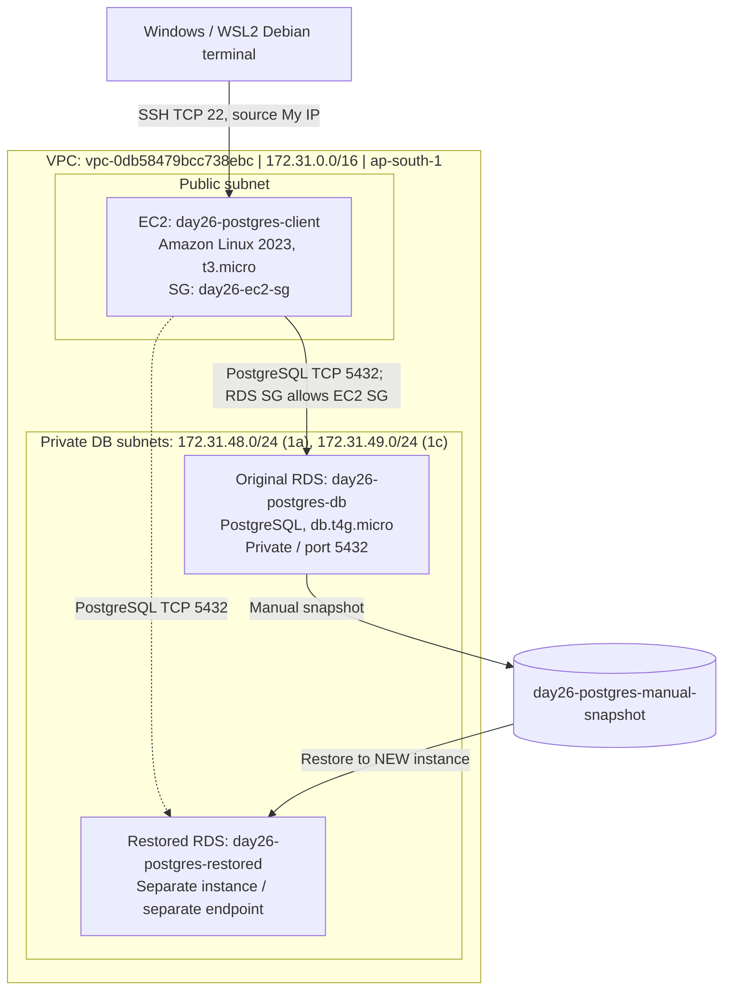
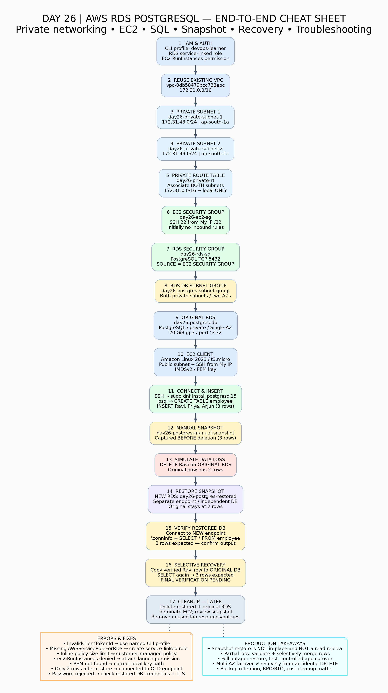

# Day 26 — AWS RDS PostgreSQL: Private Networking, EC2 Connectivity, Backup & Recovery

> **DevOps Winter Arc | Hands-on AWS lab | Region: `ap-south-1` (Mumbai)**
>
> **Status:** RDS and EC2 provisioned; SQL CRUD and manual snapshot performed; snapshot restored to a separate DB. **Final selective recovery into the original DB and resource cleanup require verification.**

## 1. What I learned

- Why databases should normally remain in **private subnets** and how an EC2 client reaches them over a VPC.
- How **VPC routing**, **security-group references**, and **RDS DB subnet groups** fit together.
- How to troubleshoot AWS **IAM authorization** errors, inline policy limits, and missing RDS service-linked roles.
- How to launch an Amazon Linux EC2 instance, connect via SSH, install `psql`, and authenticate to RDS.
- How to create a PostgreSQL table, insert records, and verify them.
- How a **manual RDS snapshot** restores into a **new DB instance**, not automatically into the original.
- Why **selective record recovery** differs from full-instance disaster recovery.
- Why **cleanup** matters for cost control.

## 2. Architecture



**Important:** This is a *single-AZ learning lab*, **not** a production high-availability architecture. A snapshot restore is not an automatically synchronized read replica. The private route table has only the VPC-local route, not an internet-gateway or NAT default route.

## 3. Resource inventory

| Resource | Name / configuration | Purpose |
|---|---|---|
| Region | `ap-south-1` | Mumbai |
| VPC | `vpc-0db58479bcc738ebc`, `172.31.0.0/16` | Network boundary |
| Private subnet 1 | `day26-private-subnet-1`, `172.31.48.0/24`, `ap-south-1a` | RDS subnet-group AZ 1 |
| Private subnet 2 | `day26-private-subnet-2`, `172.31.49.0/24`, `ap-south-1c` | RDS subnet-group AZ 2 |
| Private route table | `day26-private-rt` | Local VPC routing; both private subnets associated |
| EC2 security group | `day26-ec2-sg` | SSH TCP 22 from **My IP**; default outbound |
| RDS security group | `day26-rds-sg` | TCP 5432 **from `day26-ec2-sg`**, not public internet |
| DB subnet group | `day26-postgres-subnet-group` | Two private subnets in different AZs |
| Original RDS | `day26-postgres-db` | PostgreSQL; `db.t4g.micro`; Single-AZ; 20 GiB gp3; private |
| Restored RDS | `day26-postgres-restored` | Snapshot recovery verification |
| Manual snapshot | `day26-postgres-manual-snapshot` | Backup before simulated deletion |
| EC2 | `day26-postgres-client` | Amazon Linux 2023; `t3.micro`; 8 GiB gp3 |
| SSH key | `day26-ec2-key.pem` | **Never commit private key** |
| RDS service-linked role | `AWSServiceRoleForRDS` | Allows RDS to manage supporting AWS resources |

Do not store passwords, private SSH keys, account secrets, or unredacted credentials in this repository. Endpoint names and IP addresses in the examples below are lab-specific; update them if resources change.

## 4. Step-by-step lab

### Phase A — IAM and region

1. Use the `devops-learner` IAM user and the AWS CLI profile `devops-learner`.
2. Confirm CLI identity and region before making changes:

```bash
aws sts get-caller-identity --profile devops-learner
aws configure get region --profile devops-learner
```

3. Existing IAM permissions did **not** include all actions needed for the lab. Created lab-specific IAM policies for subnet, security group, DB subnet group, RDS, and EC2 operations as errors were identified. **Prefer customer-managed policies over growing user inline policies**, and limit permissions by resource/region where possible.
4. Encountered the IAM **2,048 non-whitespace character aggregate inline-user-policy limit**. Created and attached a customer-managed policy `Day26-RDS-Complete-Lab` instead.
5. RDS creation then failed because `AWSServiceRoleForRDS` did not exist. Created the **AWS-managed RDS service-linked role**, not a custom general-purpose role.
6. Root CloudShell displayed **“Your account verification is still in progress”**. Used the IAM Console instead.

Check the role:

```bash
aws iam get-role \
  --role-name AWSServiceRoleForRDS \
  --profile devops-learner \
  --query 'Role.{Name:RoleName,Arn:Arn}'
```

**Authentication pitfall:** Running `aws iam get-role` without `--profile devops-learner` produced `InvalidClientTokenId` because the default credentials were invalid. `aws sts get-caller-identity --profile devops-learner` worked. Signing in as root in a browser does **not** change the credentials in a local CLI session.

### Phase B — Create the private network, route table, security groups, and DB subnet group (detailed)

> **This was a substantial part of the Day 26 lab, not a prerequisite to skip.** We reused an existing VPC and public subnets, but created two **new private subnets**, their route table, **two security groups**, and the **RDS DB subnet group**. The resource names/CIDRs below are the actual lab values. Exact AWS-generated subnet/SG IDs were not captured in the chat, so the commands below discover them rather than inventing IDs.

#### B1. Choose the existing VPC

AWS Console → **VPC → Your VPCs** → select `vpc-0db58479bcc738ebc` (`172.31.0.0/16`, Mumbai). We did **not** create another VPC.

```bash
aws ec2 describe-vpcs --vpc-ids vpc-0db58479bcc738ebc \
  --region ap-south-1 --profile devops-learner \
  --query 'Vpcs[].{VpcId:VpcId,CIDR:CidrBlock}' --output table
```

**Why:** Both EC2 and RDS must have a network path. A shared VPC provides private routing between their subnets without making RDS public.

#### B2. Create private subnet 1

Console → **VPC → Subnets → Create subnet** → VPC above → name `day26-private-subnet-1` → AZ `ap-south-1a` → IPv4 CIDR `172.31.48.0/24` → Create.

**Equivalent AWS CLI (reference command; the actual lab used console steps as well):**

```bash
aws ec2 create-subnet --vpc-id vpc-0db58479bcc738ebc \
  --availability-zone ap-south-1a --cidr-block 172.31.48.0/24 \
  --tag-specifications 'ResourceType=subnet,Tags=[{Key=Name,Value=day26-private-subnet-1}]' \
  --region ap-south-1 --profile devops-learner
```

#### B3. Create private subnet 2

Console → **VPC → Subnets → Create subnet** → same VPC → name `day26-private-subnet-2` → AZ `ap-south-1c` → CIDR `172.31.49.0/24`.

```bash
aws ec2 create-subnet --vpc-id vpc-0db58479bcc738ebc \
  --availability-zone ap-south-1c --cidr-block 172.31.49.0/24 \
  --tag-specifications 'ResourceType=subnet,Tags=[{Key=Name,Value=day26-private-subnet-2}]' \
  --region ap-south-1 --profile devops-learner
```

**Why two AZs?** An RDS DB subnet group generally needs subnets in at least two Availability Zones. **This does not mean our Single-AZ database is running simultaneously in both AZs.** The subnets give RDS placement options.

**Important:** A subnet is not private *merely because it is named private*. Its route-table configuration and public-IP choices determine internet exposure. We did not add a default route from these DB subnets to an Internet Gateway or NAT Gateway.

#### B4. Create a dedicated private route table and associate both subnets

Console → **VPC → Route tables → Create route table** → name `day26-private-rt` → select existing VPC → Create.

Then select the route table → **Subnet associations → Edit subnet associations** → select **both** `day26-private-subnet-1` and `day26-private-subnet-2` → Save.

Under **Routes**, verify the only route for this lab's private route table is:

| Destination | Target | Meaning |
|---|---|---|
| `172.31.0.0/16` | `local` | Traffic can travel within the VPC |

There must be **no** `0.0.0.0/0 → igw-...` or `0.0.0.0/0 → nat-...` route in this private route table for our lab design.

**Equivalent CLI workflow** (replace IDs returned by your account):

```bash
aws ec2 create-route-table --vpc-id vpc-0db58479bcc738ebc \
  --tag-specifications 'ResourceType=route-table,Tags=[{Key=Name,Value=day26-private-rt}]' \
  --region ap-south-1 --profile devops-learner

# Record the returned RouteTableId and both SubnetIds, then:
aws ec2 associate-route-table --route-table-id YOUR_PRIVATE_ROUTE_TABLE_ID \
  --subnet-id YOUR_PRIVATE_SUBNET_1_ID --region ap-south-1 --profile devops-learner
aws ec2 associate-route-table --route-table-id YOUR_PRIVATE_ROUTE_TABLE_ID \
  --subnet-id YOUR_PRIVATE_SUBNET_2_ID --region ap-south-1 --profile devops-learner
```

**Verification:**

```bash
aws ec2 describe-route-tables --filters \
  'Name=tag:Name,Values=day26-private-rt' \
  --region ap-south-1 --profile devops-learner \
  --query 'RouteTables[].{Routes:Routes,Associations:Associations}'
```

**Why:** The private RDS subnets should support communication inside the VPC but should not have direct public-internet routing.

#### B5. Create the EC2 security group

Console → **EC2 → Security Groups → Create security group**:

- **Name:** `day26-ec2-sg`
- **Description:** Day 26 PostgreSQL client EC2
- **VPC:** `vpc-0db58479bcc738ebc`
- **Inbound:** initially **none**
- **Outbound:** default allow outbound

Later, before SSH, we edited this existing SG under **Inbound rules → Edit inbound rules** and added **SSH / TCP 22 / My IP (`/32`)**. We did **not** allow SSH from `0.0.0.0/0`.

**CLI reference:**

```bash
aws ec2 create-security-group --group-name day26-ec2-sg \
  --description 'Day26 PostgreSQL client EC2' \
  --vpc-id vpc-0db58479bcc738ebc \
  --region ap-south-1 --profile devops-learner

# Once created, add SSH from YOUR_CURRENT_PUBLIC_IP/32 only:
aws ec2 authorize-security-group-ingress --group-id YOUR_EC2_SG_ID \
  --protocol tcp --port 22 --cidr YOUR_CURRENT_PUBLIC_IP/32 \
  --region ap-south-1 --profile devops-learner
```

**Why:** EC2 needs tightly restricted administrative access; it does **not** need PostgreSQL port 5432 opened inbound to itself.

#### B6. Create the RDS security group and its crucial SG-to-SG rule

Console → **EC2 → Security Groups → Create security group**:

- **Name:** `day26-rds-sg`
- **Description:** Day 26 private PostgreSQL RDS
- **VPC:** same VPC
- **Inbound rule:** **PostgreSQL / TCP 5432 / Source = `day26-ec2-sg`** (choose the **security group** as the source, not an IP range)
- **Outbound:** default outbound

**CLI reference:**

```bash
aws ec2 create-security-group --group-name day26-rds-sg \
  --description 'Day26 private PostgreSQL RDS' \
  --vpc-id vpc-0db58479bcc738ebc \
  --region ap-south-1 --profile devops-learner

aws ec2 authorize-security-group-ingress --group-id YOUR_RDS_SG_ID \
  --protocol tcp --port 5432 --source-group YOUR_EC2_SG_ID \
  --region ap-south-1 --profile devops-learner
```

**Why SG-to-SG?** The database accepts PostgreSQL traffic from network interfaces belonging to the EC2 SG, even if the EC2 private IP changes. It **does not** expose port 5432 to the internet.

**Verification:**

```bash
aws ec2 describe-security-groups --filters \
  'Name=group-name,Values=day26-ec2-sg,day26-rds-sg' \
  --region ap-south-1 --profile devops-learner \
  --query 'SecurityGroups[].{Name:GroupName,Id:GroupId,Inbound:IpPermissions}'
```

#### B7. Create the RDS DB subnet group

Console → **RDS → Subnet groups → Create DB subnet group**:

1. **Name:** `day26-postgres-subnet-group`
2. **Description:** Private subnet group for Day 26 PostgreSQL
3. **VPC:** `vpc-0db58479bcc738ebc`
4. Select AZs **`ap-south-1a`** and **`ap-south-1c`**.
5. Select **only** `day26-private-subnet-1` and `day26-private-subnet-2`.
6. Click **Create**.

**CLI reference:**

```bash
aws rds create-db-subnet-group \
  --db-subnet-group-name day26-postgres-subnet-group \
  --db-subnet-group-description 'Day26 private PostgreSQL subnets' \
  --subnet-ids YOUR_PRIVATE_SUBNET_1_ID YOUR_PRIVATE_SUBNET_2_ID \
  --region ap-south-1 --profile devops-learner

aws rds describe-db-subnet-groups \
  --db-subnet-group-name day26-postgres-subnet-group \
  --region ap-south-1 --profile devops-learner
```

**Why:** RDS needs to know which subnets it is allowed to use when placing the database's network interfaces. A DB subnet group is **not** a security group: it controls *subnet placement*, while `day26-rds-sg` controls *network traffic*.

#### B8. IAM errors encountered during networking setup

We encountered permission gaps while creating networking resources with `devops-learner`. Instead of using the root account for day-to-day infrastructure operations, we added lab-specific permissions to the IAM user:

| Resource/action | Permission family | Lab policy / lesson |
|---|---|---|
| Create and tag private subnets | `ec2:CreateSubnet`, `ec2:CreateTags` | `Day26-Subnet-Lab` |
| Create route table and associate subnets | `ec2:CreateRouteTable`, `ec2:AssociateRouteTable` | `Day26-Subnet-Lab` |
| Create SGs and add ingress rules | `ec2:CreateSecurityGroup`, `ec2:AuthorizeSecurityGroupIngress` | `Day26-SecurityGroup-Lab` (used/planned during setup) |
| Create RDS DB subnet group | `rds:CreateDBSubnetGroup` | `Day26-RDS-SubnetGroup-Lab` (used/planned during setup) |
| Create RDS instance | `rds:CreateDBInstance` | Customer-managed `Day26-RDS-Complete-Lab` |

The exact AWS denial text for each *individual* subnet/SG action was not preserved in this conversation, so it would be inaccurate to invent a sequence of error messages. The confirmed issues include **missing permissions**, the **IAM inline-policy size limit**, and the **missing RDS service-linked role** (documented in Phase A and the troubleshooting table).

**Networking checkpoint before RDS creation:** two private subnets in different AZs; both associated with the private route table; EC2 and RDS SGs created; RDS ingress **5432 from EC2 SG**; DB subnet group includes both private subnets. Only after this did we proceed to create `day26-postgres-db`.

### Phase C — Create PostgreSQL RDS

AWS Console → **RDS → Databases → Create database**:

| Setting | Lab value |
|---|---|
| Creation | Full configuration |
| Engine | PostgreSQL |
| Template | Free tier option shown in console (eligibility and billing depend on account) |
| Identifier | `day26-postgres-db` |
| Master username | `postgres` |
| Password | Self-managed; **do not commit** |
| DB class | `db.t4g.micro` |
| Availability | Single-AZ |
| Storage | 20 GiB gp3; storage autoscaling off |
| VPC | Existing lab VPC |
| DB subnet group | `day26-postgres-subnet-group` |
| Public access | **No** |
| Security group | `day26-rds-sg` |
| Port | 5432 |
| Automated backup | Enabled; 1-day retention |
| Enhanced monitoring | Off |
| Deletion protection | Off for disposable lab |

RDS took time to reach **Available**; provisioning is asynchronous. The service-linked role issue was resolved before the successful creation.

Check status from Debian:

```bash
aws rds describe-db-instances \
  --db-instance-identifier day26-postgres-db \
  --region ap-south-1 \
  --profile devops-learner \
  --query 'DBInstances[0].{Status:DBInstanceStatus,Endpoint:Endpoint.Address,Port:Endpoint.Port,Public:PubliclyAccessible,Class:DBInstanceClass}' \
  --output table
```

### Phase D — Create EC2 and connect by SSH

1. EC2 → **Launch instance** → name `day26-postgres-client`.
2. AMI: **Amazon Linux 2023**; type **`t3.micro`**; 8 GiB **gp3** root volume.
3. Created `day26-ec2-key` (RSA, `.pem`). AWS downloaded the private key. **Keep it locally and private.**
4. Selected the existing VPC, **an existing public subnet**, **auto-assign public IPv4 enabled**, and existing `day26-ec2-sg`.
5. Because an **existing SG** was selected, edited its inbound rule separately via EC2 → Security Groups: **SSH TCP 22 from My IP (`/32`)**. A public subnet also needs an internet-gateway route for direct internet SSH.
6. Selected **IMDSv2 only (token required)** under Advanced details. IMDSv2 improves metadata-service security.
7. EC2 launch initially failed: `ec2:RunInstances` was not allowed. Added/attached a customer-managed `Day26-EC2-Launch-Lab` policy permitting necessary EC2 launch/read/tag actions. Retry succeeded.
8. Waited for **2/2 EC2 status checks passed**.

**SSH issue and fix:**

```text
Warning: Identity file /home/manu/day26-ec2-key.pem not accessible
Permission denied (publickey,...)
```

The key was not in `~/` as the first SSH command assumed. Locate it and use its **actual path**. In this lab, the working SSH command was executed from the directory containing the PEM:

```bash
# Example from WSL2 Debian; adjust for your actual location
find /mnt/c/Users -name 'day26-ec2-key.pem' 2>/dev/null
chmod 400 day26-ec2-key.pem
ssh -i day26-ec2-key.pem ec2-user@YOUR_EC2_PUBLIC_IP
```

Successful prompt:

```text
[ec2-user@ip-172-31-0-235 ~]$
```

**Do not add `.pem` files to Git:** see `.gitignore` below.

### Phase E — PostgreSQL client and private RDS connection

On **EC2**:

```bash
sudo dnf install -y postgresql15
psql --version
# Observed: psql (PostgreSQL) 15.19

psql "host=day26-postgres-db.c1o4oeako332.ap-south-1.rds.amazonaws.com port=5432 dbname=postgres user=postgres sslmode=require"
```

- `psql` = PostgreSQL client (not a second database server).
- `host` = private RDS DNS endpoint.
- `port=5432` = PostgreSQL port.
- `user=postgres` = master database user.
- `sslmode=require` = request encrypted transport; for production-grade server identity verification use `verify-full` with the correct RDS CA bundle.
- Password is entered interactively; never paste it into documentation.

The connection succeeded from EC2 to the **original private RDS**.

### Phase F — SQL practice

At the `postgres=>` prompt:

```sql
CREATE TABLE employee (
    emp_id SERIAL PRIMARY KEY,
    emp_name VARCHAR(50),
    department VARCHAR(50),
    salary INTEGER
);

\dt

INSERT INTO employee (emp_name, department, salary)
VALUES
('Ravi', 'DevOps', 75000),
('Priya', 'Platform Engineering', 90000),
('Arjun', 'Cloud Engineering', 85000);

SELECT * FROM employee ORDER BY emp_id;
```

**Observed result before snapshot:**

| emp_id | emp_name | department | salary |
|---:|---|---|---:|
| 1 | Ravi | DevOps | 75000 |
| 2 | Priya | Platform Engineering | 90000 |
| 3 | Arjun | Cloud Engineering | 85000 |

### Phase G — Manual snapshot and simulated incident

1. AWS Console → **RDS → Databases** → select `day26-postgres-db` → **Actions → Take snapshot**.
2. Snapshot ID: `day26-postgres-manual-snapshot`.
3. Waited for snapshot **Available** before deleting any data.
4. Simulated accidental deletion on the **original DB**:

```sql
DELETE FROM employee WHERE emp_name = 'Ravi';
SELECT * FROM employee ORDER BY emp_id;
```

The original DB then contained **Priya and Arjun** (two rows). The earlier snapshot should preserve Ravi.

### Phase H — Restore snapshot to a NEW DB instance

1. AWS Console → **RDS → Snapshots → Manual**.
2. Selected `day26-postgres-manual-snapshot` → **Actions → Restore snapshot**.
3. New identifier: `day26-postgres-restored`.
4. Used private subnet group, existing RDS security group, Single-AZ, appropriate small instance class, public access **No**.
5. Waited for restored DB status **Available**.
6. Important: AWS **did not change the original DB**. It created a **separate instance and endpoint**:

```text
Original: day26-postgres-db.c1o4oeako332.ap-south-1.rds.amazonaws.com
Restored: day26-postgres-restored.c1o4oeako332.ap-south-1.rds.amazonaws.com
```

**Troubleshooting #1 — Still seeing only two records after restore:**

```sql
\conninfo
```

The command revealed that the SQL session was still connected to **the original endpoint**. A restore does not redirect existing sessions. Exit using `\q` and connect explicitly to the restored endpoint.

**Troubleshooting #2 — Restored endpoint authentication:**

```text
FATAL: password authentication failed for user "postgres"
FATAL: no pg_hba.conf entry ... no encryption
```

The connection reached the restored DB, so this was **not** a security-group/VPC reachability failure. The first message indicates a password/authentication problem. The second can result from a non-SSL fallback attempt being rejected. The lab plan was to modify **only the restored instance's** master password in the RDS Console, wait for the modification, and connect using `sslmode=require`.

```bash
psql "host=day26-postgres-restored.c1o4oeako332.ap-south-1.rds.amazonaws.com port=5432 dbname=postgres user=postgres sslmode=require"
```

Then verify:

```sql
\conninfo
SELECT * FROM employee ORDER BY emp_id;
```

**Verification note:** The user reported completing the restored DB task, but the final `SELECT` output from the restored endpoint was **not shared** in the conversation. Confirm the three rows before treating recovery as verified.

### Phase I — Selective recovery into original DB (final verification pending)

**Production principle:** If only one record was lost and the original database has received new transactions, restoring the *entire* snapshot over production could discard newer data. Instead, restore to a temporary DB, validate the missing row, and merge it carefully into the original.

For this controlled lab, the original Ravi values are already known from the pre-deletion `SELECT` result. On the **original** database only:

```sql
\conninfo
SELECT * FROM employee WHERE emp_id = 1;

-- Execute only if emp_id=1 is absent and values are verified:
INSERT INTO employee (emp_id, emp_name, department, salary)
VALUES (1, 'Ravi', 'DevOps', 75000);

SELECT * FROM employee ORDER BY emp_id;
```

**Expected:** 3 rows again. Explicit `emp_id=1` preserves the original ID; since the sequence had already advanced to 3, no sequence adjustment is needed in this specific example. In a real production incident, extract records from the restored database, compare schemas/keys/foreign keys, validate consistency and approvals, use a transaction, and avoid overwriting legitimate later changes. PostgreSQL does **not** automatically copy rows between two independent RDS instances.

**Do not claim selective recovery is complete until the final original-DB `SELECT` is confirmed.**

## 5. Error → root cause → fix cheat sheet

| Symptom | Root cause / diagnosis | Fix / learning |
|---|---|---|
| `AccessDenied` on RDS create | `rds:CreateDBInstance` not allowed | Attach scoped customer-managed RDS policy |
| IAM inline policy size exceeded | Aggregate 2,048-character user inline-policy limit | Create customer-managed policy instead |
| RDS create: service-linked role permission | `AWSServiceRoleForRDS` missing | Create correct AWS RDS service-linked role using authorized account |
| CloudShell: account verification in progress | CloudShell access restricted | Used IAM Console; CloudShell is not required |
| `InvalidClientTokenId` | Wrong/default CLI credentials | Add `--profile devops-learner`, check `sts get-caller-identity` |
| `NoSuchEntity` for RDS role | Role did not exist | Create and verify `AWSServiceRoleForRDS` |
| `ec2:RunInstances` unauthorized | IAM policy missing EC2 launch permission | Attach managed EC2 launch policy |
| No SSH rule in EC2 launch UI | Existing SG chosen | Edit existing SG inbound rules separately |
| SSH key file not accessible | Wrong PEM path | Find file, use correct `-i` path, restrict permissions |
| EC2 status checks initializing | Instance boot and health checks in progress | Wait for 2/2 checks |
| Restored DB still appears to have 2 rows | SQL session connected to **original** endpoint | `\conninfo`; reconnect to restored endpoint |
| Restored DB password rejected | Credential mismatch; separate SSL fallback error | Correct restored DB credentials and use TLS |
| Original DB unchanged after restore | Snapshot restore makes a **new instance** | Selective data copy or planned application cutover |

## 6. Production troubleshooting scenarios

### Scenario 1 — Accidental deletion of customer rows

1. Record incident time and identify affected tables/rows.
2. Prevent further damage and coordinate application write behavior.
3. Select a snapshot or **point-in-time recovery** target that predates deletion.
4. Restore to a **separate** instance in a controlled network.
5. Validate recovered rows and any dependencies.
6. Export/merge only approved missing data into production with transaction safeguards.
7. Reconcile row counts and application behavior; retain audit trail.
8. Remove temporary recovery resources only after sign-off.

### Scenario 2 — Full DB failure

1. Assess whether **Multi-AZ failover** can recover service without snapshot restoration.
2. If restore is required, select the latest valid backup/PITR target based on RPO/RTO.
3. Restore to a new DB, verify consistency, performance, networking, secrets, and application connectivity.
4. Coordinate writes and cut over application endpoint/configuration.
5. Monitor service and retire the old DB after approval.

### Scenario 3 — EC2 cannot reach private RDS

Check: same VPC or connected network; subnet routes; RDS status; SG inbound **5432 from EC2 SG**; outbound rules; DNS resolution; correct endpoint/port; PostgreSQL authentication and TLS. Distinguish **timeout** (network) from **password authentication failed** (reached DB).

## 7. Interview questions (with concise answers)

1. **Why keep RDS private?** Reduce exposure; allow only application/client networks.
2. **Why two DB subnets?** RDS subnet groups normally span at least two AZs for placement and recovery options.
3. **Does a snapshot restore update the original DB?** No. RDS creates a new DB instance.
4. **Snapshot vs read replica?** Snapshot = point-in-time backup state; replica = ongoing replication of changes.
5. **Snapshot restore vs point-in-time recovery?** Snapshot returns to its capture state; PITR can restore to a supported selected time using automated backups/logs.
6. **What is a service-linked role?** An IAM role predefined for a specific AWS service, such as RDS.
7. **Why SG-to-SG referencing?** Permits traffic from members of a source SG without hardcoding changing instance IPs.
8. **What is IMDSv2?** EC2 metadata service requiring a session token.
9. **Why did SSH fail despite EC2 being reachable?** The local private key file path was wrong.
10. **Why did restored RDS reject login?** Credential mismatch; separate non-TLS attempt was also rejected.
11. **Can we recover one deleted row without replacing production?** Yes, validate and merge it from a restored temporary database.
12. **What is RPO vs RTO?** Recovery Point Objective = tolerable data loss; Recovery Time Objective = tolerable outage duration.
13. **Why doesn't Multi-AZ protect against accidental `DELETE`?** Replication can propagate logical changes; backups/PITR are needed for historical recovery.
14. **Does stopping EC2 stop all charges?** No; EBS and other resources can continue billing.
15. **What is the risk of a public RDS instance?** Increased attack surface; public access should be avoided unless strictly necessary and secured.

## 8. Cleanup checklist — do this AFTER review and verification

> **Not yet performed.** The plan was to review the lab and GitHub documentation before deletion. Deleting DB instances is destructive. Ensure all desired SQL verification and screenshots are captured first.

- [ ] Confirm original RDS contains Ravi, Priya, Arjun after selective recovery.
- [ ] Confirm restored DB endpoint was tested and three rows verified.
- [ ] Capture any screenshots/terminal evidence for the README/LinkedIn post.
- [ ] Delete **restored** RDS instance `day26-postgres-restored` (final snapshot only if needed).
- [ ] Delete **original** RDS instance `day26-postgres-db` after explicit confirmation that no data is needed (final snapshot per retention needs).
- [ ] Delete manual snapshot `day26-postgres-manual-snapshot` if no longer needed; retained snapshots can cost money.
- [ ] Terminate EC2 `day26-postgres-client` (check EBS volumes and elastic IPs if any).
- [ ] Delete lab SGs **after** instances are gone and references released.
- [ ] Delete DB subnet group, private subnet associations/route table, and lab private subnets if no longer needed.
- [ ] Delete temporary EC2 key pair in AWS if no longer needed; securely manage local PEM.
- [ ] Review and remove temporary lab IAM policies if unused; preserve service-linked role if other RDS resources depend on it.
- [ ] Check AWS Billing / Cost Explorer for residual resources. Credits/free-tier labeling does not guarantee zero charges.

## 9. Git commands

From the repository root, place this README in `AWS/Day26/README.md` (or your preferred Day 26 folder). Place the cheat-sheet image beside it and add a reference:

```markdown

```

Then:

```bash
git status
git add AWS/Day26/README.md AWS/Day26/Day26_RDS_Cheat_Sheet.png
git commit -m "docs: Day 26 AWS RDS PostgreSQL lab and recovery"
git push
```

Adjust paths if your repository folder name differs. Check `git status` and ensure no `.pem`, credentials, or passwords are staged.

## 10. Key takeaway

> **An RDS snapshot restore creates a new database instance.** For selective data loss, recover validated records from the restored instance into the original database; for broader disaster recovery, validate the new instance and coordinate a controlled application cutover. Always verify the active endpoint with `\conninfo` before changing data.

## 11. Visual one-page cheat sheet


A scalable SVG version is also included: [`Day26_RDS_Cheat_Sheet.svg`](Day26_RDS_Cheat_Sheet.svg).
