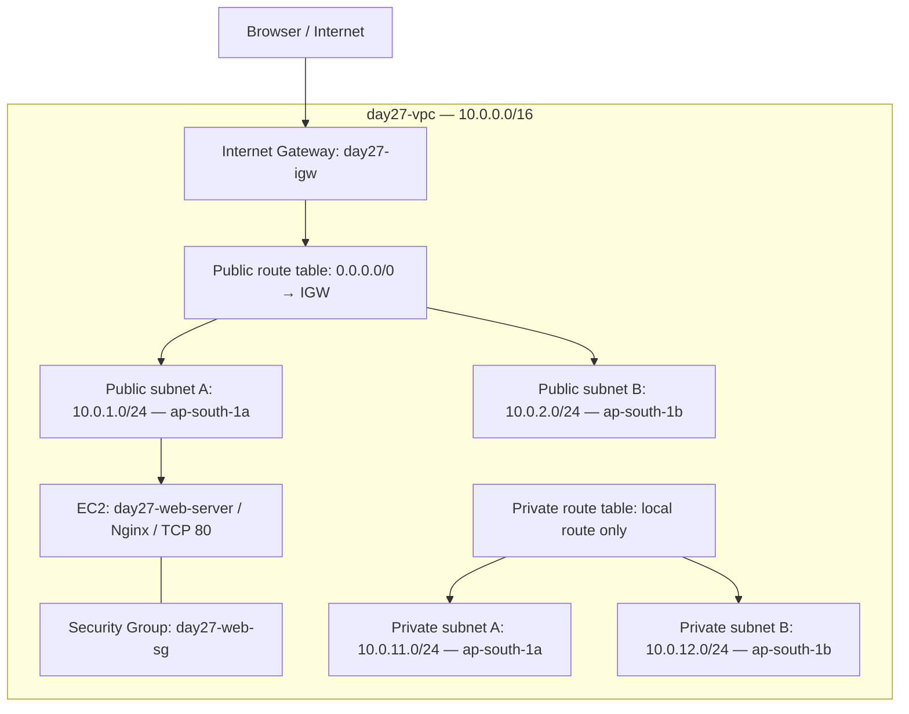

# Day 27 — AWS VPC Networking | DevOps Winter Arc ☁️

## 🎯 Objective
Build a custom AWS VPC with public and private subnets across two Availability Zones, configure routing, deploy an Nginx EC2 test server, and troubleshoot access using Security Groups (SGs) and Network Access Control Lists (NACLs).

**Region:** `ap-south-1` (Mumbai)  
**AWS CLI profile:** `devops-learner`  
**Lab VPC:** `day27-vpc` (`vpc-0bf3eae02ca490b86`)  
**VPC CIDR:** `10.0.0.0/16`

> **Lab status:** EC2 and networking were successfully tested. The final restoration of the default NACL association and cleanup of the running EC2 have **not yet been confirmed**. Check the verification and cleanup sections before leaving the lab.

## 🧠 Concepts in plain language

| AWS component | Simple analogy | Purpose |
|---|---|---|
| VPC | Your own gated campus | Isolated virtual network |
| Subnet | A building within the campus | Divides the VPC address space |
| Public subnet | Building with a road to the outside | Route table has an Internet Gateway route |
| Private subnet | Building without a direct road to the outside | No direct Internet Gateway route |
| Internet Gateway (IGW) | Main road to the Internet | Connects public VPC resources to the Internet |
| Route table | Road signs | Decides where packets travel |
| Security Group | Guest list at a room | Stateful allow-only filtering on network interfaces |
| Network ACL | Rules at the building gate | Stateless subnet-level allow/deny filtering |
| Availability Zone | Separate campus location | Helps design for fault isolation |

**Important:** A public subnet's IGW route does not by itself make every instance Internet-reachable. The instance also needs a suitable public IP, appropriate SG/NACL rules, and a listening application.

## 🗺️ Architecture



The private subnets have **no NAT Gateway** in this lab to avoid NAT Gateway charges. The custom NACL test was associated with the EC2 subnet only during troubleshooting.

## 📋 Resource inventory

| Resource | Name / ID | Configuration |
|---|---|---|
| VPC | `day27-vpc` / `vpc-0bf3eae02ca490b86` | `10.0.0.0/16` |
| Public subnet A | `day27-public-a` / `subnet-0839595024552e3a4` | `10.0.1.0/24`, AZ `ap-south-1a` |
| Public subnet B | `day27-public-b` / `subnet-07d92ce0b1a1c3110` | `10.0.2.0/24`, AZ `ap-south-1b` |
| Private subnet A | `day27-private-a` | `10.0.11.0/24`, AZ `ap-south-1a` |
| Private subnet B | `day27-private-b` | `10.0.12.0/24`, AZ `ap-south-1b` |
| Internet Gateway | `day27-igw` / `igw-05557a36b09527350` | Attached to VPC |
| Public route table | `day27-public-rt` | Local + `0.0.0.0/0 → IGW` |
| Private route table | `day27-private-rt` | Local only |
| Default SG | `sg-0b67c4fb4afd431bd` | Inbound from same SG; outbound allow |
| Web SG | `day27-web-sg` / `sg-05702aa1171a57aff` | Inbound TCP 80 from test client `/32`; outbound allow |
| Default NACL | `acl-0e60cf308d82b2c20` | Rule 100 allow all in/out; implicit deny |
| Test NACL | `day27-web-nacl` / `acl-03465f1835d3e2098` | Inbound rule 100 deny TCP 80; rule 200 allow all; outbound rule 100 allow all |
| Test EC2 | `day27-web-server` / `i-0b791d33df3b4a6b8` | Amazon Linux 2023, `t3.micro`, Nginx |
| Test public IP | `65.0.72.78` | Ephemeral; may change after stop/start |

> The exact private subnet IDs were not established in the verified session. Retrieve them with the CLI instead of guessing.

## 🛠️ Hands-on steps performed

### 1. Create the VPC

Created `day27-vpc` with CIDR `10.0.0.0/16`. AWS also created a default SG, default NACL, and main route table automatically.

```bash
aws ec2 describe-vpcs \
  --filters Name=tag:Name,Values=day27-vpc \
  --region ap-south-1 --profile devops-learner \
  --query 'Vpcs[].{VpcId:VpcId,Cidr:CidrBlock}' --output table
```

### 2. Create four subnets across two AZs

- Public A: `10.0.1.0/24` (`ap-south-1a`)
- Public B: `10.0.2.0/24` (`ap-south-1b`)
- Private A: `10.0.11.0/24` (`ap-south-1a`)
- Private B: `10.0.12.0/24` (`ap-south-1b`)

```bash
aws ec2 describe-subnets \
  --filters Name=vpc-id,Values=vpc-0bf3eae02ca490b86 \
  --region ap-south-1 --profile devops-learner \
  --query 'Subnets[].{SubnetId:SubnetId,AZ:AvailabilityZone,CIDR:CidrBlock,Name:Tags[?Key==`Name`]|[0].Value}' \
  --output table
```

### 3. Attach an Internet Gateway

Created `day27-igw` and attached it to `day27-vpc`.

```bash
aws ec2 describe-internet-gateways \
  --internet-gateway-ids igw-05557a36b09527350 \
  --region ap-south-1 --profile devops-learner
```

### 4. Configure public and private routing

- Public route table: `10.0.0.0/16 → local`, `0.0.0.0/0 → igw-05557a36b09527350`; associated with both public subnets.
- Private route table: `10.0.0.0/16 → local` only; associated with both private subnets.

```bash
aws ec2 describe-route-tables \
  --filters Name=vpc-id,Values=vpc-0bf3eae02ca490b86 \
  --region ap-south-1 --profile devops-learner \
  --query 'RouteTables[].{Id:RouteTableId,Routes:Routes,Associations:Associations[*].SubnetId}' \
  --output json
```

### 5. Inspect the default Security Group and NACL

The default SG allows inbound traffic from resources using that same SG, and outbound IPv4 traffic. The default NACL allows all IPv4 traffic with rule 100 in both directions, followed by implicit deny.

### 6. Create and test a custom web Security Group

Created `day27-web-sg` (`sg-05702aa1171a57aff`) in the custom VPC. Allowed inbound TCP port 80 from the then-current public IP `223.185.49.8/32` and outbound IPv4 traffic. Practiced adding an inbound TCP 8080 rule and removing it again.

> Do not reuse the old `/32` blindly: your public IP can change. For a new test, update the rule to your current public IP.

```bash
aws ec2 describe-security-groups \
  --group-ids sg-05702aa1171a57aff \
  --region ap-south-1 --profile devops-learner \
  --query 'SecurityGroups[].{Name:GroupName,Inbound:IpPermissions,Outbound:IpPermissionsEgress}' \
  --output json
```

### 7. Deploy Nginx on an EC2 instance

Launched `day27-web-server` (Amazon Linux 2023, `t3.micro`) in public subnet A with public IPv4 and the custom SG. No SSH key pair was used; Nginx was configured using EC2 user data:

```bash
#!/bin/bash
dnf install -y nginx
systemctl enable --now nginx
echo '<h1>Day 27 - AWS VPC Networking</h1><p>My EC2 web server is working!</p>' > /usr/share/nginx/html/index.html
```

Verified in browser at `http://65.0.72.78`: the custom Nginx page loaded successfully.

```bash
aws ec2 describe-instances \
  --region ap-south-1 --profile devops-learner \
  --filters Name=tag:Name,Values=day27-web-server \
  --query 'Reservations[].Instances[].{Instance:InstanceId,State:State.Name,Subnet:SubnetId,PublicIP:PublicIpAddress,SecurityGroups:SecurityGroups[*].GroupId}' \
  --output json
```

### 8. Security Group troubleshooting experiment

1. Removed the inbound TCP 80 ALLOW rule from `day27-web-sg`.
2. Retested the webpage and received `ERR_CONNECTION_TIMED_OUT`.
3. Restored inbound TCP 80; the rule was restored successfully.

**Lesson:** SGs are *stateful*, support ALLOW rules only, and block inbound traffic when no matching ALLOW rule exists.

### 9. Network ACL troubleshooting experiment

Created `day27-web-nacl` with:

| Direction | Rule | Protocol / port | Action |
|---|---:|---|---|
| Inbound | 100 | TCP 80, from `0.0.0.0/0` | DENY |
| Inbound | 200 | All IPv4 traffic | ALLOW |
| Outbound | 100 | All IPv4 traffic | ALLOW |
| Both | 32767 | Any traffic not otherwise matched | DENY |

**First attempt:** The webpage still worked. CLI investigation showed the custom NACL was associated with `subnet-07d92ce0b1a1c3110`, while the EC2 instance was actually in `subnet-0839595024552e3a4`.

**Fix:** Re-associated the custom NACL with the EC2 subnet, `subnet-0839595024552e3a4`.

**Result:** Browser returned a timeout as expected.

**Root cause:** The deny rule was correct, but initially applied to the *wrong subnet*.

```bash
aws ec2 describe-network-acls \
  --region ap-south-1 --profile devops-learner \
  --filters Name=tag:Name,Values=day27-web-nacl \
  --query 'NetworkAcls[*].{NACL:NetworkAclId,Subnets:Associations[*].SubnetId,Rules:Entries[*].{Number:RuleNumber,Protocol:Protocol,From:PortRange.From,To:PortRange.To,Action:RuleAction,Egress:Egress,CIDR:CidrBlock}}' \
  --output json
```

### 10. Restore the normal subnet association — verify before declaring complete

In **VPC Console → Network ACLs**, select the **default NACL** (`acl-0e60cf308d82b2c20`), then **Subnet associations → Edit subnet associations**, and select the EC2 subnet (`subnet-0839595024552e3a4`). Save. Retest the Nginx page in a fresh browser session.

**Status:** This recovery step was recommended, but successful completion has not yet been confirmed.

### 11. Visualize the VPC in AWS Console

**VPC → Your VPCs → `day27-vpc` → Resource map**.

The built-in map visualizes subnet, route-table, and gateway relationships. It is **not** a full EC2/SG/NACL application topology diagram.

## 🔍 Key learning: Security Group vs NACL

| Feature | Security Group | Network ACL |
|---|---|---|
| Applies to | Network interface | Subnet |
| Rules | ALLOW only | ALLOW and DENY |
| State | Stateful | Stateless |
| Evaluation | Aggregate matching ALLOW rules | Lowest-numbered matching rule wins |
| Return traffic | Automatically allowed for an established tracked connection | Must be allowed by rules in the opposite direction |
| Default behavior | No matching inbound ALLOW → blocked | No matching rule → implicit deny |

**Analogy:** SG = guest list for a room. NACL = building gate with numbered ALLOW and DENY instructions. Traffic must satisfy **both**.

### Stateless return traffic example

A browser opens a TCP connection to server port 80 from a temporary client port (e.g., 52000):

```text
Browser:52000  --->  EC2:80        (incoming HTTP request)
Browser:52000  <---  EC2:80        (return traffic)
```

A subnet NACL must allow the request and its return traffic in their respective directions. For traffic originating from outside to an EC2 web server, outbound rules must permit the destination ephemeral port range used by clients. Our lab's outbound ALLOW-all rule permitted that return traffic; inbound DENY TCP 80 blocked the request during the experiment.

## 🧰 Troubleshooting checklist

When an EC2 web server times out:

1. **Instance state:** Is EC2 running and passing status checks?
2. **Web service:** Is Nginx running and listening on TCP 80?
3. **Public address:** Is the browser using the instance's current public IP?
4. **Routing:** Does the instance's subnet have `0.0.0.0/0 → IGW`?
5. **Security Group:** Does an inbound ALLOW match TCP 80 and your source IP?
6. **Network ACL:** Is the NACL associated with the **correct subnet**, and do its rules allow both request and response?
7. **OS firewall:** Is any host-level firewall blocking traffic?
8. **Fresh connection:** Retest using an incognito window or `curl`.

```bash
curl -v --connect-timeout 8 http://65.0.72.78
```

> **Access issue encountered:** SSM Session Manager was denied due to missing `ssm:StartSession` permission. This did not prevent the user-data-based Nginx test. An operational SSM session also requires suitable instance role, agent, and network connectivity.

## 💰 Cost safety and cleanup

**Important:** The last verified EC2 state was `running`. An EC2 instance, EBS volume, and public IPv4 can generate charges even if you are not using the webpage. AWS Free Tier eligibility or credits may offset some charges but do not guarantee zero cost.

**Recommended next action:** Confirm the experiment is finished, then terminate the disposable EC2 instance:

```bash
aws ec2 terminate-instances \
  --instance-ids i-0b791d33df3b4a6b8 \
  --region ap-south-1 --profile devops-learner

aws ec2 wait instance-terminated \
  --instance-ids i-0b791d33df3b4a6b8 \
  --region ap-south-1 --profile devops-learner
```

After termination, inspect **EC2 → Volumes**, **Elastic IPs**, and **Snapshots** for resources that may still incur charges. Do not delete shared or unrelated resources.

The VPC, subnets, route tables, IGW, SGs, and NACLs themselves generally have no hourly resource charge. A NAT Gateway was deliberately not created.

If you want to remove the entire lab, delete resources in dependency order: EC2/ENIs → custom NACL association restored → custom NACL and SG → route-table associations/custom route tables → IGW detach/delete → subnets → VPC. Verify the resource belongs to `day27-vpc` before deleting it.

## 🎤 Interview questions and answers

**Q1. What is a VPC?**  
An isolated virtual network in AWS where we define IP ranges, subnets, routes, and network security.

**Q2. What makes a subnet public?**  
Its associated route table includes a route to an Internet Gateway. Individual instances still need suitable addressing and security rules for Internet connectivity.

**Q3. Why create subnets across two Availability Zones?**  
To support designs that tolerate the failure of a single AZ; merely creating subnets in two AZs does not itself make an application highly available.

**Q4. Security Group vs NACL?**  
SGs are stateful, allow-only filters applied to network interfaces. NACLs are stateless, numbered allow/deny filters applied to subnets.

**Q5. Why did Nginx stay reachable after creating a DENY rule?**  
The NACL was associated with the wrong subnet. After associating it with the subnet hosting EC2, the website timed out.

**Q6. What happens when an SG allows port 80 but a NACL denies port 80?**  
The connection is blocked. Both layers must permit the traffic.

**Q7. Why do NACLs need return-path rules?**  
They are stateless: packets in each direction are checked independently.

**Q8. Why wasn't a NAT Gateway created?**  
The lab focused on subnet isolation and inbound public web access; NAT Gateway charges were unnecessary for these exercises.

**Q9. What would you check first if an EC2 website timed out?**  
Instance health, listening service, current public IP, subnet route table, SG, NACL association/rules, and host firewall.

**Q10. Does the VPC Resource Map show everything?**  
No. It helps visualize VPC network relationships, not the complete EC2 application topology.

## ✅ Learning outcomes

- [x] Created a custom VPC with CIDR `10.0.0.0/16`
- [x] Created four public/private subnets across two AZs
- [x] Attached an Internet Gateway
- [x] Configured public and private route tables
- [x] Inspected default SG and NACL behavior
- [x] Created a custom web Security Group and tested TCP 80/8080 rules
- [x] Launched an EC2 instance with Nginx via user data
- [x] Verified the HTTP webpage in a browser
- [x] Simulated an SG outage by removing inbound TCP 80
- [x] Simulated a NACL outage using explicit DENY TCP 80
- [x] Diagnosed and fixed a wrong NACL-to-subnet association
- [ ] Confirmed restoration of default NACL association
- [ ] Confirmed EC2 cleanup and absence of unexpected billable leftovers

---

**DevOps Winter Arc — Day 27:** The biggest lesson was not just creating VPC resources; it was proving how a *correct firewall rule on the wrong subnet* fails to affect the intended server, then verifying the root cause with AWS CLI.
