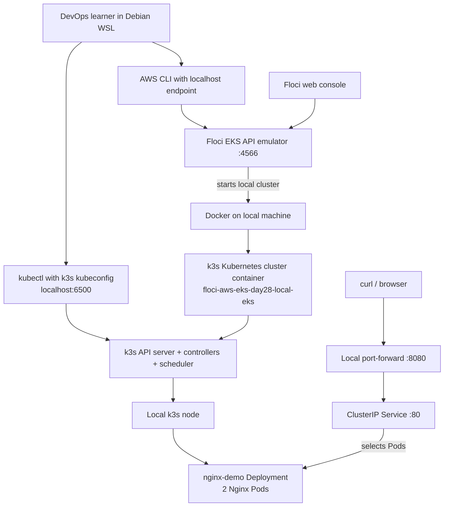
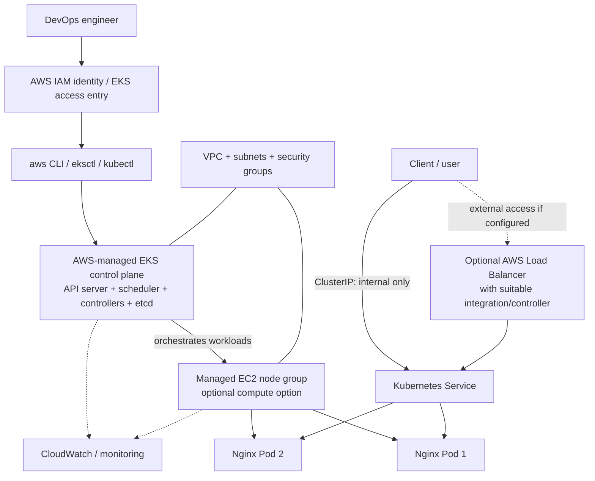
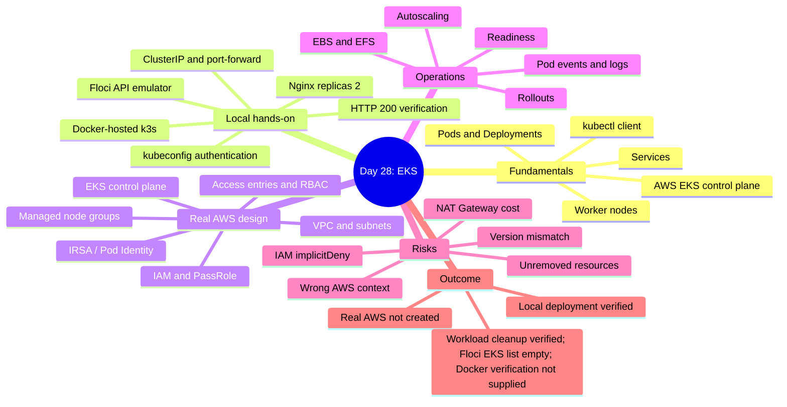

# DevOps Winter Arc — Day 28/90: Amazon EKS

> **Lab status:** Local Floci + k3s application deployment **completed and verified**. Real AWS EKS **not created**. Nginx cleanup **verified**; Floci EKS API removal **verified**; Docker container cleanup **not independently verified**.  
> **Region used for AWS CLI exercises:** `ap-south-1` (Mumbai).  
> **Approach:** Learn Kubernetes-on-EKS concepts using a local AWS API emulator, inspect a real AWS configuration with read-only commands and `eksctl --dry-run`, and avoid chargeable AWS cluster creation.

## Contents

1. [Objective and scope](#1-objective-and-scope)
2. [What was actually accomplished](#2-what-was-actually-accomplished)
3. [Architecture A — Floci local lab](#3-architecture-a--floci-local-lab)
4. [Architecture B — real Amazon EKS](#4-architecture-b--real-amazon-eks)
5. [Prerequisites and tools](#5-prerequisites-and-tools)
6. [Hands-on walkthrough: Floci](#6-hands-on-walkthrough-floci)
7. [Real AWS exploration performed — read-only](#7-real-aws-exploration-performed--read-only)
8. [How the same task would work on real AWS](#8-how-the-same-task-would-work-on-real-aws)
9. [Local vs AWS comparison](#9-local-vs-aws-comparison)
10. [Pitfalls, troubleshooting and security](#10-pitfalls-troubleshooting-and-security)
11. [Costs and cleanup](#11-costs-and-cleanup)
12. [Interview questions with answers](#12-interview-questions-with-answers)
13. [Mind map](#13-mind-map)
14. [Evidence, checklist and references](#14-evidence-checklist-and-references)

---

## 1. Objective and scope

The Day 28 assignment covers EKS control plane, managed node groups, IAM/IRSA, deploying a two-replica Nginx application, a Kubernetes Service, troubleshooting, and safe cleanup. The original assignment permits a design-only route if cloud charges are a concern.

**What we did:** created an EKS-like resource through **Floci** (local AWS emulator), connected to the underlying **k3s** cluster, deployed two Nginx replicas behind a `ClusterIP` Service, verified HTTP `200 OK`, and viewed the cluster in the Floci console. We also investigated what would be required to create a **real** EKS cluster in AWS, but stopped before provisioning any real EKS resources.

**Not claimed:** real AWS-managed control plane, real EC2 worker nodes, IAM Roles for Service Accounts (IRSA), AWS load balancer, or real EKS application deployment.

## 2. What was actually accomplished

| Activity | Observed result | Status |
|---|---|---|
| Install tooling | AWS CLI `2.39.6`, `kubectl` `v1.37.2`, `eksctl` `0.231.0` | Done |
| Start local emulator | Floci API at `http://localhost:4566` | Done |
| Create EKS-like resource | `day28-local-eks` via Floci EKS API | Done |
| View in Floci console | Resource displayed as `ACTIVE`, simulated version `1.29` | Done |
| Connect to Kubernetes | Direct k3s kubeconfig on `https://127.0.0.1:6500` (local access) | Done |
| Verify node | One Ready k3s node, `v1.34.1+k3s1` | Done |
| Deploy Nginx | `nginx-demo`, 2/2 replicas | Done |
| Create Service | `nginx-demo` ClusterIP, port 80 | Done |
| Test application | `curl -I http://localhost:8080` → `HTTP/1.1 200 OK` | Done |
| Real AWS discovery | STS, EKS list, VPC/subnets/routes, IAM simulation, `eksctl` dry-run | Done, read-only |
| Real EKS creation | **Not attempted** | Intentionally skipped |
| Local Nginx cleanup | Two `kubectl get deployments,pods,services` checks showed only `service/kubernetes` | **Verified** |
| Floci EKS API cleanup | `eks list-clusters` returned `{"clusters": []}` | **Verified** |
| k3s Docker container removal | `docker ps -a` output not yet supplied | **Pending** |

> **Important version detail:** Floci's EKS API reported Kubernetes `1.29` as simulated metadata, while the actual k3s server was `v1.34.1+k3s1`. These are not evidence of a real AWS EKS cluster. The `kubectl` client (`v1.37.2`) was also several minor versions newer than the k3s server; prefer a supported client/server version skew for ongoing work.

## 3. Architecture A — Floci local lab



**Responsibility split:**

- **Floci** imitates the AWS EKS API and displays EKS-like resources; it is **not** AWS-managed infrastructure.
- **Docker** hosts the local k3s container.
- **k3s** is a real lightweight Kubernetes distribution. Its control plane reconciles Deployments and manages Pods.
- **kubectl** is a client that sends API requests; it does **not** independently schedule or heal Pods.
- **ClusterIP** provides internal cluster connectivity. `kubectl port-forward` provides temporary local access, **not** a public load balancer.

## 4. Architecture B — real Amazon EKS



**Real-world nuance:** EKS manages the Kubernetes **control plane**; workload compute can be EC2 managed node groups, self-managed nodes, Fargate, or EKS Auto Mode depending on the architecture. A cluster can be `ACTIVE` while having **zero nodes** and **zero running application Pods**. The diagram shows the managed EC2 node group path for this assignment.

**Request flow in a typical EC2-backed cluster:** IAM-authorized operator → EKS Kubernetes API → Deployment/ReplicaSet reconciliation → scheduler assigns Pods to nodes → kubelet/container runtime runs containers → Service routes traffic to healthy Pod endpoints. A public load balancer is a **separate, optional** AWS resource and may incur charges.

## 5. Prerequisites and tools

- Debian on WSL, Docker, Floci, AWS CLI, `eksctl`, and `kubectl`.
- `deployment.yaml` in the Day 28 directory.
- A local Floci endpoint (`http://localhost:4566`).
- Real AWS profile `devops-learner` used **only** for read-only discovery and dry-run in this activity.

Check tools:

```bash
aws --version
kubectl version --client
eksctl version
docker ps
```

> **Safety:** The commands below are historical/reproducible lab instructions. Only run local creation commands if you intend to recreate the lab. Do not paste real AWS credentials into documentation or commit kubeconfig files.

## 6. Hands-on walkthrough: Floci

### 6.1 Start the emulator and isolate its credentials

```bash
floci start

export AWS_ENDPOINT_URL=http://localhost:4566
export AWS_DEFAULT_REGION=ap-south-1
export AWS_ACCESS_KEY_ID=test
export AWS_SECRET_ACCESS_KEY=test
unset AWS_PROFILE
```

`test` is a dummy local emulator credential, **not** an AWS access key. The explicit `--endpoint-url` below is an extra safeguard against accidentally targeting real AWS.

### 6.2 Create an EKS-like cluster in Floci

```bash
aws --endpoint-url http://localhost:4566 \
  --region ap-south-1 --no-sign-request \
  eks create-cluster \
  --name day28-local-eks \
  --role-arn arn:aws:iam::000000000000:role/eks-role \
  --resources-vpc-config 'subnetIds=[],securityGroupIds=[]'
```

**Only valid in this emulator:** The fake IAM role and empty subnet/security-group arrays would **not** be valid instructions for provisioning real EKS.

Verify the simulated EKS resource:

```bash
aws --endpoint-url http://localhost:4566 \
  --region ap-south-1 --no-sign-request \
  eks describe-cluster --name day28-local-eks

aws --endpoint-url http://localhost:4566 \
  --region ap-south-1 --no-sign-request \
  eks list-clusters
```

Observed: Floci showed `day28-local-eks` as `ACTIVE` and its console displayed version `1.29`. Floci started the Docker container `floci-aws-eks-day28-local-eks`, running **k3s**, with local port mapping `6500:6443`.

**CLI pitfall we encountered:** Using `--version` to specify the Kubernetes version with `aws eks create-cluster` was interpreted as the AWS CLI global version flag and printed the AWS CLI version instead of creating a cluster. Use the EKS API's supported input mechanism, such as an appropriately structured `--cli-input-json`, if version selection is required; do not assume that `--version` is safe in this command.

### 6.3 Connect kubectl to the actual k3s API

An AWS-generated kubeconfig initially attempted AWS IAM token authentication, which did **not** work with this local k3s cluster. We therefore retrieved the k3s kubeconfig from its container:

```bash
mkdir -p ~/.kube

docker exec floci-aws-eks-day28-local-eks \
  cat /etc/rancher/k3s/k3s.yaml > ~/.kube/day28-floci.yaml

sed -i 's#https://127.0.0.1:6443#https://127.0.0.1:6500#g' \
  ~/.kube/day28-floci.yaml

chmod 600 ~/.kube/day28-floci.yaml
```

The kubeconfig contains powerful local cluster credentials: **never commit or publish it**. It uses a localhost endpoint on the same machine as Docker; adjust only if your environment differs.

Use this kubeconfig explicitly for every local cluster command:

```bash
kubectl --kubeconfig ~/.kube/day28-floci.yaml get nodes
kubectl --kubeconfig ~/.kube/day28-floci.yaml get pods -A
```

Observed: one Ready node named like an EC2 hostname (`i-e210b09cb6dd36a08.ec2.internal`), with Kubernetes `v1.34.1+k3s1`; CoreDNS and metrics-server Pods were running. **That EC2-looking name was simulated; no EC2 instance was created.**

### 6.4 Create `deployment.yaml`

```yaml
apiVersion: apps/v1
kind: Deployment
metadata:
  name: nginx-demo
spec:
  replicas: 2
  selector:
    matchLabels:
      app: nginx-demo
  template:
    metadata:
      labels:
        app: nginx-demo
    spec:
      containers:
        - name: nginx
          image: nginx:stable
          ports:
            - containerPort: 80
---
apiVersion: v1
kind: Service
metadata:
  name: nginx-demo
spec:
  type: ClusterIP
  selector:
    app: nginx-demo
  ports:
    - port: 80
      targetPort: 80
```

**Why these resources?** Deployment declares the desired replica count (`2`). A ReplicaSet maintains that count. The Service provides a stable in-cluster address and selects Pods by label (`app: nginx-demo`). `ClusterIP` avoids requesting an AWS load balancer.

### 6.5 Deploy and verify

```bash
kubectl --kubeconfig ~/.kube/day28-floci.yaml \
  apply --dry-run=client -f deployment.yaml

kubectl --kubeconfig ~/.kube/day28-floci.yaml apply -f deployment.yaml

kubectl --kubeconfig ~/.kube/day28-floci.yaml \
  rollout status deployment/nginx-demo

kubectl --kubeconfig ~/.kube/day28-floci.yaml get deployments
kubectl --kubeconfig ~/.kube/day28-floci.yaml get pods -o wide
kubectl --kubeconfig ~/.kube/day28-floci.yaml get services
```

Observed: Deployment `nginx-demo` had **2/2** ready replicas; the Service had a ClusterIP such as `10.100.235.85` and exposed port `80`. ClusterIP values can differ when recreated.

### 6.6 Test Nginx with port-forwarding

Terminal 1:

```bash
kubectl --kubeconfig ~/.kube/day28-floci.yaml \
  port-forward service/nginx-demo 8080:80
```

Terminal 2:

```bash
curl -I http://localhost:8080
```

Observed:

```text
HTTP/1.1 200 OK
Server: nginx/1.30.6
```

This proves that the Nginx application responded through the local port-forward. It **does not** prove an AWS load balancer exists or that traffic was balanced across both replicas. Stop port-forwarding with `Ctrl+C`.

### 6.7 View the resource in the Floci console

Open the Floci console from the local emulator (previously accessed via `http://localhost:4566/_floci/ui`, redirecting to the UI on port `4500`). Navigate to **AWS → EKS** and inspect `day28-local-eks`. The screenshot showed status `ACTIVE` and simulated version `1.29`.

### 6.8 Optional self-healing experiment (not confirmed as performed)

```bash
kubectl --kubeconfig ~/.kube/day28-floci.yaml get pods -l app=nginx-demo

kubectl --kubeconfig ~/.kube/day28-floci.yaml delete pod \
  $(kubectl --kubeconfig ~/.kube/day28-floci.yaml \
    get pods -l app=nginx-demo \
    -o jsonpath='{.items[0].metadata.name}')

kubectl --kubeconfig ~/.kube/day28-floci.yaml get pods -l app=nginx-demo -w
```

Expected: Kubernetes creates a replacement Pod to restore the desired replica count. Stop the watch with `Ctrl+C`. This is **optional**, not evidence of a test already completed.

## 7. Real AWS exploration performed — read-only

After removing Floci environment overrides, we used the **real AWS profile**:

```bash
unset AWS_ENDPOINT_URL AWS_ACCESS_KEY_ID AWS_SECRET_ACCESS_KEY AWS_SESSION_TOKEN
export AWS_PROFILE=devops-learner
export AWS_REGION=ap-south-1

aws sts get-caller-identity
aws eks list-clusters --region ap-south-1
```

**Observed:** real IAM identity `devops-learner`; **no EKS clusters** in `ap-south-1` at the time checked.

We also inspected the account's existing **default VPC**, three subnets across `ap-south-1a`, `1b`, and `1c`, and a route table with a default route to an Internet Gateway. The subnet `MapPublicIpOnLaunch` flag was `True`. The route table had no explicit subnet associations in the queried output, so it may be the main route table; this would need confirmation before deployment.

### IAM blocker found

```bash
aws iam simulate-principal-policy \
  --policy-source-arn "$(aws sts get-caller-identity --query Arn --output text)" \
  --action-names eks:CreateCluster iam:CreateRole iam:PassRole \
  --query 'EvaluationResults[*].{Action:EvalActionName,Decision:EvalDecision}' \
  --output table
```

Observed simulation results:

```text
eks:CreateCluster  implicitDeny
iam:CreateRole     implicitDeny
iam:PassRole      implicitDeny
```

The IAM user had read-only/VPC and earlier lab policies, but no confirmed permission for these EKS provisioning actions. `implicitDeny` in this simulation is a strong warning, though complete authorization also depends on other applicable policy layers and context. **We did not try to bypass the restriction.** The account owner had root access but chose not to change IAM permissions or create real resources.

### eksctl dry-run and the NAT Gateway discovery

A first `eksctl --dry-run` failed because no AWS profile was selected. Setting `AWS_PROFILE=devops-learner` resolved credential discovery. The default dry-run then proposed `nat.gateway: Single` — a **potential extra cost**.

We instead prepared `day28-real-eks.yaml` using the existing VPC and explicitly disabling NAT:

```yaml
apiVersion: eksctl.io/v1alpha5
kind: ClusterConfig
metadata:
  name: day28-real-eks
  region: ap-south-1
  version: "1.34"
vpc:
  id: vpc-0db58479bcc738ebc
  subnets:
    public:
      ap-south-1a:
        id: subnet-00698086d711aa54c
      ap-south-1b:
        id: subnet-0411976d508d370d9
      ap-south-1c:
        id: subnet-06bd1d7967901109e
  nat:
    gateway: Disable
managedNodeGroups: []
```

Preview only:

```bash
eksctl create cluster -f day28-real-eks.yaml --dry-run
```

The preview confirmed the existing VPC, three specified subnets, `nat.gateway: Disable`, and no configured managed node group. **A dry-run does not guarantee successful provisioning, IAM access, correct routing, or zero costs if executed without `--dry-run`.**

> **Privacy:** Actual account ID and IAM unique IDs are intentionally omitted from this README. VPC/subnet IDs shown above are historical configuration identifiers, not secrets; replace them if recreating in a different account. Consider redacting resource IDs from public screenshots.

## 8. How the same task would work on real AWS

> **Documentation only — not executed.** The commands below illustrate the workflow; do **not** run them until IAM, networking, current Kubernetes version, costs, and a cleanup plan have been approved. EKS and associated AWS resources are chargeable.

### Phase A — Plan and authorize

1. Confirm the AWS account, profile, region, budget alert, and available credits. Alerts are **not hard spending limits**.
2. Select a **currently supported** EKS Kubernetes version (verify at execution time).
3. Decide whether to use an existing VPC or create a dedicated VPC; verify subnet routes, IP capacity, security groups, DNS settings, and EKS subnet/AZ requirements.
4. Obtain least-privilege provisioning permissions for EKS, IAM `PassRole`, EC2/VPC, and CloudFormation as required by the chosen tool.
5. Create or identify an **EKS cluster IAM service role** trusted by `eks.amazonaws.com`, with the appropriate AWS-managed cluster policy. Do **not** confuse this with the permissions of the human operator.
6. Plan Kubernetes access using **EKS access entries** or the authentication mode appropriate to the cluster. An IAM user with AWS API access is not automatically authorized to perform every Kubernetes action.
7. Review the generated `eksctl` plan and confirm **no unexpected NAT Gateways, node groups, public IPs, or load balancers**.

### Phase B — Create the control plane

```bash
# ILLUSTRATIVE — CHARGEABLE IF RUN WITHOUT --dry-run
# First review a suitable cluster configuration and permissions:
eksctl create cluster -f day28-real-eks.yaml --dry-run

# Only after approval, a real create operation would look like:
# eksctl create cluster -f day28-real-eks.yaml
```

Wait for EKS status `ACTIVE` and verify via the AWS EKS console or:

```bash
# Only after a real cluster exists:
aws eks describe-cluster \
  --name day28-real-eks --region ap-south-1 \
  --query 'cluster.{Status:status,Version:version,Endpoint:endpoint}'
```

**Critical:** A control-plane-only cluster has no worker nodes. You cannot run Nginx Pods until compatible compute capacity exists.

### Phase C — Add compute (separate, chargeable step)

With approved networking, node IAM role, capacity, and instance size, provision an EC2 managed node group (or another supported compute option). For example, a **separately reviewed** `eksctl` node-group configuration might specify a small managed group. Do not copy a generic instance-type command blindly: capacity, AMI support, subnet placement, and IAM policies must be checked.

Then:

```bash
# Only when the real cluster and nodes exist:
aws eks update-kubeconfig --region ap-south-1 --name day28-real-eks
kubectl config current-context
kubectl get nodes
kubectl get pods -A
```

**Context safety:** The last `update-kubeconfig` call can change the default kubectl context. Always inspect the context before applying or deleting resources. Prefer a dedicated kubeconfig/context when switching between local k3s, Kind, and real EKS.

### Phase D — Deploy and expose Nginx

```bash
# Only after confirming the intended REAL EKS context:
kubectl apply -f deployment.yaml
kubectl rollout status deployment/nginx-demo
kubectl get deployments,pods,services -o wide
```

The same Deployment and `ClusterIP` Service manifest can work on EKS, provided nodes can pull the image and networking is healthy. For a quick low-cost test, `kubectl port-forward service/nginx-demo 8080:80` can be used without a cloud load balancer. For internet-facing traffic, configure the appropriate Service/Ingress/Gateway integration and AWS load balancing deliberately; this has additional cost and security implications.

### Phase E — Observe and clean up

- Inspect `kubectl describe pod`, `kubectl get events`, EKS cluster health, node group status, VPC networking, and CloudWatch logs where enabled.
- Delete application resources, then delete node groups and cluster using the same provisioning workflow (for example `eksctl delete cluster -f ...` where appropriate).
- Verify lab-created CloudFormation stacks, load balancers, target groups, EBS volumes, security groups, NAT Gateways, Elastic IPs, and public IPv4 allocations. **Do not delete shared/default VPC resources.**
- Recheck AWS Billing/Cost Explorer later because usage reporting can lag.

### IAM access vs workload permissions (IRSA)

- **Human/CI access:** IAM identity + EKS authentication/access entries + Kubernetes RBAC determine who can operate the cluster.
- **Pod access to AWS:** IRSA associates a Kubernetes ServiceAccount with an IAM role through an OIDC provider, enabling appropriately scoped AWS API permissions for that workload. EKS Pod Identity is another AWS-native approach. Neither was configured in this lab.
- **Node IAM role:** separate permissions needed by the worker node and supporting agents.

### Storage and scaling

- **EBS:** block storage typically attached to a node in one Availability Zone; useful for a single-node-mounted persistent volume, subject to CSI driver and access-mode constraints.
- **EFS:** shared network file system that can support multi-node access; different performance and cost characteristics.
- **HPA:** scales Pod replicas based on configured metrics; **node autoscaling** adds/removes compute capacity when Pods need it. Increasing replicas does not magically add nodes.

## 9. Local vs AWS comparison

| Dimension | Floci + local k3s (performed) | Real EKS (design only) |
|---|---|---|
| AWS EKS API | Emulated | Actual AWS service |
| Control plane | k3s running locally | AWS-managed |
| Worker capacity | Local Docker/k3s node | EC2 managed nodes / other EKS compute |
| AWS IAM service roles | Fake placeholder accepted by emulator | Real trust policies, roles, `PassRole`, access configuration |
| VPC | Not actually provisioned for local k3s | Real VPC/subnets/security groups |
| Deployment | Two Nginx replicas running | Same Kubernetes manifests after compute setup |
| Service | ClusterIP + local port-forward | ClusterIP, or optionally cloud load balancer |
| Billing | No AWS EKS charge for local lab | EKS fee + possible compute/network/storage costs |
| Console | Floci UI | AWS EKS Console |
| What it teaches | kubectl, YAML, reconciliation, emulator workflow | IAM, networking, managed services, operational cloud integration |

## 10. Pitfalls, troubleshooting and security

### Problems we actually encountered

| Symptom | Root cause / lesson | Resolution |
|---|---|---|
| `kubectl get nodes` authentication failed after `aws eks update-kubeconfig` against Floci | AWS CLI exec token did not authenticate to underlying k3s | Extract k3s kubeconfig and use `--kubeconfig ~/.kube/day28-floci.yaml` |
| Floci showed Kubernetes `1.29`, `kubectl` showed `v1.34.1+k3s1` | EKS API metadata was simulated; k3s was the actual server | Distinguish API emulation from real Kubernetes engine |
| AWS CLI printed version instead of creating a cluster | `--version` interpreted as AWS CLI global option | Avoid this flag on `aws eks create-cluster`; use supported API input |
| `eksctl --dry-run` could not get AWS credentials | `AWS_PROFILE` was unset and no default credentials resolved | `export AWS_PROFILE=devops-learner` |
| Default `eksctl` dry-run included `nat.gateway: Single` | Tool defaults can create chargeable networking | Explicitly review plan; use existing VPC and disable NAT where appropriate |
| IAM simulator returned `implicitDeny` for EKS/IAM actions | Learner user lacked confirmed provisioning permissions | Stop; seek authorized least-privilege access; do not run real create |

### Real AWS pitfalls to remember

1. **Wrong account/region/context:** `AWS_PROFILE`, `AWS_ENDPOINT_URL`, `AWS_REGION`, and kubeconfig can point to different environments. Verify identity and context every time.
2. **Surprise costs:** EKS control plane, EC2 nodes, EBS, load balancers, NAT Gateways, public IPv4, and data transfer can be billed independently. Even short-lived resources can incur charges.
3. **IAM ≠ Kubernetes RBAC:** AWS credentials alone do not guarantee Kubernetes administrator permissions. IAM `PassRole` is distinct from cluster-service-role trust and Pod permissions.
4. **`ACTIVE` ≠ application healthy:** The EKS control plane may be active with zero Ready nodes, Pending Pods, or broken Service endpoints.
5. **Public subnet assumptions:** Public-IP assignment alone does not prove the correct route table, Internet Gateway, security rules, or Kubernetes subnet tagging.
6. **NAT/egress:** Private worker nodes need a designed path to registries and AWS APIs (NAT or suitable VPC endpoints); a NAT Gateway may be expensive.
7. **Load balancer behavior:** A `LoadBalancer` Service may require correct controller/provider integration, subnet discovery, IAM permissions, health checks, and security-group rules. It can create chargeable resources.
8. **Version compatibility:** Check supported EKS versions, add-ons, node AMIs, and `kubectl` version skew; do not rely on the emulator's version field.
9. **Security:** Do not commit AWS keys, kubeconfig certificates, admin tokens, or screenshots containing sensitive identifiers. Limit API endpoint exposure and IAM privileges.
10. **Cleanup:** Deleting Pods/Deployments does **not** delete the EKS cluster or all AWS resources. Deleting a cluster may leave independent resources; verify every billable dependency.
11. **Default VPC:** Reusing shared/default networking can reduce setup work, but never delete shared VPC/subnets/security groups as part of lab cleanup.
12. **Credits and alerts:** Promotional credits have eligibility conditions. Budget alerts are not spending caps and may arrive after charges occur.

### Practical troubleshooting commands

```bash
# Kubernetes (select the correct kubeconfig/context first)
kubectl get nodes -o wide
kubectl get pods -A
kubectl get pods -l app=nginx-demo -o wide
kubectl describe deployment nginx-demo
kubectl describe pod <POD_NAME>
kubectl get events --sort-by=.metadata.creationTimestamp
kubectl logs deployment/nginx-demo
kubectl get svc,endpoints,endpointslices

# Real AWS read-only checks (only if a real cluster exists)
aws sts get-caller-identity
aws eks describe-cluster --name <CLUSTER_NAME> --region <REGION>
aws eks list-nodegroups --cluster-name <CLUSTER_NAME> --region <REGION>
```

**Typical diagnosis:** `Pending` → node capacity/taints/requests; `ImagePullBackOff` → image/tag/registry egress; `CrashLoopBackOff` → app logs and probes; `Service` unreachable → labels, endpoints, readiness, ports, security rules; `kubectl Unauthorized` → kubeconfig, EKS access entry, IAM and RBAC.

## 11. Costs and cleanup

### Cost model

- **Floci/k3s lab:** runs on your computer; no real EKS cluster billing from this lab. It still uses local CPU, RAM, storage, and electricity.
- **Real EKS:** published standard-support control-plane pricing has historically been **$0.10 per cluster-hour** (extended-support clusters higher), plus worker compute and optional networking/storage resources. **Check live AWS pricing for your region and support status before a real lab**: <https://aws.amazon.com/eks/pricing/>.
- **No real EKS resources were created in this activity.** The AWS checks and `eksctl --dry-run` were read-only / previews.

### Local cleanup — **Nginx and Floci EKS API removal verified; Docker check not supplied**

Two successful `kubectl --kubeconfig ~/.kube/day28-floci.yaml get deployments,pods,services` outputs after Nginx cleanup. Both showed **only the built-in `service/kubernetes`**, confirming that `nginx-demo` Deployment, Pods, and Service were absent from the default namespace. The earlier deletion command output itself was not supplied. **The Floci EKS API now returns `{"clusters": []}`, verifying that no EKS cluster is listed. The actual `eks delete-cluster` command output was not supplied, and no `docker ps -a` result was shared. The user considers cleanup finished; Docker removal remains unverified in this record.**

**Step 1 — Stop forwarding:** Stop any active `kubectl port-forward` or watch with `Ctrl+C`.

**Step 2 — Delete the application:** From the Day 28 directory, run the first command below. It should delete the `nginx-demo` Deployment and Service.

**Step 3 — Verify workload removal (COMPLETED):** Ran `kubectl --kubeconfig ~/.kube/day28-floci.yaml get deployments,pods,services` twice. Both times, only the built-in `kubernetes` Service remained. Observed ages: 68m and 71m.

**Step 4 — Delete the simulated EKS cluster:** Only after verifying the application deletion, run the local AWS CLI deletion command below.

**Step 5 — Verify cluster removal (API VERIFIED; DOCKER NOT CHECKED):** Ran the local Floci `eks list-clusters` command; it returned `{"clusters": []}`. Docker container verification and a final Floci UI refresh have not been supplied.

Commands (execute sequentially, not as an unreviewed batch):

```bash
# Deletes only the nginx-demo Deployment and Service in the local k3s cluster
kubectl --kubeconfig ~/.kube/day28-floci.yaml delete -f deployment.yaml

# Verify nginx-demo workloads and Service are absent
kubectl --kubeconfig ~/.kube/day28-floci.yaml get deployments,pods,services

# Deletes the simulated EKS cluster via the LOCAL Floci endpoint
aws --endpoint-url http://localhost:4566 \
  --region ap-south-1 --no-sign-request \
  eks delete-cluster --name day28-local-eks

# Verify the Floci EKS resource is gone
aws --endpoint-url http://localhost:4566 \
  --region ap-south-1 --no-sign-request eks list-clusters

# Verify its local cluster container is gone
docker ps -a --filter name=floci-aws-eks-day28-local-eks
```

Observed: an empty Floci EKS cluster list. To complete independent verification, confirm there is no matching k3s cluster container. If a container remains, investigate before deleting anything manually. Refresh the Floci UI to verify disappearance.

**Do not remove** the separate Kind cluster `winter-arc-control-plane`, the Floci emulator container, or the ECR registry container unless you explicitly intend to. Keep `deployment.yaml` and this README for GitHub; keep `~/.kube/day28-floci.yaml` private. The old kubeconfig can be removed after the cluster is gone if no longer needed.

### Real AWS cleanup — conceptual only

If an EKS lab were actually created, delete Kubernetes workload resources, then any managed node groups and the cluster using the appropriate `eksctl`/CloudFormation workflow; confirm all lab-created load balancers, target groups, EBS volumes, security groups, NAT Gateways, Elastic IPs, and public IPv4 resources are gone. Never delete shared infrastructure. Review costs after reporting catches up.

## 12. Interview questions with answers

**1. What is Amazon EKS?**  
A managed Kubernetes service where AWS operates the Kubernetes control plane. Workloads and compute still require configuration and operations, depending on the chosen compute mode.

**2. What is the difference between EKS and k3s?**  
EKS is AWS's managed Kubernetes service; k3s is a lightweight Kubernetes distribution that can run locally or on servers. In this lab, Floci simulated EKS while k3s ran the actual Kubernetes cluster.

**3. What does `kubectl` do?**  
It communicates with the Kubernetes API. Controllers and nodes, not the `kubectl` binary, maintain desired workload state.

**4. What is the control plane?**  
The API server, scheduler, controller managers, and state storage (`etcd` in standard Kubernetes architectures) coordinate the cluster. AWS operates the EKS control plane.

**5. What is a worker node?**  
A machine or compute environment that runs Pods through a kubelet and container runtime. In EC2-backed EKS, nodes are EC2 instances.

**6. What is an EKS managed node group?**  
An AWS-managed lifecycle integration for a group of EC2 worker nodes attached to an EKS cluster.

**7. Can an EKS cluster be `ACTIVE` with no worker nodes?**  
Yes. The control plane can be ready even when no compute exists for ordinary application Pods.

**8. Deployment vs Pod vs ReplicaSet?**  
A Pod hosts one or more containers. A ReplicaSet maintains a desired Pod count. A Deployment manages ReplicaSets and rollout behavior.

**9. If one Nginx Pod crashes, who replaces it?**  
The Kubernetes controllers (through the Deployment's ReplicaSet) work to restore the desired replica count, assuming cluster capacity and scheduling allow it.

**10. What does `replicas: 2` mean?**  
Kubernetes should maintain two matching application Pods. It does not guarantee they are on separate nodes without scheduling constraints.

**11. What is a `ClusterIP` Service?**  
An internal stable virtual address and port that routes traffic to selected Pod endpoints. It does not provide public internet access by itself.

**12. What does `kubectl port-forward` prove?**  
That a local TCP connection can be forwarded to a selected Pod or a Pod selected through a resource such as a Service. It does not validate external load balancing.

**13. How does `LoadBalancer` differ from `ClusterIP` on AWS?**  
A `LoadBalancer` Service can trigger integration with an AWS load balancer when the appropriate controller/provider setup exists; `ClusterIP` stays internal. AWS load balancers are separate billable resources.

**14. IAM permissions vs Kubernetes RBAC?**  
IAM governs AWS API permissions and participates in EKS authentication; Kubernetes RBAC governs allowed Kubernetes API operations. EKS access entries can map identities into Kubernetes access policies/groups.

**15. What is IRSA?**  
IAM Roles for Service Accounts: an EKS pattern for granting a Pod scoped AWS permissions via a Kubernetes ServiceAccount and an IAM role using OIDC federation.

**16. What is the EKS cluster IAM role?**  
A role trusted by the EKS service to perform permitted AWS operations on behalf of the cluster. It is different from the operator's IAM permissions and the worker node IAM role.

**17. Why does `iam:PassRole` matter?**  
When an AWS API request specifies a role for a service to assume, the caller often needs permission to pass that role. Having `eks:CreateCluster` alone may be insufficient.

**18. What is a NAT Gateway and why was it a pitfall?**  
It provides outbound connectivity for resources in private subnets. The default `eksctl` dry-run proposed one, which could add hourly and data-processing costs.

**19. Why can Pods remain `Pending`?**  
Insufficient nodes/resources, taints, affinity/selector constraints, storage issues, or other scheduling blockers. Inspect Pod events and scheduler messages.

**20. Why might `ImagePullBackOff` occur?**  
Incorrect image/tag, registry credentials, rate limits, or missing network access to the registry.

**21. What is the difference between EBS and EFS?**  
EBS is block storage generally attached within an Availability Zone; EFS is a network file system supporting shared access. CSI drivers and workload access requirements determine use.

**22. HPA vs node autoscaling?**  
HPA changes Pod replica counts; node autoscaling changes compute capacity. Both may be needed when demand increases.

**23. What is the AWS Load Balancer Controller?**  
A Kubernetes controller that integrates supported Kubernetes resources with AWS load balancer APIs, commonly for ALB Ingress and supported NLB configurations.

**24. Why did the Floci kubeconfig fail at first?**  
It used an AWS IAM-token authentication workflow, while the underlying local k3s API expected its own credentials. We used the k3s kubeconfig instead.

**25. Why is a dry-run important?**  
It reveals planned configuration and potentially costly defaults before provisioning. It is not a full authorization, networking, or billing guarantee.

**26. How do you prevent accidental real AWS commands?**  
Separate AWS profiles, remove emulator environment variables when appropriate, verify `aws sts get-caller-identity`, inspect kubeconfig context, and use explicit Floci `--endpoint-url` for local API calls.

**27. Why does deleting a Deployment not stop all EKS charges?**  
The EKS control plane, EC2 nodes, load balancers, storage, and networking resources may continue to exist and bill independently.

**28. What would you say about this project in an interview?**  
“I simulated the EKS API locally with Floci, used k3s as the Kubernetes engine, deployed a two-replica Nginx Deployment and ClusterIP Service, and verified HTTP 200 via port-forwarding. I also examined real AWS EKS prerequisites using STS, VPC and IAM read-only checks and `eksctl --dry-run`, identified a NAT Gateway cost pitfall and missing IAM permissions, and intentionally avoided provisioning a chargeable real cluster.”

## 13. Mind map



If your Markdown viewer does not support Mermaid mind maps, use this text outline:

```text
Day 28 — Amazon EKS
├── Concepts: EKS control plane | nodes | kubectl | IAM/RBAC
├── Local lab: Floci → Docker/k3s → Deployment (2 Pods) → ClusterIP
│   └── Verification: kubectl Ready | port-forward | HTTP 200
├── Real AWS design: IAM → VPC/subnets → EKS → node group → workloads
├── Operations: events | logs | readiness | scaling | EBS/EFS
├── Risks: cost | NAT | wrong context | credentials | cleanup
└── Outcome: local lab complete | real EKS not created | workload removed; Floci EKS list empty; Docker verification not supplied
```

## 14. Evidence, checklist and references

### Suggested screenshots (3–5, per assignment)

1. Floci AWS → EKS resource `day28-local-eks` showing `ACTIVE` (**captured**).
2. `kubectl --kubeconfig ~/.kube/day28-floci.yaml get nodes` showing the Ready k3s node (**observed in terminal**).
3. `kubectl ... get deployments,pods,services` showing 2/2 Nginx replicas and ClusterIP (**observed in terminal**).
4. `curl -I http://localhost:8080` showing `HTTP/1.1 200 OK` (**observed in terminal**).
5. Floci EKS cluster list empty (**verified by CLI; screenshot pending**).

Do not publish the real AWS account ID, credentials, kubeconfig contents, or unnecessarily revealing resource identifiers in screenshots.

### Completion checklist

- [x] Explain EKS control plane, worker nodes, Kubernetes and `kubectl`.
- [x] Create an EKS-like cluster locally through Floci.
- [x] Connect to k3s and inspect Ready node / system Pods.
- [x] Deploy Nginx with two replicas and a ClusterIP Service.
- [x] Verify Nginx HTTP `200 OK`.
- [x] Inspect the simulated cluster in the Floci console.
- [x] Explain real EKS architecture, IAM/IRSA, networking, EBS/EFS and autoscaling.
- [x] Investigate a real AWS IAM permission issue and NAT cost pitfall without provisioning.
- [x] Verify local Nginx Deployment, Pods, and Service are absent (two checks).
- [x] Verify the local Floci EKS API lists zero clusters (`{"clusters": []}`).
- [ ] Verify the local k3s Docker cluster container has been removed.
- [ ] Add final cleanup screenshot and update this README.
- [ ] Optional: test Pod self-healing and document observed output.
- [ ] Optional future lab: provision and destroy real EKS in an authorized, budgeted sandbox.

### References

- Assignment: *DevOps Winter Arc — Day 28/90: Amazon EKS* (provided PDF).
- [Amazon EKS documentation](https://docs.aws.amazon.com/eks/latest/userguide/what-is-eks.html)
- [Amazon EKS pricing](https://aws.amazon.com/eks/pricing/)
- [eksctl documentation](https://eksctl.io/)
- [Kubernetes Deployments](https://kubernetes.io/docs/concepts/workloads/controllers/deployment/)
- [Kubernetes Services](https://kubernetes.io/docs/concepts/services-networking/service/)
- [Kubernetes kubectl port-forward](https://kubernetes.io/docs/reference/kubectl/generated/kubectl_port-forward/)
- [EKS IAM Roles for Service Accounts](https://docs.aws.amazon.com/eks/latest/userguide/iam-roles-for-service-accounts.html)

---

**Learning summary:** Floci let us rehearse an EKS-like AWS API workflow without provisioning AWS infrastructure; k3s supplied real Kubernetes behavior. Real EKS adds AWS-managed control-plane operations, IAM access, VPC networking, worker compute, cloud integrations, and ongoing cost responsibility. **Learn → Build → Break → Fix → Explain → Clean up.**
