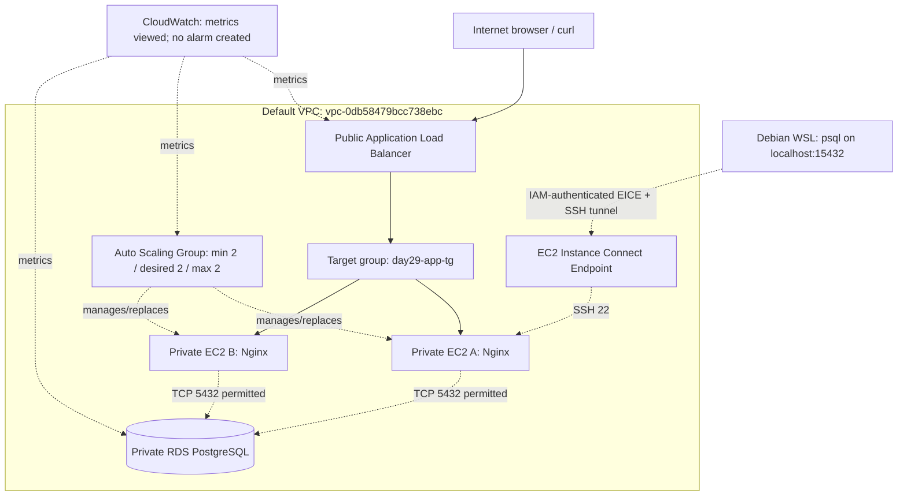
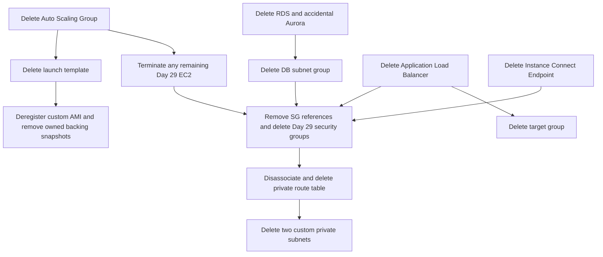

# Day 29 — AWS High Availability Capstone

> DevOps Winter Arc | Region: `ap-south-1` (Mumbai) | Lab date: 15 November 2026
>
> **Status (updated after teardown):** Web tier, ALB, Auto Scaling recovery, private RDS connectivity and SQL CREATE/INSERT/SELECT succeeded. CloudWatch metrics were viewed; no CloudWatch alarm was created. The operator reported completing the Day 29 Console deletion sequence, including the final EC2 termination step. This README records those actions; it does not claim independent post-deletion verification. GitHub publishing is not confirmed.

## 1. The assignment in plain English

Build a web application platform that remains reachable if an application server disappears, keeps its database off the public internet, and can be observed and recovered safely.

**Analogy:** The ALB is a receptionist directing customers to available service counters (EC2). The Auto Scaling Group is the manager who replaces a closed counter. Private subnets are staff-only rooms. Security groups are door guards. RDS PostgreSQL is the secure records room. CloudWatch is the monitoring room.

### What we actually demonstrated

| Component / test | Observed result | Status |
|---|---|---|
| ALB + Nginx web servers | Web traffic reached the servers through ALB; responses from different instances observed | Verified |
| Auto Scaling Group | One EC2 instance terminated; ASG replaced it and targets recovered | Verified |
| Private EC2 networking | Application instances had private IPs and no public IPs | Verified |
| Private RDS PostgreSQL | DNS resolved to `172.31.96.81`; TCP 5432 reachable from private EC2 | Verified |
| Secure database access | Laptop `psql` through EC2 Instance Connect Endpoint + SSH forwarding; PostgreSQL TLS 1.3 | Verified |
| SQL smoke test | Created table, inserted three rows, selected all three | Verified |
| CloudWatch metrics | Opened ApplicationELB metrics; operator subsequently confirmed viewing metrics | Viewed (operator-reported) |
| CloudWatch alarms / dashboard | No alarm or dashboard created during this lab | Not in scope of completed practice |
| GitHub README push / LinkedIn publishing | Documentation and draft prepared; publishing not confirmed | Not yet reported |
| Cost cleanup | Operator reported executing Console deletion steps for Day29 RDS/Aurora, ASG/EC2, ALB/TG, LT/AMI, EICE, DB subnet group, SGs, route table/subnets | Deletion actions reported; no independent final inventory |

> **Scope distinction:** This was an infrastructure and database-connectivity capstone. We did **not** prove that the Nginx application itself executes SQL; SQL was issued by `psql` on the laptop through an SSH tunnel.

## 2. Architecture



### Network boundaries

- **Public-facing:** ALB in default public subnets.
- **Private application:** Two Auto Scaling EC2 instances in custom private subnets. No public IPs.
- **Private database:** RDS PostgreSQL, `PubliclyAccessible=False`, within a DB subnet group.
- **No NAT gateway for app subnets:** Outbound package installation from private EC2 timed out. This is why the Nginx image was baked into a custom AMI and why we ran `psql` on the laptop instead of installing it on EC2.
- **Database SG:** Allows PostgreSQL TCP 5432 from the **application security group**, not the public internet.
- **App SG:** HTTP TCP 80 from the **ALB security group**; SSH TCP 22 was allowed from the relevant EICE/app SG path for lab access.

## 3. Resource inventory — identifiers from the lab

**Account:** `426029558221` — use only for personal lab notes; avoid displaying account IDs in public LinkedIn screenshots.

| Resource | Identifier / name |
|---|---|
| Region | `ap-south-1` |
| VPC (existing/default; **preserve**) | `vpc-0db58479bcc738ebc` |
| Public subnets (existing/default; **preserve**) | `subnet-00698086d711aa54c`, `subnet-0411976d508d370d9` |
| Private app subnets (Day29) | `subnet-0625a3843c5b1f8f5`, `subnet-09e55084870cd5c43` |
| Private route table (Day29) | `rtb-0fbccbf5cc01faf72` (local route only) |
| ALB | `day29-app-alb` |
| ALB DNS | `day29-app-alb-494888170.ap-south-1.elb.amazonaws.com` |
| Target group | `day29-app-tg` |
| ASG | `day29-app-asg` (2/2/2) |
| Launch template | `lt-02f9220287644cf4e` (v2) |
| Custom Nginx AMI | `ami-049625e37c3a6404f` |
| Private EC2 observed | `i-02c790dcae8fe9e1d` (`172.31.96.110`), `i-0938de2264581d4de` (`172.31.97.115`) |
| ALB SG | `sg-0208b81b9276707b5` |
| App SG | `sg-01b4d531dfaddb11d` |
| DB SG | `sg-0c8ffce0f9a748b16` |
| Builder SG | `sg-0cb23ad5a56f94d5f` |
| RDS instance | `day29-postgres` |
| RDS endpoint | `day29-postgres.c1o4oeako332.ap-south-1.rds.amazonaws.com` |
| RDS private IP (observed) | `172.31.96.81` — can change; use endpoint DNS |
| RDS subnet group | `day29-db-subnet-group` |
| RDS master user (confirmed by successful login) | `postgres` |
| EC2 Instance Connect Endpoint | `eice-0624119c197966d48` |
| Accidental Aurora resources (deletion requested in Console) | Cluster `database-1`, writer `database-1-instance-1` |

**Security:** Never put database passwords, private SSH keys, AWS access keys, or session tokens in GitHub.

## 4. Build walkthrough — why each step matters

### Phase A — Network foundation

1. Used the **existing default VPC** and public subnets for the internet-facing ALB.
2. Created two **private subnets** across availability zones `ap-south-1a` and `ap-south-1b` for the application and database network.
3. Associated a custom private route table with only the VPC-local route. This provided internal VPC connectivity, but no outbound internet/NAT route.
4. Created separate security groups for the ALB, app instances and database. This enforced *least-privilege network paths*: internet → ALB HTTP; ALB SG → app HTTP; app SG → DB TCP 5432.

**Why two AZs?** The app instances can be spread across failure domains rather than relying on a single server or zone. Two EC2 instances alone do not prove full AZ failure resilience; we tested instance replacement, not an AZ outage.

### Phase B — Nginx application image and launch template

1. Prepared an Amazon Linux 2023 EC2 builder with Nginx installed and an HTTP response for smoke testing.
2. Created a custom AMI (`ami-049625e37c3a6404f`) so replacement instances could boot with Nginx already installed **without needing package downloads from private subnets**.
3. Created launch template `lt-02f9220287644cf4e`; used version **2** in the final ASG.
4. Configured the Auto Scaling Group `day29-app-asg` with **minimum 2, desired 2, maximum 2** and both private subnets.

**Troubleshooting lesson:** A launch template is a reusable recipe; an ASG uses that recipe to create/recreate EC2 instances. In private subnets without NAT, user-data that downloads packages from internet repositories can fail. A pre-baked AMI avoids that dependency.

### Phase C — Public ALB and instance recovery

1. Created `day29-app-tg` to register Nginx targets and track health.
2. Created internet-facing `day29-app-alb` in public subnets and routed HTTP traffic to the target group.
3. Verified the ALB DNS returned the Nginx page and that traffic could reach multiple app instances.
4. Terminated an ASG-managed instance from the console. The ASG launched a replacement, restoring the desired count.

**Interview point:** The ALB distributes traffic only to healthy registered targets; the ASG maintains the requested instance count. The ALB **does not** create replacement instances itself.

**HTTP check (from Debian):**

```bash
curl -i http://day29-app-alb-494888170.ap-south-1.elb.amazonaws.com/
```

### Phase D — Private PostgreSQL RDS

1. Created an RDS PostgreSQL DB instance `day29-postgres` with **public access disabled**.
2. Created DB subnet group `day29-db-subnet-group` spanning private subnets.
3. Allowed PostgreSQL TCP 5432 from the app SG in the DB SG.
4. From private EC2, verified endpoint DNS and TCP port access:

```bash
getent hosts day29-postgres.c1o4oeako332.ap-south-1.rds.amazonaws.com
# Observed: 172.31.96.81

timeout 5 bash -c 'echo > /dev/tcp/day29-postgres.c1o4oeako332.ap-south-1.rds.amazonaws.com/5432' 
# Observed: SUCCESS — TCP 5432 reachable
```

**Important:** TCP success proves network reachability, not SQL authentication or database functionality. We tested SQL separately below.

### Phase E — Secure access to private EC2

1. Because the EC2 instances had no public IPs, created **EC2 Instance Connect Endpoint** `eice-0624119c197966d48` in the VPC.
2. Browser-based EC2 Instance Connect Endpoint access from the root Console successfully opened a shell on `172.31.96.110`.
3. AWS CLI SSH initially failed on IAM `ec2-instance-connect:SendSSHPublicKey`.
4. Added a **scoped permission** for the specific instance to the already-attached customer-managed policy `Day29-LaunchTemplate-Policy`.
5. AWS CLI SSH then failed on `ec2-instance-connect:OpenTunnel` for the EICE ARN. The policy JSON in the editor showed the action, but the **active default policy version (`v3`) did not**.
6. Saved a new **default policy version** with both permissions. SSH finally succeeded:

```bash
aws ec2-instance-connect ssh \
  --instance-id i-02c790dcae8fe9e1d \
  --connection-type eice \
  --os-user ec2-user \
  --region ap-south-1 \
  --profile devops-learner
```

**IAM policy fragment used for lab access (temporary):**

```json
{
  "Effect": "Allow",
  "Action": "ec2-instance-connect:SendSSHPublicKey",
  "Resource": "arn:aws:ec2:ap-south-1:426029558221:instance/i-02c790dcae8fe9e1d"
},
{
  "Effect": "Allow",
  "Action": "ec2-instance-connect:OpenTunnel",
  "Resource": "arn:aws:ec2:ap-south-1:426029558221:instance-connect-endpoint/eice-0624119c197966d48"
}
```

**IAM lessons:** Inline policies for `devops-learner` hit the **2,048-character combined limit**; adding more inline policies was not the solution. The attached customer-managed policy was edited instead. An IAM JSON editor showing a statement does not prove that statement is in the **default effective version**. Always verify with `aws iam get-policy` and `aws iam get-policy-version`.

### Phase F — Why database tooling moved to the laptop

- Private EC2 lacked `psql`, `psycopg2`, and `libpq`.
- `dnf` package repositories timed out because the private subnet had no NAT/internet route.
- Local Debian WSL **already had `psql` 17.12**.
- Direct EICE `open-tunnel` to RDS remote port **5432 failed**: EICE supported remote ports **22 or 3389** in this attempt.
- `aws ec2-instance-connect ssh --ssh-option ...` failed: that AWS CLI subcommand did **not** accept `--ssh-option`.
- Plain `ssh -L` through the EICE proxy initially failed `Permission denied (publickey)` because it had not uploaded a short-lived SSH public key.
- Generated a temporary **local ED25519 key**, uploaded its public key via EC2 Instance Connect (approximately 60-second validity), then immediately opened an SSH port-forward tunnel.

**Local temporary key creation:**

```bash
ssh-keygen -t ed25519 -f ~/.ssh/day29-tunnel -N ""
```

**Upload short-lived public key:**

```bash
aws ec2-instance-connect send-ssh-public-key \
  --instance-id i-02c790dcae8fe9e1d \
  --instance-os-user ec2-user \
  --ssh-public-key file://$HOME/.ssh/day29-tunnel.pub \
  --availability-zone ap-south-1a \
  --region ap-south-1 \
  --profile devops-learner
```

**Immediately start the SSH tunnel from Debian (leave terminal running):**

```bash
ssh -i ~/.ssh/day29-tunnel \
  -o IdentitiesOnly=yes \
  -o ExitOnForwardFailure=yes \
  -N \
  -L 15432:day29-postgres.c1o4oeako332.ap-south-1.rds.amazonaws.com:5432 \
  -o ProxyCommand="aws ec2-instance-connect open-tunnel --instance-connect-endpoint-id eice-0624119c197966d48 --private-ip-address 172.31.96.110 --remote-port 22 --region ap-south-1 --profile devops-learner" \
  ec2-user@172.31.96.110
```

**Connect in a second Debian terminal:**

```bash
psql "host=127.0.0.1 port=15432 dbname=postgres user=postgres sslmode=require"
```

**Database authentication hiccup:** We initially tried username `postgresadmin`, which reached the server but failed password authentication. The correct master username was **`postgres`**, and login succeeded. PostgreSQL server reported **18.3**, client **17.12**, and **TLS 1.3** encryption. The major-version warning did not prevent basic SQL commands.

### Phase G — SQL test: actual successful output

```sql
CREATE TABLE day29_orders (
    order_id INT PRIMARY KEY,
    product VARCHAR(100),
    amount NUMERIC(10,2)
);

INSERT INTO day29_orders VALUES
(101, 'Laptop', 50000),
(102, 'Mobile', 25000),
(103, 'Keyboard', 1500);

SELECT * FROM day29_orders;
```

Observed:

```text
CREATE TABLE
INSERT 0 3
 order_id | product  |  amount
----------+----------+----------
      101 | Laptop   | 50000.00
      102 | Mobile   | 25000.00
      103 | Keyboard |  1500.00
(3 rows)
```

**Result:** Private PostgreSQL authentication, write and read operations succeeded over the encrypted tunnel.

### Phase H — CloudWatch metrics (observed)

- Opened **CloudWatch → Metrics → All metrics → ApplicationELB** in Mumbai.
- The first screenshot showed an empty graph before a metric was selected; the operator later confirmed **viewing the metrics**.
- The learning goal was to understand `RequestCount` (how many requests the ALB handled), `HealthyHostCount` (how many targets passed health checks), and HTTP 5XX errors (server-side failures).
- **No CloudWatch alarm or dashboard was created.** An alarm is a rule that watches a metric against a threshold over evaluation periods and changes state (OK/ALARM/INSUFFICIENT_DATA); it does not automatically send a notification unless an action, such as SNS, is configured.
- There was no need to create an alarm merely to finish teardown. Monitoring metrics and configuring alerts are different tasks.

## 5. Troubleshooting diary — symptom → root cause → correction

| Symptom / failure | Root cause / finding | Correction / learning |
|---|---|---|
| IAM operations denied | User lacked specific EC2/EICE permissions | Scoped permissions in existing managed policy; avoid broad admin grants |
| Cannot add IAM inline policy | Combined inline policy JSON exceeds 2,048 non-whitespace characters | Edit existing attached customer-managed policy |
| `SendSSHPublicKey` AccessDenied | Missing action on private EC2 instance ARN | Added scoped `SendSSHPublicKey` permission |
| `OpenTunnel` AccessDenied | Missing action in **active** policy version for EICE ARN | Saved new default managed policy version with `OpenTunnel` |
| Editor showed `OpenTunnel`, but CLI still denied | Edited JSON and effective default version differed | `get-policy-version` showed actual v3 document without `OpenTunnel` |
| CLI query returned `[]` | In this case active v3 genuinely lacked the action; note JMESPath equality checks can also miss array-valued Actions | Inspect full policy document rather than trusting one filtered query |
| `dnf` timed out in private EC2 | No NAT/internet route to repositories | Bake Nginx into AMI; use local laptop's `psql` |
| EICE direct tunnel to RDS port 5432 failed | EICE remote-port restriction in this setup (22/3389) | Tunnel to EC2 SSH 22, then forward to RDS 5432 |
| AWS CLI rejected `--ssh-option` | Option unsupported by installed `ec2-instance-connect ssh` command | Use standard OpenSSH `-L` with EICE ProxyCommand |
| SSH `Permission denied (publickey)` | Standard SSH did not automatically upload ephemeral key | `ssh-keygen` + `send-ssh-public-key` + immediate SSH |
| PostgreSQL password auth failed | Tried incorrect master username `postgresadmin` | Reconnected as `postgres` with correct password |
| `psql` major version warning | Client 17 vs server 18 | Basic SQL worked; match major versions for advanced features when practical |
| CloudWatch graph empty | No metric selected in graph yet | Choose ApplicationELB metric/dimension and wait for datapoints |
| Accidental Aurora database | Unintended cluster/writer created during DB setup | Verify and delete if still present; do not confuse with standard RDS instance |

## 6. Security, reliability and production takeaways

1. **Least privilege:** Security groups reference other security groups; IAM grants exact actions and resource ARNs.
2. **Private-by-default:** EC2 and RDS need no public IP for ALB-served web traffic or internal DB communication.
3. **Recovery:** ASG maintains desired instance count; ALB health checks determine where to route requests.
4. **No NAT implications:** Private subnets can reach internal AWS/VPC endpoints but cannot assume internet package access.
5. **Access path matters:** EC2 Instance Connect Endpoint + short-lived SSH keys enable private EC2 access without a bastion public IP.
6. **Test in layers:** DNS → TCP connectivity → SSH authentication → database login → SQL write/read.
7. **RDS caveat:** A DB subnet group spanning AZs does **not** prove RDS Multi-AZ high availability. No Multi-AZ failover was demonstrated.
8. **Application caveat:** Nginx returned a page; it was not shown performing PostgreSQL queries.
9. **Monitoring:** CloudWatch is useful only when you select the right dimensions/metrics and validate data and alarms.
10. **Cost control:** ALB, RDS, EC2, Aurora, EICE, snapshots and associated storage can incur charges. Verify teardown.

## 7. Interview questions and short answers

**Q1. Why an ALB instead of connecting to an EC2 IP?**  
An ALB provides a stable public endpoint and forwards requests to healthy backend targets.

**Q2. What happens if an ASG instance is terminated?**  
ASG launches a replacement to restore desired capacity; ALB health checks control when it receives traffic.

**Q3. Why did package installation fail?**  
The private subnet had no NAT/internet egress; AWS-local connectivity does not imply internet access.

**Q4. How can a laptop connect to private RDS securely?**  
Use an approved private access path, here EICE to EC2 SSH 22 with `ssh -L` forwarding to RDS 5432, then PostgreSQL TLS.

**Q5. What is the difference between a security group and IAM policy?**  
Security groups control network traffic; IAM controls AWS API permissions.

**Q6. What did `AccessDenied` teach us?**  
The effective default IAM policy version matters; an editor draft is not sufficient.

**Q7. How did you prove RDS works?**  
Successfully authenticated and executed `CREATE TABLE`, `INSERT` (three rows), and `SELECT`.

**Q8. Did you test full HA?**  
We tested EC2 instance replacement, not an availability-zone outage, database failover, or full end-to-end application-to-database HA.

## 8. Complete teardown diary — actions performed through AWS root Console

> **What “done” means here:** The operator confirmed each Console deletion step in the conversation. These are **reported deletion actions**, not an independently queried inventory. Deletions can be asynchronous. The final EC2 step was separately reported as done. No new root CLI credentials were created, and no extra verification commands are required to understand this record.

### Deletion order and why it mattered

| Order | Console service / action | Day 29 resource | Why we created it | Why we removed it / dependency |
|---|---|---|---|---|
| 1 | RDS → Databases → Delete | Standard RDS `day29-postgres`; accidental Aurora writer `database-1-instance-1` then cluster `database-1` | Managed private PostgreSQL for SQL testing; Aurora was an unintended extra DB | DB instances and Aurora clusters can generate charges even without queries; Aurora writer must be removed before cluster deletion. Operator confirmed initiation of this step. |
| 2 | EC2 → Auto Scaling Groups → Delete | `day29-app-asg` | Maintained two private Nginx instances and replaced failed instances | Delete the ASG before manually terminating its instances, otherwise it will recreate them. |
| 3 | EC2 → Load Balancers → Delete | `day29-app-alb` | Public entry point, distributes HTTP requests | ALB is no longer needed and may incur hourly/capacity charges; release its association before deleting target group. |
| 4 | EC2 → Target Groups → Delete | `day29-app-tg` | Group of backend EC2 targets plus health checks | Not needed after ALB; delete after ALB releases the dependency. |
| 5 | EC2 → Launch Templates → Delete | `lt-02f9220287644cf4e` | EC2 launch recipe: AMI, instance/network/security configuration | No ASG remains to use the recipe; template deletion does not delete AMI or EC2 by itself. |
| 6 | EC2 → AMIs → Deregister; delete associated snapshot if selected | `ami-049625e37c3a6404f` | Golden machine image with Nginx preinstalled, enabling new EC2s to boot without internet package downloads | AMI deregistration prevents future launches from that image; **backing EBS snapshots may be separately billable** if retained. Snapshot removal was instructed but not independently confirmed. |
| 7 | VPC → EC2 Instance Connect Endpoints → Delete | `eice-0624119c197966d48` | Secure SSH access to private EC2 without public IP/bastion | Temporary access no longer required; removes endpoint and associated network interfaces when deletion finishes. |
| 8 | RDS → Subnet groups → Delete | `day29-db-subnet-group` | Told RDS which private subnets it could use | Unnecessary after database deletion; removal can be blocked until RDS finishes deleting. |
| 9 | EC2 → Security Groups → Delete | ALB `sg-0208b81b9276707b5`; app `sg-01b4d531dfaddb11d`; DB `sg-0c8ffce0f9a748b16`; builder `sg-0cb23ad5a56f94d5f` | Stateful firewalls controlling who can reach ALB, EC2, and PostgreSQL | Remove cross-SG reference rules first; delete after attached resources and ENIs disappear. **Preserve default SG**. |
| 10 | VPC → Route tables / Subnets → Delete | `rtb-0fbccbf5cc01faf72`; `subnet-0625a3843c5b1f8f5`; `subnet-09e55084870cd5c43` | Custom private network segments across AZs and a local-only routing table | No longer needed after app/DB/EICE dependencies are gone. **Preserve default VPC and public subnets**. |
| 11 | EC2 → Instances → Terminate (if Running/Stopped) | Remaining Day 29 EC2 instances, including observed IDs `i-02c790dcae8fe9e1d` and `i-0938de2264581d4de` | Nginx servers managed by ASG | The operator reported completing this final EC2 step; already-terminated instances require no action. |

### Resource concepts in everyday language — create versus delete

**AMI (Amazon Machine Image) — a reusable server photograph.** Imagine setting up a laptop with Linux and Nginx, then capturing a reusable image of that setup. The **AMI is the template image**, not a running server. A launch template points to the AMI; an ASG launches EC2 instances from it. We baked Nginx into the AMI because the private EC2 subnet had **no NAT** and `dnf` could not reach package repositories. Deleting the launch template does **not** deregister the AMI. Deregistering the AMI does **not necessarily remove its EBS snapshots**. That is why both cleanup actions matter.

**Launch template — the server recipe.** Defines what to launch: AMI, instance type, security groups, and other settings. ASG repeatedly follows the recipe. Delete it after ASG, not before.

**Auto Scaling Group — the staffing manager.** Keeps the desired number of EC2 servers running. We configured **min=2, desired=2, max=2** and observed automatic replacement when one server was terminated. Delete ASG before terminating its managed servers so it will not replace them.

**ALB — the front-desk receptionist.** Receives public HTTP requests and routes them to healthy EC2 servers. The ALB is the public doorway; private EC2 does not need a public IP. Remove it when the site is no longer being served.

**Target group — the receptionist's list of available counters.** Holds the registered backend targets and health-check configuration. The ALB sends requests to this group. It does **not** launch servers. Delete it after ALB is gone.

**VPC — the office building.** A logically isolated network. We reused the **existing default VPC**, so we must not delete it as part of this lab.

**Subnet — a room/section inside the office.** A **public subnet** has a route toward an internet gateway; the ALB lived in the existing public subnets. A **private subnet** does not provide direct internet access to its instances; our EC2s and private RDS lived there. We created two private subnets across different AZs and deleted only those custom subnets.

**Route table — the road map.** Tells network packets where they may travel. The custom private route table had a **local VPC route** but no NAT route. This enabled internal EC2-to-RDS communication while blocking normal internet package downloads. Remove it when no longer associated with the custom private subnets.

**Security group — the door guard.** A stateful network firewall. The ALB SG admitted HTTP, the app SG admitted HTTP from the ALB SG, and the DB SG admitted PostgreSQL **TCP 5432 from the app SG**. Referencing SGs rather than opening the DB to `0.0.0.0/0` is safer. Remove SG-to-SG references before deleting the groups.

**RDS DB subnet group — the database's approved room list.** Tells RDS which subnets/AZs are available for DB placement. It is not itself a database. Delete it only after the RDS instance/cluster no longer uses it.

**EC2 Instance Connect Endpoint (EICE) — a secure staff-only entrance.** Let us connect to an EC2 instance with a private IP through AWS-controlled connectivity, without assigning the instance a public IP. It **does not install PostgreSQL**, and it cannot directly forward arbitrary RDS TCP ports in the way we first tried. We tunneled **SSH 22 to EC2**, then used OpenSSH `-L` to forward local **15432 → RDS 5432**. Delete the endpoint once remote access is no longer needed.

**EBS snapshot — a stored disk backup.** A custom AMI commonly references EBS snapshots. Deregistering an AMI can leave the underlying snapshot; a retained snapshot can continue incurring storage costs. Only delete snapshots belonging to this lab, not unrelated backups.

**CloudWatch — the control room.** We viewed metrics. An **alarm** would require choosing a metric, threshold, evaluation periods, and optional actions; **we did not create one**. There is no Day 29 CloudWatch alarm to delete based on this session.

### Why the teardown order matters (dependency chain)



### What the AWS billing screenshot proved — and did not prove

- Credits page showed **$160.00 total credits**, **$1.56 estimated credit usage**, and **$158.44 estimated credits remaining** at the time of the screenshot.
- Billing and credit figures can lag. A low estimated charge **does not prove all resources are gone**.
- The cleanup was carried out through the Console, based on operator confirmations. There was no independent final cross-service inventory in this session.
- If the operator later wants a billing safety review, check only Day 29-owned **EBS snapshots/volumes, Elastic IPs, Aurora/RDS retained backups, and remaining EC2**. Do not delete resources merely because they exist.
- Temporary IAM permissions for `SendSSHPublicKey` and `OpenTunnel` in `Day29-LaunchTemplate-Policy` were used for access; their later removal was **not reported**. These permissions do not by themselves create infrastructure charges, but should be removed when no longer required.

### Teardown summary

**Operator-reported deleted:** Day 29 RDS and accidental Aurora deletion steps; ASG; ALB; target group; launch template; custom AMI deregistration; EICE; RDS subnet group; four Day 29 SGs; private route table; two private subnets; and remaining Day 29 EC2 instances. **Not independently confirmed:** final state of each asynchronous deletion, associated AMI snapshot removal, retained DB backups, other orphaned chargeable resources, and temporary IAM permission removal.

## 9. Publish to GitHub (when ready)

Save this document as `AWS/Day29/README.md` in the existing `DevopsLearningJourney` repository. Add the architecture diagram and storyboard images to the same folder.

```bash
cd ~/DevopsLearningJourney
git status
git add AWS/Day29/README.md AWS/Day29/*.png
git diff --cached --stat
git diff --cached --check
git commit -m "docs: document Day 29 AWS HA capstone and troubleshooting"
git push
```

> If image files have not been copied into the folder, stage the README alone first. Never stage private keys, password files or AWS credentials.

---

### Day 29 in one sentence

**Built a private two-instance Nginx web tier behind an ALB, verified ASG self-healing, securely reached private PostgreSQL through EICE and SSH forwarding, executed successful SQL writes/reads, viewed CloudWatch metrics, and carried out the Day 29 Console teardown steps (operator-reported, without independent post-deletion inventory).**
